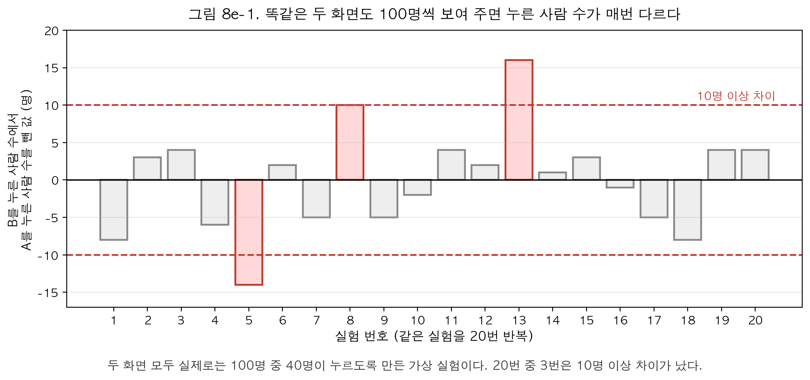
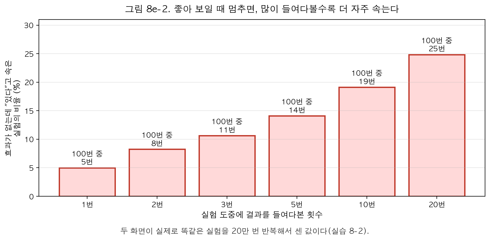
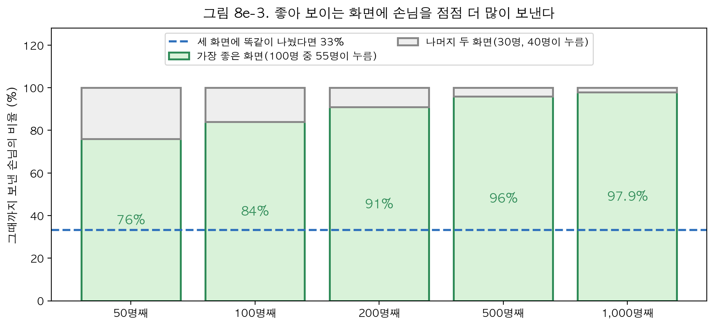

# 8장 쉽게 읽기. 두 화면 중 어느 쪽이 나은지 알아내는 법

## □ 이 장의 질문

  ○ 웹툰 앱을 운영한다고 하자. "결제하기" 버튼이 있는 화면을 새로 만들었다. 새 화면(B)이 지금 화면(A)보다 결제를 더 많이 끌어내는지 알고 싶다

  ○ 가장 확실한 방법은 손님을 둘로 나눠 한쪽에는 A를, 다른 쪽에는 B를 보여 주고 결제한 사람 수를 비교하는 것이다. 이런 실험을 **A/B 테스트**라고 부른다

  ○ 말은 쉽지만 함정이 많다. 이 장은 다섯 가지 질문에 차례로 답한다

    – 손님을 어떻게 나눠야 공정한가

    – 몇 명에게 보여 줘야 하는가

    – 차이가 났는데 우연일 수도 있는가

    – 실험 도중에 결과를 보고 일찍 끝내도 되는가

    – 좋아 보이는 화면에 손님을 더 많이 보내도 되는가

  ○ 이 문서는 계산식 없이 예와 그림으로만 설명한다. 같은 내용을 계산과 함께 배우려면 lecture/ch08.md를 본다. 실습 코드는 practice/chapter08/code/ 에 있으며, 이 문서의 실험 결과 숫자는 그 코드가 계산한 값이다

## □ 1. 손님을 공정하게 나누기 — 동전을 던진다

### 1.1 왜 손님이 고르게 하면 안 되는가

  ○ 손님에게 "옛 화면과 새 화면 중 마음에 드는 쪽을 쓰세요"라고 하면 어떻게 될까

    – 새것을 좋아하고 원래 결제를 잘하는 손님이 새 화면을 더 많이 고를 것이다

    – 그러면 새 화면 쪽 결제가 많아도, 화면이 좋아서인지 원래 결제를 잘하는 손님이 모여서인지 알 수 없다

  ○ 비유: 반 대항 달리기에서 한 반은 육상부만 뽑아 내보내고 다른 반은 아무나 내보냈다면, 이긴 반의 "훈련법"이 좋았다고 말할 수 없다. 두 팀의 구성이 처음부터 달랐기 때문이다

### 1.2 동전으로 나누면 두 집단이 닮는다

  ○ 손님이 들어올 때마다 동전을 던져 앞면이면 A, 뒷면이면 B를 보여 준다. 이것을 **무작위 배정**이라고 부른다

  ○ 동전은 손님이 누구인지 보지 않는다. 그래서 결제를 잘하는 손님도, 잘 안 하는 손님도 양쪽에 거의 반씩 나뉜다. 우리가 알지 못하는 손님의 성격까지 반씩 나뉜다

  ○ 그림 읽기 — 손님 2,000명 중 절반이 "구매 의욕이 높은 사람"인 가상의 예다

    – 왼쪽(손님이 직접 고름): B 쪽은 77%, A 쪽은 24%가 의욕이 높은 사람이다. 두 집단이 처음부터 다르다

    – 오른쪽(동전으로 나눔): 양쪽 모두 약 50%다. 두 집단이 닮았으므로, 결제 수가 다르면 화면 때문이라고 말할 수 있다

**한 줄 정리: 손님을 동전으로 나누면 두 집단이 닮는다. 그래서 결과의 차이를 화면의 차이로 읽을 수 있다.**

## □ 2. 몇 명에게 보여 줘야 하는가

### 2.1 작은 차이는 많이 봐야 보인다

  ○ 키가 180cm인 친구와 150cm인 친구는 한눈에 구별된다. 키가 170cm와 171cm인 두 친구는 나란히 세워 자세히 봐야 구별된다

  ○ 화면도 같다. B가 A보다 결제를 훨씬 많이 끌어내면 손님 몇십 명만 봐도 차이가 드러난다. 차이가 조금이면 수천 명을 봐야 한다

  ○ 실습 데이터에서 A 화면은 손님 100명 중 40명이 결제한다. B 화면이 얼마나 더 끌어내는지에 따라 필요한 손님 수가 이렇게 달라진다(실습 8-1)

<표 1: 차이를 잡아내는 데 필요한 손님 수 (화면 하나당)>

| B 화면이 100명당 더 끌어내는 결제 | 필요한 손님 수 (화면 하나당) |
| --- | --- |
| 30명 더 (40명 → 70명) | 42명 |
| 15명 더 (40명 → 55명) | 173명 |
| 5명 더 (40명 → 45명) | 1,534명 |

  ○ 차이가 30명에서 15명으로 절반이 되자, 필요한 손님은 42명에서 173명으로 약 4배가 되었다. **차이가 절반이면 손님은 약 4배 필요하다**

### 2.2 손님이 모자라면 생기는 일

  ○ 실습에서는 화면마다 100명씩만 보여 줬다. 그래서 차이가 100명당 5명인 실험은 손님이 1,534명이 아니라 100명뿐이었다

  ○ 이런 실험을 여러 번 하면 10번 중 9번은 "차이가 없다"는 결과가 나온다. 실제로는 차이가 있는데도 놓치는 것이다

  ○ 비유: 성긴 그물로는 작은 물고기를 잡을 수 없다. 물고기를 못 잡았다고 해서 바다에 물고기가 없는 것은 아니다

  ○ 그래서 실험 전에 "B가 최소 몇 명은 더 끌어내야 바꿀 가치가 있다"를 정하고, 그만큼을 잡을 수 있는 손님 수를 먼저 확인한다. 모을 수 없으면 실험을 시작하지 않는다

**한 줄 정리: 실험 전에 필요한 손님 수를 확인한다. 손님이 모자란 실험의 "차이 없음"은 아무것도 알려 주지 않는다.**

## □ 3. 차이가 났는데 우연일 수도 있다

### 3.1 똑같은 두 화면도 결과가 다르게 나온다

  ○ 동전을 100번 던지면 앞면이 꼭 50번 나오지 않는다. 47번일 때도, 55번일 때도 있다

  ○ 화면도 같다. 두 화면이 실제로 똑같이 좋아도, 100명씩 보여 주면 결제한 사람 수는 매번 조금씩 다르게 나온다

  ○ 그림 읽기 — 두 화면 모두 실제로는 100명 중 40명이 누르도록 만든 가상 실험을 20번 반복했다

    – 막대 하나가 실험 하나이며, 막대 높이는 B를 누른 사람 수에서 A를 누른 사람 수를 뺀 값이다

    – 20번 중 17번은 차이가 8명 이내였지만, 3번은 10명 이상 차이가 났다(13번 실험은 16명). 화면 차이가 전혀 없는데도 그렇다

### 3.2 실습에서 실제로 일어난 일

  ○ 실습 8-1의 네 번째 실험은 두 화면이 실제로 똑같도록(둘 다 100명 중 40명) 만들었다. 그런데 결과는 A 27명, B 43명으로 16명이나 차이가 났다

  ○ 이 결과만 보고 "B가 훨씬 좋다"고 결론 내리면 틀린다. 순전히 운이 만든 차이이기 때문이다

  ○ 통계 도구는 "이 정도 차이가 운만으로 나올 수 있는가"를 계산해 준다. 보통은 **운만으로 이런 차이가 나올 가능성이 100번에 5번보다 적으면** "차이가 있다"고 판정한다. 거꾸로 말하면, 실제로 차이가 없어도 100번 중 5번 정도는 "차이가 있다"는 잘못된 판정이 나온다

  ○ 그래서 중요한 결정을 내리기 전에는 같은 실험을 한 번 더 해서 같은 결과가 나오는지 확인한다

**한 줄 정리: 똑같은 두 화면도 운 때문에 차이가 난다. 한 번의 큰 차이만 보고 결론 내리지 않는다.**

## □ 4. 실험 도중에 결과를 몰래 보면 안 되는 이유

### 4.1 여러 번 보면 더 자주 속는다

  ○ 2주짜리 실험을 하는데, 매일 결과를 보다가 B가 좋아 보이는 날 멈추고 "B가 좋다"고 발표하면 어떨까

  ○ 비유: 주사위를 한 번 던져 6이 나올 확률은 6분의 1이다. 그런데 "다섯 번 던지는 동안 한 번이라도 6이 나오면 이긴다"고 하면 이길 가능성이 훨씬 커진다

    – 결과를 한 번 보는 것 = 주사위 한 번 던지기

    – 우연히 B가 좋아 보이는 날 = 6이 나온 경우

    – 여러 번 볼수록 그런 날을 한 번쯤 만날 가능성이 커진다

  ○ 그림 읽기 — 두 화면이 실제로 똑같은 실험에서 "좋아 보이면 멈추고 발표"하는 규칙을 썼을 때, 잘못 발표하는 실험의 비율이다(실습 8-2)

    – 끝까지 한 번만 보면 100번 중 5번만 속는다. 3절에서 말한 "100번에 5번"이다

    – 5번 들여다보면 100번 중 14번, 20번 들여다보면 100번 중 25번 속는다. 실험 4개 중 1개가 틀린 발표를 하는 셈이다

### 4.2 해결 방법 — 미리 정한 엄격한 기준

  ○ 중간에 보고 싶다면 규칙을 **실험 시작 전에** 정해 둔다

    – 몇 번 볼지 정한다(보통 3~5번)

    – 볼 때마다 넘어야 하는 기준을 정한다. 이 기준은 끝까지 한 번만 볼 때보다 엄격하다. 여러 번 보는 만큼 운에 속을 기회가 많아지므로 문턱을 높이는 것이다

  ○ 기준을 정하는 방식은 두 가지가 많이 쓰인다

    – **처음에는 아주 엄격하고 마지막에는 보통인 방식**(O'Brien-Fleming): 손님이 적은 초반에는 웬만한 차이로는 멈추지 않는다. 결론을 정확하게 내야 할 때 쓴다

    – **매번 같은 기준을 쓰는 방식**(Pocock): 초반에도 멈추기 쉽다. 나쁜 화면을 오래 보여 주는 손해가 클 때 쓴다

  ○ 실습 8-2에서 3번 들여다보면서 이 기준을 쓰자, 속는 실험의 비율이 100번 중 5번 수준으로 돌아왔다. 기준 없이 3번 봤을 때는 100번 중 11번이었다

  ○ 기준에 아주 조금 못 미쳤다고 해서 멈추면 안 된다. 기준을 실험 도중에 바꾸면 미리 정한 의미가 사라진다

**한 줄 정리: 아무 때나 들여다보고 멈추면 속는다. 볼 횟수와 기준을 미리 정하면 중간에 봐도 된다.**

## □ 5. 좋아 보이는 화면에 손님을 더 많이 보내기

### 5.1 반반 나누기의 손해

  ○ 지금까지는 손님을 끝까지 반반으로 나눴다. 그러면 실험하는 동안 절반의 손님은 나쁜 쪽 화면을 본다. 그만큼 결제를 놓친다

  ○ 그래서 생각할 수 있는 방법이 있다. **실험하면서 좋아 보이는 화면에 손님을 점점 더 많이 보내는 것**이다

### 5.2 맛집 고르기와 같은 고민

  ○ 새로 이사 온 동네에서 점심을 먹는다고 하자

    – 지금까지 가 본 식당 중 제일 맛있는 곳만 가면 실패는 적지만, 더 맛있는 식당을 영영 모를 수 있다

    – 새 식당만 계속 시도하면 맛없는 식당에서 밥을 자주 먹게 된다

    – 똑똑한 방법은 "몇 번 안 가 본 식당은 가끔 가 보고, 여러 번 가서 맛있다고 확인된 곳은 자주 가는 것"이다

  ○ 이 방법을 화면에 그대로 쓴 것이 **톰슨 샘플링**이다

    – 손님을 몇 명 안 보낸 화면은 아직 잘 모르므로 가끔 기회를 준다

    – 손님을 많이 보내 좋다고 확인된 화면에는 손님을 많이 보낸다

    – 이 조절을 사람이 하지 않고 프로그램이 손님 한 명마다 자동으로 한다

### 5.3 실습 결과

  ○ 실습 8-3은 화면 세 개(실제로 100명 중 30명, 55명, 40명이 결제)를 놓고 손님 1,000명을 이 방법으로 보냈다

  ○ 그림 읽기

    – 50명째에 이미 가장 좋은 화면에 76%를 보냈고, 1,000명째에는 97.9%(979명)를 보냈다. 세 화면에 똑같이 나눴다면 33%였을 것이다

    – 똑같이 나눴다면 나쁜 화면 때문에 놓친 결제가 약 133건이었을 텐데, 이 방법으로는 약 4건으로 줄었다

### 5.4 대신 잃는 것

  ○ 가장 나쁜 화면에는 손님이 6명만 갔고, 그중 아무도 결제하지 않았다. 이 화면은 실제로는 100명 중 30명이 결제하는 화면이다. 6명만 봐서는 이 화면이 얼마나 나쁜지 정확히 알 수 없다

  ○ 즉, 이 방법은 **좋은 화면을 찾고 손해를 줄이는 데는 뛰어나지만, 나쁜 화면이 얼마나 나쁜지는 알려 주지 않는다**

  ○ 그래서 목적에 따라 고른다

| 목적 | 고를 방법 |
| --- | --- |
| 각 화면이 정확히 얼마나 좋은지 보고서에 써야 한다 | 반반으로 나누기(1~4절) |
| 실험하는 동안 결제를 최대한 많이 받아야 한다 | 좋아 보이는 쪽에 더 보내기(5절) |

**한 줄 정리: 좋아 보이는 쪽에 더 보내면 손해가 줄지만, 나쁜 쪽에 대해서는 알 수 없게 된다.**

## □ 6. "B가 더 나을 가능성"으로 멈추기

  ○ 결과를 "B가 A보다 나을 가능성이 99%"처럼 말하는 방법도 있다. 손님이 들어올 때마다 이 가능성을 다시 계산하고, 실험 전에 정한 선을 넘으면 멈춘다

    – 99% 이상이 되면: B가 낫다고 보고 B를 채택한다

    – 5% 이하가 되면: B가 나을 가망이 없다고 보고 B를 접는다

    – 그 사이면: 손님을 더 모은다

  ○ 실습 8-4의 한 실험(실제로 A는 100명 중 40명, B는 100명 중 70명이 결제)에서 일어난 일이다

    – 손님 50명째(각 25명): A 11명, B 19명이 결제했다. B가 나을 가능성은 98.87%로, 99%에 조금 못 미쳐 계속 모았다

    – 손님 100명째(각 50명): A 21명, B 37명이 결제했다. 가능성이 99.93%가 되어 멈추고 B를 채택했다

  ○ 이렇게 하면 차이가 분명한 실험은 일찍 끝난다. 실습의 세 실험은 끝까지 했다면 600명이 필요했지만 450명으로 끝났다

  ○ 4절과 마찬가지로, 99%라는 선은 실험 전에 정하고 도중에 바꾸지 않는다

**한 줄 정리: "B가 나을 가능성"이 미리 정한 선을 넘으면 멈춘다. 선은 실험 전에 정한다.**

## □ 7. 이야기로 정리하기 — 웹툰 앱 "툰마루"의 결제 화면

  ○ 이 절은 가상의 회사와 가상의 수치로 만든 이야기다. 앞에서 배운 순서를 한 번에 따라간다

  ○ **문제**: 결제 화면까지 온 손님 100명 중 10명만 결제를 마친다. 결제 단계가 3쪽이라 중간에 떠나는 손님이 많다. 1쪽으로 줄인 새 화면을 만들었다. 회사는 "100명당 2명 이상 더 결제하면 새 화면으로 바꾼다"고 정했다

  ○ **1단계 — 나누는 방법(1절)**: 손님이 들어올 때마다 프로그램이 동전을 던지듯 A와 B로 나눈다

  ○ **2단계 — 필요한 손님 수(2절)**: 100명당 10명을 12명으로 올리는 차이를 잡으려면 화면 하나당 3,841명, 모두 7,682명이 필요하다. 결제 화면에 오는 손님은 하루 약 600명이므로 2주(14일)면 약 8,400명이 모인다. 충분하므로 실험을 시작한다

  ○ **3단계 — 중간 확인 규칙(4절)**: 실험 전에 "3번 확인한다, 처음에는 아주 엄격한 기준을 쓴다"고 문서에 적었다

  ○ **4단계 — 실험 진행**

<표 2: 툰마루 실험의 중간 확인 (가상의 수치)>

| 확인 | 날짜 | A 화면 결제 | B 화면 결제 | 100명당 결제 (A → B) | 결정 |
| --- | --- | --- | --- | --- | --- |
| 1번째 | 5일째 | 1,280명 중 128명 | 1,281명 중 155명 | 10.0명 → 12.1명 | 기준에 못 미침 → 계속 |
| 2번째 | 9일째 | 2,560명 중 259명 | 2,561명 중 322명 | 10.1명 → 12.6명 | 기준을 넘음 → 멈춤 |

    – 1번째 확인에서 B가 2명 넘게 좋아 보였지만, 초반의 엄격한 기준에는 못 미쳤다. 여기서 "좋아 보인다"고 멈췄다면 4절의 함정에 빠진 것이다

    – 2번째 확인에서 기준을 넘었으므로 멈췄다. 계획보다 5일 일찍 끝났다

    – 확인할 때마다 A와 B의 손님 수(1,280명과 1,281명, 2,560명과 2,561명)가 거의 같은지도 봤다. 동전으로 나눴다면 거의 같아야 한다. 크게 다르면 나누는 프로그램이 고장 난 것이므로 결과를 믿지 않는다

  ○ **5단계 — 보고**: "새 화면은 100명당 결제를 약 10명에서 약 12.6명으로, 약 2.5명 늘렸다." 다만 이 숫자에도 운이 섞여 있어서, 실제로 늘어난 크기는 적게는 0.7명, 많게는 4.2명일 수 있다. 회사가 정한 "2명 이상"을 확실히 넘는다고까지는 말할 수 없으므로, 보고서에 이 범위를 함께 적고 도입 여부는 회사가 정한다

## □ 기억할 규칙 다섯 가지

  ○ **손님은 동전으로 나눈다.** 손님이 직접 고르게 하면 화면 효과와 손님 성격이 섞인다

  ○ **필요한 손님 수를 먼저 확인한다.** 차이가 절반이면 손님은 약 4배 필요하다. 모자라면 시작하지 않는다

  ○ **한 번의 큰 차이를 믿지 않는다.** 똑같은 두 화면도 운 때문에 16명씩 차이가 날 수 있다

  ○ **볼 횟수와 기준은 실험 전에 정한다.** 아무 때나 보고 멈추면 속는 실험이 100번 중 5번에서 14번, 25번으로 늘어난다

  ○ **목적에 맞게 고른다.** 정확한 보고가 목적이면 반반으로 나누고, 실험 중 손해를 줄이는 것이 목적이면 좋아 보이는 쪽에 더 보낸다
