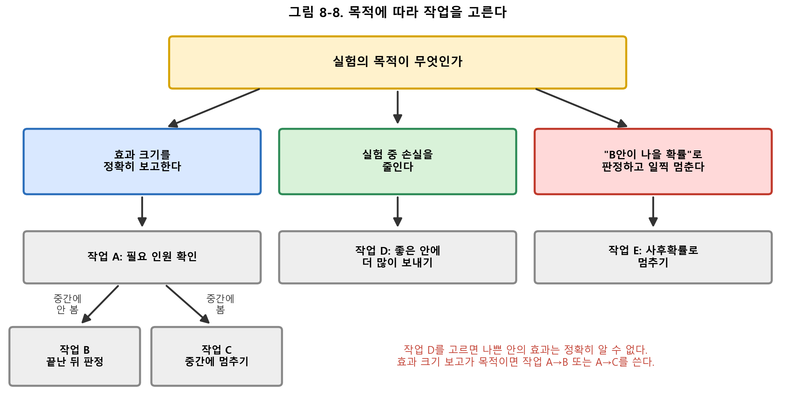
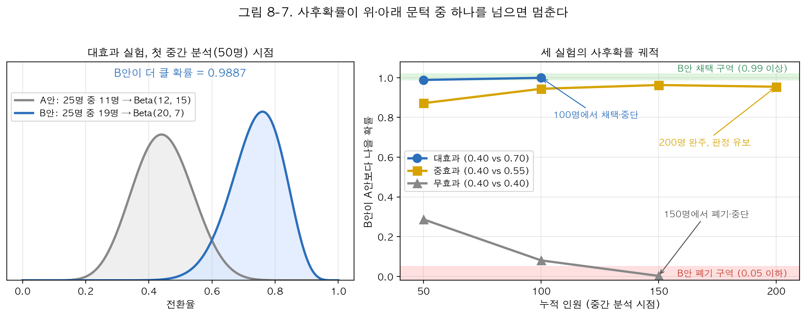

# 8장 실습 매뉴얼. A/B 테스트와 적응형 실험

## □ 이 매뉴얼 사용법

  ○ 이 문서는 8장 실습 코드를 **원리를 몰라도 순서대로 따라 하면 결과를 얻도록** 쓴 조작 설명서다. 원리는 본문(lecture/ch08.md)에 있다

  ○ 각 작업은 같은 순서로 되어 있다: **언제 쓰나 → 준비 → 순서 → 출력에서 볼 곳 → 판정표 → 하지 말 것**

  ○ 판정표는 "이 숫자가 나오면 이렇게 한다"를 적은 표다. 숫자를 표에 대 보고 오른쪽 칸의 행동을 그대로 한다

  ○ 매뉴얼에 실은 출력 예는 실제 출력에서 필요한 줄만 골라 줄여 옮긴 것이다. 숫자는 실제 출력과 같다

## □ 1. 준비

### 1.1 실행하는 법

  1. 터미널(Windows는 명령 프롬프트)을 연다

  2. 실습 폴더로 이동한다: `cd practice/chapter08/code`

  3. 스크립트를 실행한다: `python 8-1-fixed-rct-simulation.py` (Mac은 `python3`)

  4. 화면에 나온 내용은 `practice/chapter08/results/8-1-fixed-rct-simulation.log` 에도 저장된다. 그림은 같은 폴더에 `.png`로 저장된다

  ○ 실행이 안 되면 "문제 해결"(7절)의 첫 줄을 본다

### 1.2 스크립트 다섯 개

| 파일 | 하는 일 | 쓰는 작업 |
| --- | --- | --- |
| 8-1-fixed-rct-simulation.py | 필요 인원·검정력 계산, 실험 결과 판정 | 작업 A, B |
| 8-2-group-sequential-design.py | 중간에 멈춰도 되는 기준선 계산 | 작업 C |
| 8-3-thompson-sampling.py | 좋은 안에 더 많이 보내는 배분의 결과 | 작업 D |
| 8-4-bayesian-adaptive.py | "B안이 나을 확률"로 멈추기 | 작업 E |
| 8-5-korean-dtx-case.py | 선택지 5개일 때의 배분 결과 | 작업 D |

  ○ 다섯 스크립트는 `practice/chapter08/data/` 의 연습용 데이터를 읽는다. 실제 서비스 데이터를 넣는 기능은 없다. 실제 실험을 설계할 때는 작업 A와 C의 **참조표**를 쓴다

### 1.3 낱말 다섯 개

| 낱말 | 뜻 |
| --- | --- |
| 안(팔) | 비교하는 화면·콘텐츠 하나. A안은 기존, B안은 새것 |
| 전환율 | 그 안을 본 100명 중 구매·가입 같은 목표 행동을 한 사람 수 |
| p값 | 작을수록 "우연이 아니다"에 가깝다. 0.05 미만이면 유의하다고 부른다 |
| 검정력 | 효과가 정말 있을 때 실험이 그것을 잡아낼 확률. 0.80 이상이어야 한다 |
| 사후확률 | 지금까지 데이터로 계산한 "B안이 A안보다 나을 확률" |

## □ 2. 어떤 작업을 할지 고르기



  ○ 그림 맨 위 질문에 답하고 화살표를 따라간다

| 하고 싶은 일 | 작업 |
| --- | --- |
| 실험을 시작해도 되는지 알고 싶다 | 작업 A |
| 끝난 실험의 결과를 판정하고 싶다 | 작업 B |
| 실험 도중에 결과를 보고 일찍 끝내고 싶다 | 작업 C 또는 E |
| 실험하는 동안 나쁜 안을 보는 사람을 줄이고 싶다 | 작업 D |

## □ 작업 A. 실험 시작 전 — 필요 인원 확인

  ○ **언제 쓰나**: 실험을 시작하기 전에 반드시 한 번 한다

  ○ **준비**: 두 숫자를 정한다. ① A안의 지금 전환율(예: 0.10) ② B안이 이 정도는 올려야 의미 있다는 최소 차이(예: +0.02)

  ○ **순서**

  1. 아래 참조표에서 ①에 해당하는 줄을 찾는다

  2. 그 줄에서 ②에 해당하는 칸을 읽는다. 이 숫자가 **한 안에 필요한 인원**이다

  3. 2를 곱하면 전체 필요 인원이다

  4. 실험 기간 동안 모을 수 있는 인원과 비교해 판정표대로 한다

<표 A-1: 한 안에 필요한 인원 (검정력 0.80, 유의수준 0.05)>

| A안 전환율 | +0.01 | +0.02 | +0.05 | +0.10 | +0.15 | +0.30 |
| --- | --- | --- | --- | --- | --- | --- |
| 0.02 | 3,826 | 1,141 | 269 | 102 | 59 | 24 |
| 0.05 | 8,158 | 2,213 | 435 | 141 | 76 | 27 |
| 0.10 | 14,751 | 3,841 | 686 | 199 | 100 | 32 |
| 0.20 | 25,583 | 6,510 | 1,094 | 294 | 138 | 39 |
| 0.30 | 33,275 | 8,394 | 1,377 | 356 | 163 | 42 |
| 0.40 | 37,827 | 9,493 | 1,534 | 388 | 173 | 42 |
| 0.50 | 39,240 | 9,806 | 1,565 | 388 | 170 | 39 |

  ○ 예: A안 전환율 0.10, 최소 차이 +0.02 → 표에서 3,841명. 전체 7,682명이 필요하다

  ○ 표의 값은 실습 코드 8-1의 계산식으로 구했다. 0.40 줄의 1,534 / 173 / 42는 실습 로그의 값과 같다

  ○ **판정표**

| 상황 | 할 일 |
| --- | --- |
| 모을 수 있는 인원 ≥ 필요 인원 | 실험을 시작한다 |
| 모을 수 있는 인원 < 필요 인원 | 시작하지 않는다. 실험 기간을 늘리거나, 최소 차이를 키우거나(표에서 오른쪽 칸), 실험을 접는다 |
| 최소 차이를 정할 수 없다 | 시작하지 않는다. "얼마 이상 올라야 의미 있는가"를 먼저 정한다 |

  ○ **실습으로 확인하기**: `python 8-1-fixed-rct-simulation.py` 를 실행하고 출력의 **[2단계]** 와 **[3단계]** 를 본다

```
[2단계]  시나리오 1 (소효과)  +0.05   필요 n/팔 1534   실제 n/팔 100   과부족 -1434
[3단계]  시나리오 1 (소효과)  +0.05   검정력 0.106    부족 (효과를 놓칠 확률이 큼)
```

  ○ 위 줄은 "1,534명이 필요한데 100명만 모았다 → 검정력 0.106 → 효과가 있어도 열 번 중 아홉 번은 놓친다"로 읽는다

  ○ **하지 말 것**: 인원이 모자란 실험을 "일단 돌려 보자"로 시작하지 않는다. 그런 실험에서 "유의하지 않음"이 나와도 효과가 없다는 뜻이 아니다

## □ 작업 B. 실험이 끝난 뒤 — 결과 판정

  ○ **언제 쓰나**: 작업 A에서 정한 인원을 다 모으고 실험이 끝났을 때

  ○ **순서**

  1. 두 안에 배정된 인원 비율을 먼저 본다. 50:50으로 설계했는데 크게 어긋나면 3단계로 가지 않는다(판정표 첫 줄)

  2. `python 8-1-fixed-rct-simulation.py` 를 실행하고 출력의 **[1단계]** 를 본다

  3. 시나리오마다 **관측 효과**, **95% CI**(신뢰구간), **p값** 세 줄을 읽는다

```
시나리오 3 (대효과)
  관측 효과   : +0.260  95% CI [+0.126, +0.394]
  p값         : 0.0002  →  유의함
```

  ○ **판정표** — 위에서부터 차례로 대 보고, 처음 걸리는 줄의 행동을 한다

| 순서 | 확인할 것 | 걸리면 할 일 |
| --- | --- | --- |
| 1 | 배정 비율이 설계와 어긋났다(예: 50:50 설계인데 48:52) | 결과를 읽지 않는다. 배정·기록 과정을 고친 뒤 다시 실험한다 |
| 2 | 작업 A의 필요 인원에 못 미쳤다 | "판단할 수 없음"으로 보고한다 |
| 3 | 중간에 결과를 보다가 좋아 보여서 멈췄다 | p값을 쓰지 않는다. 같은 실험을 다시 한다(작업 C를 쓰면 이 문제가 없다) |
| 4 | p값 ≥ 0.05 | "효과를 확인하지 못함"으로 보고한다 |
| 5 | p값 < 0.05, 신뢰구간이 0을 포함하지 않음 | "효과 있음"으로 보고하고, 관측 효과와 신뢰구간을 함께 적는다 |

  ○ 실습 출력의 네 시나리오를 판정표에 대 본 결과다

| 시나리오 | p값 | 판정 | 걸린 줄 |
| --- | --- | --- | --- |
| 1 (참 효과 +0.05) | 0.3890 | 판단할 수 없음 | 2 (필요 1,534명, 실제 100명) |
| 2 (참 효과 +0.15) | 0.1589 | 판단할 수 없음 | 2 (필요 173명, 실제 100명) |
| 3 (참 효과 +0.30) | 0.0002 | 효과 있음, +0.260 [+0.126, +0.394] | 5 |
| 4 (참 효과 0) | 0.0176 | 효과 있음으로 나옴 | 5 |

  ○ 시나리오 4는 참 효과가 0인데 "효과 있음"이 나왔다. p값 0.05 기준은 이런 잘못된 판정을 20번에 1번꼴로 허용한다. 결과가 중요한 결정으로 이어지면 같은 실험을 한 번 더 해서 확인한다

  ○ **하지 말 것**: 지표를 여러 개 보고 그중 유의한 것만 보고하지 않는다. 실험 전에 주 지표 하나를 정해 문서에 적는다

## □ 작업 C. 실험 도중에 결과를 보고 일찍 멈추기

  ○ **언제 쓰나**: 실험 기간이 길어서 중간에 결과를 확인하고 싶을 때. 아무 규칙 없이 중간에 보면 잘못된 "효과 있음"이 크게 늘어난다(5번 보면 5%가 14%가 된다)

  ○ **준비**: 실험 전에 두 가지를 정해 문서에 적는다. ① 몇 번 볼지(2~5번) ② 어느 경계를 쓸지(아래 표)

| 경계 | 특징 | 이럴 때 고른다 |
| --- | --- | --- |
| O'Brien-Fleming(OBF) | 처음에는 거의 멈추지 않고, 마지막에 0.05 근처로 풀린다 | 최종 결론의 정확도가 중요할 때. 잘 모르겠으면 이것 |
| Pocock | 매번 같은 기준이라 일찍 멈추기 쉽다 | 나쁜 안을 보여 주는 비용이 커서 일찍 끝내는 것이 중요할 때 |

  ○ **순서**

  1. 전체 인원을 볼 횟수로 똑같이 나눠 확인 시점을 정한다. 예: 전체 200명, 3번 → 67명·133명·200명

  2. 아래 참조표에서 볼 횟수와 경계에 맞는 줄을 찾는다

  3. 각 확인 시점에 p값을 계산해, 그 차례의 기준값보다 **작으면 멈추고 "효과 있음"**, 크거나 같으면 다음 시점까지 계속 모은다

  4. 마지막 차례에서도 기준값을 넘지 못하면 "효과를 확인하지 못함"으로 끝낸다

<표 C-1: 차례마다 멈추려면 p값이 이 값보다 작아야 한다>

| 볼 횟수 | 경계 | 1차 | 2차 | 3차 | 4차 | 5차 |
| --- | --- | --- | --- | --- | --- | --- |
| 2 | OBF | 0.00515 | 0.04790 | | | |
| 2 | Pocock | 0.02915 | 0.02915 | | | |
| 3 | OBF | 0.00052 | 0.01419 | 0.04525 | | |
| 3 | Pocock | 0.02177 | 0.02177 | 0.02177 | | |
| 4 | OBF | 0.00005 | 0.00421 | 0.01944 | 0.04299 | |
| 4 | Pocock | 0.01816 | 0.01816 | 0.01816 | 0.01816 | |
| 5 | OBF | 0.000005 | 0.00124 | 0.00838 | 0.02242 | 0.04114 |
| 5 | Pocock | 0.01553 | 0.01553 | 0.01553 | 0.01553 | 0.01553 |

  ○ 표의 값은 실습 코드 8-2의 계산 방법으로 구했다. 3번 줄의 값은 실습 로그와 같다

  ○ 예: 3번 보기로 하고 OBF를 골랐는데 2차(133명)에서 p값 0.018이 나왔다 → 기준 0.01419보다 크므로 멈추지 않고 3차까지 모은다. Pocock을 골랐다면 0.018 < 0.02177이므로 멈춘다

  ○ **실습으로 확인하기**: `python 8-2-group-sequential-design.py` 를 실행하고 **[2단계]** 표에서 `Pocock p`, `OBF p` 열을 읽는다. 볼 횟수를 바꾸려면 파일 위쪽의 `K = 3` 을 `K = 4` 처럼 고치고 다시 실행한다

  ○ **판정표**

| 상황 | 할 일 |
| --- | --- |
| 그 차례의 p값 < 기준값 | 멈추고 "효과 있음"으로 보고한다 |
| 그 차례의 p값 ≥ 기준값, 마지막 차례가 아님 | 다음 확인 시점까지 계속 모은다 |
| 마지막 차례의 p값 ≥ 기준값 | "효과를 확인하지 못함"으로 끝낸다 |
| 기준값에 아주 조금 못 미쳤다 | 멈추지 않는다. 기준을 낮추지 않는다 |

  ○ **하지 말 것**: 볼 횟수·시점·경계를 실험 도중에 바꾸지 않는다. 계획은 3번인데 5번 봤다면 이 표는 쓸 수 없다

## □ 작업 D. 좋은 안에 사용자를 더 많이 보내기

  ○ **언제 쓰나**: 효과 크기를 정확히 아는 것보다 **실험하는 동안의 성과**(구매·가입 수)가 중요할 때. 실시간으로 배분을 바꿀 수 있는 시스템이 있어야 한다

  ○ 이 방법(톰슨 샘플링)은 성과가 좋아 보이는 안에 다음 사용자를 더 자주 보낸다. 사람이 따로 정할 설정값이 없다

  ○ **순서**

  1. `python 8-3-thompson-sampling.py` 를 실행한다(안 3개, 1,000명)

  2. **[3단계]** 에서 가장 좋은 안의 배분 비율이 시간에 따라 오르는지 본다

  3. **[4단계]** 에서 `기대 손실`(나쁜 안을 본 탓에 놓친 전환의 수)을 고정 배분과 비교한다

  4. **[5단계]** 에서 안별 `배분 인원`을 보고, 보고서에 실을 안과 뺄 안을 판정표대로 고른다

```
[3단계]    시점 t     Arm 0     Arm 1     Arm 2
             50      8.0%     76.0%     16.0%
           1000      0.6%     97.9%      1.5%
[4단계]  고정 1:1:1   기대 손실 133.33  /  톰슨 샘플링   기대 손실 3.75
[5단계]  Arm 0  배분 인원 6    사후평균 0.125  참값 0.30
         Arm 1  배분 인원 979  사후평균 0.581  참값 0.55
```

  ○ 위 출력은 "가장 좋은 안 1에 97.9%를 보내 놓친 전환을 약 133건에서 약 4건으로 줄였다. 대신 6명만 받은 안 0의 추정값 0.125는 참값 0.30과 크게 다르다"로 읽는다

  ○ 선택지가 5개인 경우는 `python 8-5-korean-dtx-case.py` 로 같은 순서를 따른다. 출력 [4단계]의 `기대값끼리 비교` 줄(+9.0%)이 보고할 개선율이다

  ○ **판정표**

| 상황 | 할 일 |
| --- | --- |
| 배분 인원이 30명 미만인 안 | 그 안의 추정값을 보고서에 싣지 않는다 |
| 개선율이 두 개 나옴(기댓값 비교, 실현값 비교) | 기댓값 비교 값을 보고한다. 실현값에는 이번 실행의 운이 섞여 있다 |
| 배분 인원 순위 | 효과 순위로 읽지 않는다. 8-5 실습에서는 4위와 5위가 뒤집혔다 |
| 전체 인원이 수백 명 이하 | 배분이 한쪽으로 몰리기 전에 끝나므로 이 방법의 이득이 작다. 작업 A→B를 쓴다 |

  ○ **하지 말 것**: 이 방법으로 "모든 안의 효과 크기"를 보고하려 하지 않는다. 나쁜 안에는 사람을 거의 보내지 않으므로 그 안의 정보가 모이지 않는다

## □ 작업 E. "B안이 나을 확률"로 일찍 멈추기

  ○ **언제 쓰나**: 결론을 "B안이 나을 확률 99%"처럼 확률로 말하고 싶고, 결과가 분명하면 일찍 끝내고 싶을 때

  ○ **준비**: 실험 전에 세 값을 정한다. 실습 파일 위쪽에 이 세 줄이 있다

```python
THETA_EFFICACY = 0.99      # 이 이상이면 B안 채택하고 중단
THETA_FUTILITY = 0.05      # 이 이하이면 B안 접고 중단
INTERIM_POINTS = [50, 100, 150, 200]   # 확인 시점(누적 인원)
```

| 값 | 권장 |
| --- | --- |
| 채택 기준 | 외부 보고·규제가 걸리면 0.99, 내부 운영 결정이면 0.95 |
| 폐기 기준 | 0.05 |
| 첫 확인 시점 | 각 안에 50명 이상 모인 뒤. 너무 이르면 값이 크게 흔들린다 |

  ○ **순서**

  1. `python 8-4-bayesian-adaptive.py` 를 실행한다

  2. **[2단계]** 에서 확인 시점마다 `P(p_B>p_A)` 열(사후확률)과 `결정` 열을 읽는다

  3. **[3단계]** 요약표에서 시나리오별 최종 인원과 아낀 인원을 본다

```
[2단계-대효과]  누적 n 50   B안 19/25, A안 11/25   P(p_B>p_A) 0.9887   계속
                누적 n 100  B안 37/50, A안 21/50   P(p_B>p_A) 0.9993   B안 채택·중단
```



  ○ 그림 오른쪽처럼 사후확률이 위쪽 초록 띠(0.99 이상)에 들어가면 채택, 아래쪽 빨간 띠(0.05 이하)에 들어가면 폐기, 그 사이면 계속이다

  ○ **판정표**

| 사후확률 | 할 일 | 실습 예 |
| --- | --- | --- |
| 채택 기준(0.99) 이상 | 멈추고 B안 채택 | 대효과: 100명에서 0.9993 |
| 폐기 기준(0.05) 이하 | 멈추고 B안 폐기 | 무효과: 150명에서 0.0023 |
| 그 사이, 마지막 시점 아님 | 계속 모은다 | 대효과 50명의 0.9887(기준에 0.0013 모자람) |
| 그 사이, 마지막 시점 | "판정 유보"로 끝낸다 | 중효과: 200명에서 0.9545 |

  ○ 실습의 세 실험은 고정 설계면 600명이 필요했지만 이 방법으로 450명에 끝났다

  ○ **하지 말 것**: 결과를 본 뒤 0.99를 0.95로 낮추지 않는다. 문턱을 0.95로 바꾸면 실습의 중효과 실험은 150명에서 채택으로 결론이 바뀐다. 기준은 실험 전에 정한 값만 유효하다

## □ 6. 사례로 따라 하기 — 결제 화면 이탈 줄이기

  ○ 이 절은 가상의 회사와 가상의 수치로 만든 사례다. 매뉴얼의 작업을 실제 문제에 어떤 순서로 적용하는지 보여 준다

### 6.1 문제

  ○ 가상의 온라인 서점 "책마루"는 장바구니까지 온 고객 100명 중 10명만 결제를 마친다(전환율 0.10). 결제 화면이 3쪽으로 나뉘어 있어서 중간에 떠나는 고객이 많다는 의견이 나왔다

  ○ 개발팀이 결제를 1쪽으로 줄인 새 화면(B안)을 만들었다. 경영진은 "전환율이 0.02 이상 오르면 새 화면으로 바꾼다"고 정했다

  ○ 장바구니에 들어오는 고객은 하루 약 600명이다

### 6.2 1단계 — 목적을 정한다(2절)

  ○ 질문: "새 화면이 전환율을 얼마나 올리는가"를 숫자로 보고해야 한다. 실험하는 동안의 손실을 줄이는 것보다 효과 크기 보고가 목적이므로, 그림 8-8에서 왼쪽 길(작업 A → B 또는 C)을 고른다

  ○ 실험 기간이 2주라 중간에 확인하고 싶다는 요청이 있었다 → **작업 A → 작업 C** 로 진행하고, 작업 C가 끝까지 가면 작업 B로 판정한다

### 6.3 2단계 — 필요 인원을 확인한다(작업 A)

  1. 표 A-1에서 A안 전환율 0.10 줄, 최소 차이 +0.02 칸을 읽는다 → 한 안에 **3,841명**

  2. 전체 필요 인원은 3,841 × 2 = **7,682명**

  3. 하루 600명이면 7,682 ÷ 600 ≈ 12.8일이 걸린다. 요일에 따라 손님이 달라지므로 온전한 2주(14일)로 잡는다. 14일 동안 약 8,400명이 모이므로 필요 인원보다 많다

  4. 판정표 첫 줄(모을 수 있는 인원 ≥ 필요 인원)에 해당한다 → **실험을 시작한다**

### 6.4 3단계 — 중간 확인 계획을 문서에 적는다(작업 C)

  ○ 실험 시작 전에 설계 문서에 다음을 적었다

| 항목 | 정한 값 |
| --- | --- |
| 주 지표 | 장바구니 고객의 결제 완료 비율(전환율) |
| 볼 횟수 | 3번 |
| 경계 | O'Brien-Fleming(최종 결론의 정확도가 중요하므로) |
| 확인 시점 | 누적 2,561명 / 5,121명 / 7,682명 (전체를 3등분) |
| 멈추는 기준(표 C-1) | 1차 p < 0.00052 / 2차 p < 0.01419 / 3차 p < 0.04525 |

### 6.5 4단계 — 실험을 돌리며 확인한다

  ○ 매번 p값을 보기 전에 두 안의 인원부터 확인한다(작업 B 판정표 1번)

  ○ 표의 p값은 두 전환율의 차이가 우연인지 보는 보통의 검정(두 비율 z검정)으로 계산했다

<표 6-1: 책마루 실험의 중간 확인 결과 (가상의 수치)>

| 확인 | 누적 인원 | A안 결제/인원 | B안 결제/인원 | A안 전환율 | B안 전환율 | p값 | 기준 | 결정 |
| --- | --- | --- | --- | --- | --- | --- | --- | --- |
| 1차 (5일째) | 2,561 | 128 / 1,280 | 155 / 1,281 | 0.100 | 0.121 | 0.0901 | 0.00052 | 계속 |
| 2차 (9일째) | 5,121 | 259 / 2,560 | 322 / 2,561 | 0.101 | 0.126 | 0.0056 | 0.01419 | **멈춤** |

  ○ 1차 확인

    – 인원 1,280 대 1,281로 거의 반반이다 → 결과를 읽어도 된다

    – B안 전환율이 0.021 높아 보이지만 p값 0.0901은 1차 기준 0.00052보다 크다 → **계속 모은다**. 이 시점에 "좋아 보인다"고 멈췄다면 작업 C의 규칙을 어긴 것이다

  ○ 2차 확인

    – 인원 2,560 대 2,561로 반반이다

    – p값 0.0056은 2차 기준 0.01419보다 작다 → **멈추고 "효과 있음"으로 판정한다**. 계획보다 5일, 약 2,561명 일찍 끝났다

  ○ 만약 인원이 2,440 대 2,681로 나왔다면, 반반에서 어긋난 정도를 검정한 p값이 0.0008이다. 이 경우는 전환율을 보지 않고 배정 과정부터 점검한다(7절 문제 해결)

### 6.6 5단계 — 결과를 보고한다

  ○ 2차 시점의 효과는 0.126 − 0.101 = **+0.025**, 95% 신뢰구간은 **[+0.007, +0.042]** 다

  ○ 판정표대로 쓴 보고 문장

    – "새 결제 화면은 전환율을 0.101에서 0.126으로 0.025 올렸다(95% 신뢰구간 +0.007 ~ +0.042). 사전에 정한 3회 확인 계획 중 2회차에서 O'Brien-Fleming 기준(p < 0.01419)을 충족해 실험을 종료했다"

  ○ 경영진 기준(+0.02 이상)과 비교할 때 주의할 점

    – 효과 추정값 +0.025는 기준을 넘지만, 신뢰구간의 아래 끝 +0.007은 기준보다 작다. "효과가 있다"는 확인되었지만 "+0.02 이상이다"까지는 확인되지 않았다

    – 그래서 보고서에는 "효과는 있으며 크기는 +0.007에서 +0.042 사이로 추정된다"라고 적고, 새 화면 도입 여부는 이 범위를 보고 경영진이 정한다

### 6.7 목적이 달랐다면

| 목적 | 고를 작업 | 책마루 실험에서 달라지는 점 |
| --- | --- | --- |
| 효과 크기 보고 (이 사례) | A → C | 위와 같다 |
| 연말 할인 기간 2주 동안 결제 수를 최대로 | D | 새 화면이 좋아 보이면 더 많은 고객에게 보여 준다. 대신 효과 크기를 정확히 보고할 수 없다 |
| "새 화면이 나을 확률"로 경영진에게 보고 | E | 확인 시점마다 사후확률을 계산해 0.99 이상이면 채택한다 |

**한 줄 정리: 목적을 먼저 고르고(2절), 표에서 인원과 기준을 읽고(작업 A·C), 기준을 미리 적은 뒤, 확인 시점마다 판정표대로 행동한다.**

## □ 7. 문제 해결

| 증상 | 원인 | 조치 |
| --- | --- | --- |
| `python: command not found` | Mac에는 `python` 명령이 없을 수 있다 | `python3` 로 실행한다 |
| `ModuleNotFoundError` | 필요한 라이브러리가 설치되지 않았다 | 저장소 맨 위에서 `pip install -r requirements.txt` 를 실행한다 |
| `findfont: Font family 'Malgun Gothic' not found` | Mac·Linux에는 이 한글 글꼴이 없다 | 계산 결과에는 영향이 없다. 그림의 한글만 깨진다 |
| 효과가 있을 것 같은데 유의하지 않다 | 인원이 모자라 검정력이 낮다 | 작업 A의 표로 필요 인원을 확인한다 |
| 효과가 0이어야 하는데 유의하다 | 5% 확률로 생기는 잘못된 판정이다 | 같은 실험을 다시 해서 확인한다 |
| 배정 비율이 50:50에서 어긋났다 | 배정·기록 과정 오류 | 결과를 읽지 않고 과정을 고친다 |
| 기준값에 아주 조금 못 미쳤다 | — | 멈추지 않는다. 기준을 바꾸지 않는다 |
| 배분이 적은 안의 숫자가 이상하다 | 그 안의 정보가 거의 없다 | 30명 미만인 안은 보고하지 않는다 |

## □ 8. 최종 점검표 — 실험 전에 모두 "예"여야 한다

  ○ 목적을 하나로 정했는가? (효과 크기 보고 / 실험 중 성과 / 확률로 판정)

  ○ 주 지표 하나를 문서에 적었는가?

  ○ 작업 A의 표로 필요 인원을 확인했고, 그 인원을 모을 수 있는가?

  ○ 중간에 볼 계획이면 볼 횟수·시점·경계(또는 사후확률 문턱)를 문서에 적었는가?

  ○ 실험 도중에 이 값들을 바꾸지 않기로 했는가?
