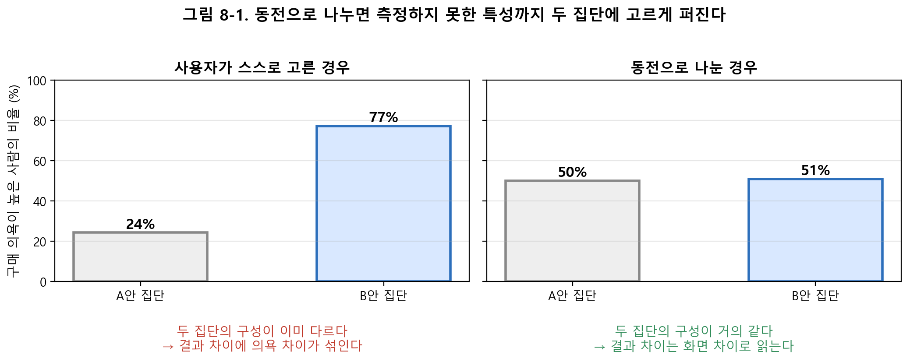
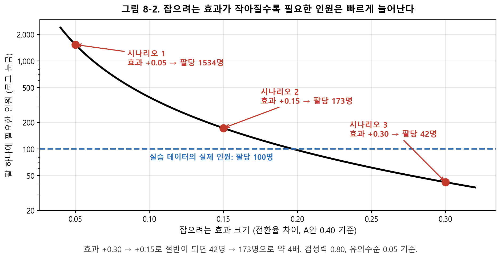
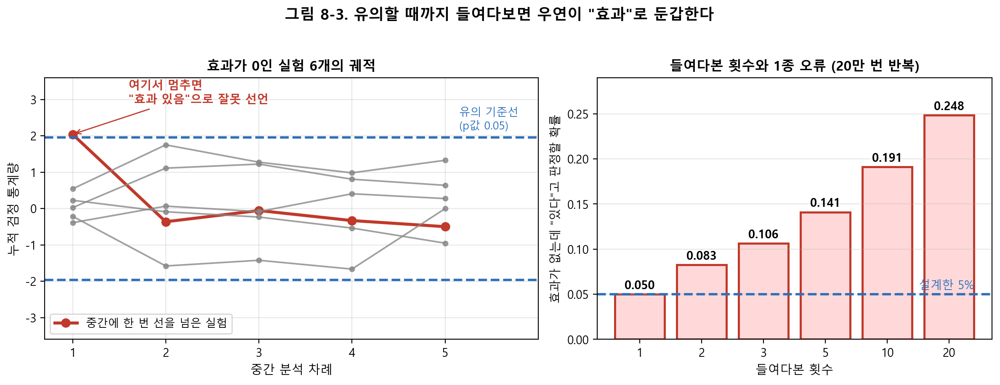
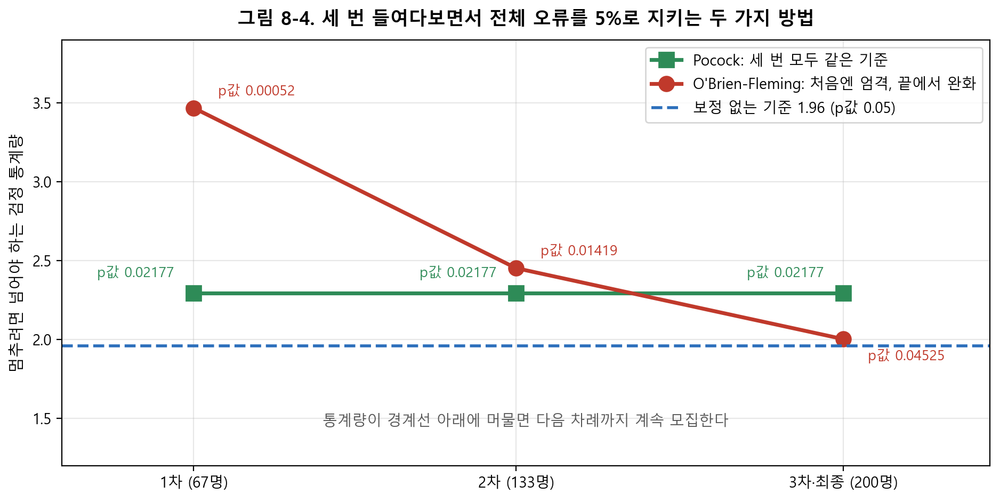
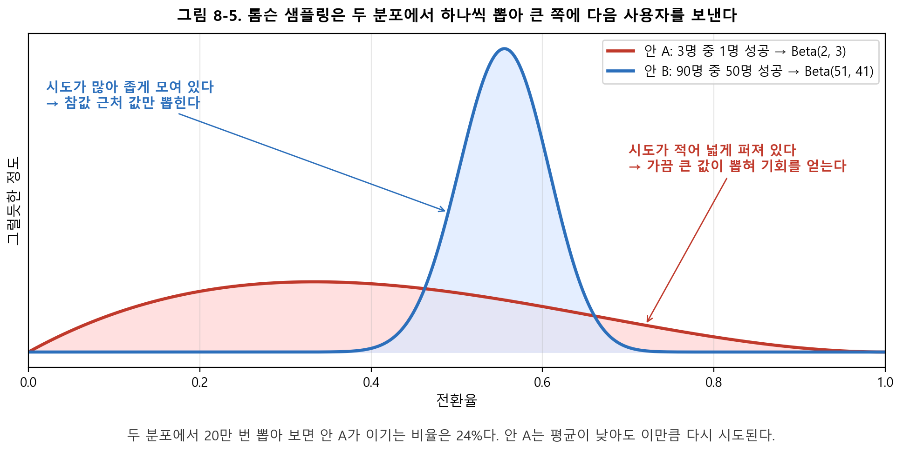
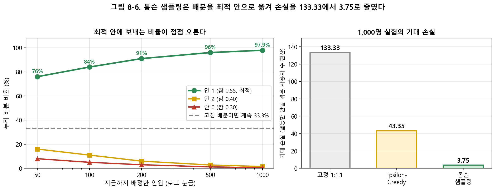
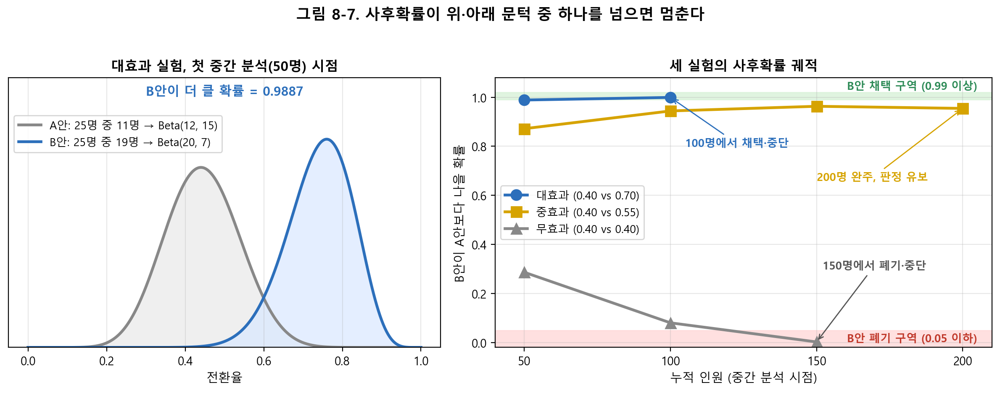

# 8장. A/B 테스트와 적응형 실험 설계

## □ 이 장의 질문

  ○ 새 화면(B안)이 기존 화면(A안)보다 나은지 확인하려고 사용자를 반씩 나눠 2주 동안 실험한다. 그동안 절반의 사용자는 두 안 중 나쁜 쪽을 계속 본다. 이 손실을 줄이려고 중간에 결과를 들여다보고 좋아 보이면 멈추거나, 잘되는 안에 사용자를 더 보내도 될까

  ○ 이 장의 답은 "규칙 없이 하면 안 되고, 규칙을 미리 정하면 된다"이다. 규칙 없이 중간에 멈추면 없는 효과를 있다고 보고할 확률이 커진다. 배분을 바꾸면 손실은 줄지만 나쁜 안의 효과를 정확히 알아내는 일은 포기해야 한다

  ○ 이 장은 무엇을 얻고 무엇을 내주는지를 숫자로 확인하는 방법을 배운다. 방법마다 같은 순서를 따른다: 왜 필요한가 → 원리(작은 숫자로 손계산) → 코드 → 결과 읽기

## □ 이 장을 읽는 방법

  ○ 이 장은 두 파트로 나뉜다

    – 1부(8.1~8.2): 배분을 반반으로 고정한 A/B 테스트를 설계한다. 몇 명이 필요한지 계산하고, 중간에 결과를 들여다봐도 오류가 늘지 않게 하는 규칙을 배운다

    – 2부(8.3~8.6): 실험 도중에 배분 비율 자체를 바꾸는 설계(톰슨 샘플링, 베이지안 적응형 설계)를 실행해, 손실이 얼마나 줄고 대신 무엇을 포기하는지 확인한다


  ○ 실습 코드는 practice/chapter08/code/ 에 있고, 실행하면 콘솔 출력이 practice/chapter08/results/<스크립트명>.log 로 저장된다. 본문의 실행 결과 발췌는 이 코드가 실제로 계산한 값이다. 실습 데이터는 정답(참 전환율)을 알고 만든 연습용 데이터라서, 계산한 값이 참값에서 얼마나 빗나갔는지 채점할 수 있다

  ○ 용어 미리보기 — 본문에서 처음 나올 때마다 다시 풀어 설명하므로, 여기서는 눈에 익히기만 하면 된다

| 용어 | 쉬운 뜻 |
| --- | --- |
| 무작위 배정 | 누가 어느 안을 받을지를 동전 던지기처럼 우연으로만 정하는 것 |
| 전환율 | 그 안을 본 사람 100명 중 목표 행동(구매·가입)을 한 사람의 비율 |
| 1종 오류 | 효과가 없는데 "있다"고 잘못 판정하는 실수. 허용 상한(유의수준)은 보통 5% |
| 검정력 | 효과가 정말 있을 때 실험이 그 효과를 잡아낼 확률. 기준은 0.80 |
| 중간 분석 | 실험이 끝나기 전에 결과를 미리 들여다보고 멈출지 정하는 것 |
| 톰슨 샘플링 | 성과가 좋아 보이는 안에 점점 더 많은 사용자를 보내는 배분 방법 |
| 사후확률 | 지금까지의 데이터를 보고 계산한 "B안이 A안보다 나을 확률" |

# 1부. 반반으로 나눈 실험을 설계하고 끝낼 시점을 정한다

## □ 1부 개요

  ○ 이 파트가 끝나면: 필요 인원과 검정력을 계산해 실험을 시작할지 정하고, 중간에 들여다볼 때 쓸 중단 경계를 고를 수 있다

  ○ 다루는 절: 8.1 ~ 8.2

## □ 8.1 무작위 배정과 A/B 테스트

### 8.1.1 실험이 기준점인 이유 — 동전이 두 집단을 같게 만든다

  ○ 앞 장들의 방법은 관측 데이터에서 효과를 구하려고 가정에 기댔다. 도구변수는 배제제약을, 이중차분은 평행추세를 가정하며, 이 가정들은 데이터로 완전히 확인되지 않는다. 그래서 결과를 읽는 사람은 늘 "그 가정이 맞다면"이라는 단서를 붙여야 한다

  ○ 실험은 이 단서를 없앤다. 누가 처치를 받을지를 연구자가 동전 던지기로 정하는 것이 **무작위 배정**이다

    – 동전은 사람의 나이·소득·의욕을 보지 않는다. 그래서 측정한 특성뿐 아니라 측정하지 못한 특성까지 두 집단에 비슷한 비율로 나뉜다

    – 두 집단의 구성이 같으므로, 결과 평균의 차이를 그대로 처치의 효과로 읽는다. 3장에서 매칭으로 애써 만들던 "비슷한 두 집단"이 설계 단계에서 이미 만들어진다

  ○ 비즈니스에서는 이 절차를 **A/B 테스트**라고 부른다. 사용자를 A안(대조군)과 B안(처치군)에 무작위로 나눠 보여 준 뒤 **전환율**을 비교한다. 전환율은 그 안을 본 100명 중 목표 행동을 한 사람의 비율이다. 의학의 무작위 대조시험(RCT)과 구조가 같다



  ○ 그림 8-1 읽는 법 — 2,000명을 만들어 실행한 가상의 예다. 절반이 "구매 의욕이 높은 사람"이며, 이 의욕은 데이터에 기록되지 않는다고 하자

    – 왼쪽: 사용자가 화면을 스스로 고르게 하면, 의욕이 높은 사람이 새 화면을 더 많이 고른다. B안 집단의 77%, A안 집단의 24%가 의욕이 높은 사람이다. 이 상태에서 B안의 전환율이 높게 나와도, 화면 덕분인지 원래 의욕이 높은 사람이 모였기 때문인지 구별할 수 없다

    – 오른쪽: 동전으로 나누면 두 집단 모두 의욕이 높은 사람이 50%, 51%로 거의 같다. 이 경우 전환율 차이는 화면 차이에서 나온 것으로 읽는다

  ○ 인원이 적은 실험에서는 **층화 무작위 배정**을 쓴다. 중요한 특성(모바일/데스크톱, 신규/기존)으로 사용자를 먼저 묶고 각 묶음 안에서 반반으로 나누므로, 우연히 한쪽에 모바일 사용자가 몰리는 일을 막는다

**한 줄 정리: 동전으로 나누면 측정하지 못한 특성까지 같은 두 집단이 만들어진다. 그래서 결과 차이를 효과로 읽는다.**

### 8.1.2 표본 크기 — 실험 전에 정해야 하는 숫자

  ○ 왜 필요한가: 실험을 먼저 시작하고 "언제까지 모을지"를 결과를 보며 정하면, 결과가 좋아 보이는 시점에 멈추게 된다. 그러면 결론이 부풀려진다. 그래서 **표본 크기**(실험에 필요한 인원)는 시작 전에 계산해 문서에 적는다

  ○ 계산에 넣는 값은 세 가지다: A안의 예상 전환율, B안의 예상 전환율, 원하는 검정력(8.1.3). 계산 결과는 "한 안에 몇 명"이다. 이 장에서는 비교하는 안 하나를 **팔(arm)** 이라고 부르므로 "팔당 몇 명"으로 쓴다

  ○ 원리: 작은 차이를 구별하려면 많이 봐야 한다

    – 동전 두 개 중 하나가 앞면이 조금 더 잘 나오는지 확인한다고 하자. 앞면 확률이 0.4와 0.7이면 몇십 번만 던져도 차이가 보인다. 0.40과 0.45면 수천 번을 던져야 우연과 구별된다

    – 필요 인원은 두 전환율 차이의 **제곱**에 반비례한다. 그래서 **잡으려는 효과가 절반이 되면 필요 인원은 약 4배**, 3분의 1이 되면 약 9배가 된다

  ○ 실습 데이터의 세 실험(A안 전환율은 모두 0.40)에 이 계산을 적용한 결과다(`results/8-1-fixed-rct-simulation.log` 발췌)

```
  시나리오                    참 효과     필요 n/팔     필요 총원     실제 n/팔       과부족
  시나리오 1 (소효과)           +0.05       1534      3068        100     -1434
  시나리오 2 (중효과)           +0.15        173       346        100       -73
  시나리오 3 (대효과)           +0.30         42        84        100       +58
  시나리오 4 (무효과)           +0.00         무한        무한        100         -
```



  ○ 그림 8-2 읽는 법

    – 가로축은 잡으려는 효과(전환율 차이), 세로축은 팔당 필요 인원이다. 세로축은 로그 눈금이라 한 칸 올라갈 때마다 인원이 몇 배씩 늘어난다

    – 효과 +0.30 → +0.15로 절반이 되면 42명 → 173명으로 4.1배가 된다. +0.05로 다시 3분의 1이 되면 1,534명으로 다시 8.9배가 된다. 파란 점선(실제 인원 팔당 100명)보다 위에 있는 시나리오 1·2는 인원이 모자란다

  ○ 결과를 읽는 법

    – **판정 눈금: 필요 인원을 확보하지 못하면 실험을 시작하지 않는다.** 시나리오 1은 팔당 1,534명이 필요한데 100명뿐이므로, 효과가 있어도 찾지 못한다

    – 시나리오 3은 42명이면 충분한데 100명을 모았다. 팔당 58명이 남았고, 그 인원 중 A안에 배정된 사람은 더 나쁜 화면을 불필요하게 본 셈이다

    – 시나리오 4의 "무한"은 계산 실패가 아니다. 참 효과가 0이면 구별할 차이가 없으므로, 아무리 모아도 "차이가 있다"를 확인할 수 없다. 그래서 설계할 때 "이 정도 효과면 의미 있다"는 최소 효과 크기를 먼저 정한다

**한 줄 정리: 표본 크기는 실험 전에 정해 문서에 적는다. 잡으려는 효과가 절반이면 인원은 4배다.**

### 8.1.3 검정력 — 지금 인원으로 무엇을 잡을 수 있는가

  ○ 왜 필요한가: 현실에서는 인원이 먼저 정해져 있는 경우가 많다. 하루 방문자 수가 정해져 있고 실험 기간이 2주로 묶여 있다면, 질문은 "몇 명이 필요한가"가 아니라 "지금 인원으로 어느 크기의 효과까지 잡을 수 있는가"가 된다

  ○ 그 답이 **검정력(power)** 이다. 검정력 0.80은 "효과가 정말 그 크기라면, 같은 실험을 100번 했을 때 80번은 유의하다는 결론이 나온다"는 뜻이다. 거꾸로 말하면 20번은 효과가 있는데도 놓친다

    – 비유: 검정력은 그물의 촘촘함에 대응한다. 큰 물고기(큰 효과)는 성긴 그물(적은 인원)로도 잡히지만, 작은 물고기(작은 효과)는 촘촘한 그물(많은 인원)이 있어야 잡힌다

  ○ 팔당 100명일 때 네 시나리오의 검정력이다(로그 발췌)

```
  시나리오                    참 효과      검정력                        판정
  시나리오 1 (소효과)           +0.05    0.106         부족 (효과를 놓칠 확률이 큼)
  시나리오 2 (중효과)           +0.15    0.566         부족 (효과를 놓칠 확률이 큼)
  시나리오 3 (대효과)           +0.30    0.992                        충분
  시나리오 4 (무효과)           +0.00    0.050       효과 없음 (이 값은 1종 오류율)
```

  ○ 결과를 읽는 법

    – 팔당 100명으로 +0.05 효과를 잡을 확률은 0.106이다. 열 번 중 아홉 번은 놓친다. 이런 실험에서 "유의하지 않았다"는 결과가 나와도 효과가 없다는 근거가 되지 않는다. 그물이 성겨서 못 잡았을 뿐이다

    – 시나리오 4의 0.050은 성격이 다르다. 참 효과가 0인데 "유의하다"고 나올 확률이므로 **1종 오류**의 확률이다. 설계에서 정한 5%와 같으므로 검정이 설계대로 작동한다

    – **판정 눈금: 검정력 0.80 미만이면 실험을 그대로 진행하지 않는다.** 인원을 늘리거나, 잡으려는 최소 효과를 키우거나, 흩어짐이 작은 다른 지표로 바꾼 뒤 다시 계산한다. 셋 다 할 수 없으면 실험을 접는다

**한 줄 정리: 검정력 0.80이 실험 시작의 관문이다. 관문을 넘지 못한 실험의 "유의하지 않음"은 정보가 아니다.**

### 8.1.4 실습 8-1 — 네 실험을 실제로 돌려 결과를 읽는다

  ○ 앞의 두 소절은 실험 전의 계산이었다. 이제 실제 데이터(`8-1-fixed-rct.csv`, 시나리오마다 팔당 100명, 모두 800명)로 계산이 예고한 대로 결과가 나오는지 확인한다

  ○ 실습 코드(`8-1-fixed-rct-simulation.py`)는 시나리오마다 B안 전환율에서 A안 전환율을 빼 관측 효과를 구하고, t검정으로 그 차이가 우연인지 판정한다

  ○ 실행 결과(로그 발췌)

```
시나리오 1 (소효과)  관측 효과 +0.060  95% CI [-0.076, +0.196]  p=0.3890  유의하지 않음
시나리오 2 (중효과)  관측 효과 +0.100  95% CI [-0.039, +0.239]  p=0.1589  유의하지 않음
시나리오 3 (대효과)  관측 효과 +0.260  95% CI [+0.126, +0.394]  p=0.0002  유의함
시나리오 4 (무효과)  관측 효과 +0.160  95% CI [+0.029, +0.291]  p=0.0176  유의함
```

  ○ 결과를 읽는 법

    – 시나리오 1·2는 참 효과가 있는데도 유의하지 않다. 검정력 0.106과 0.566이 예고한 결과다. 보고서에는 "효과가 없다"가 아니라 "이 인원으로는 판단할 수 없다"고 쓴다

    – 시나리오 3은 p=0.0002로 유의하고, 95% 신뢰구간(참값이 들어 있을 법한 범위) [+0.126, +0.394]도 0을 포함하지 않는다

    – **시나리오 4가 이 실습의 핵심이다.** 두 안의 참 전환율이 똑같이 0.40인데 p=0.018로 유의하게 나왔다. 관측 효과 +0.160은 순전히 우연이며, 1종 오류다. 유의수준 5%란 이런 실험이 20번에 1번꼴로 나오는 것을 허용한다는 뜻이다

  ○ **판정 눈금: 유의한 결과를 받으면 세 가지를 순서대로 확인한다.** ① 미리 정한 인원에 도달했는가 ② 중간에 여러 번 들여다보다가 유의할 때 멈춘 것은 아닌가(8.2) ③ 효과 크기가 사업적으로 의미 있는가. 하나라도 걸리면 결론을 미루고 같은 실험을 다시 한다

**한 줄 정리: 검정력이 예고한 대로 결과가 나온다. 그리고 효과가 0이어도 20번에 1번은 유의하게 나온다.**

### 8.1.5 실험 점검 — 배정 비율부터 확인한다

  ○ 분석 방법보다 기본 점검이 실험의 성패를 더 자주 가른다. 가장 자주 생기는 문제가 **표본 비율 불일치(SRM, Sample Ratio Mismatch)** 다. 50:50으로 배정하도록 설계했는데 실제 기록은 48:52처럼 어긋난 경우다

    – 수백만 명 규모에서 이 정도 차이는 우연으로 생기지 않는다. 예를 들어 자동 접속 프로그램(봇)의 기록이 B안에서만 걸러졌다면 두 집단의 구성이 달라지고, 8.1.1에서 동전으로 만든 "같은 두 집단"이 깨진다

    – **판정 눈금: 배정 비율 검정에서 p < 0.001이면, 효과 추정치가 아무리 좋아 보여도 결과를 읽지 않는다.** 기록 과정을 고친 뒤 실험을 다시 한다

  ○ 실험 설계 문서에는 **주 지표 하나**와 **가드레일 지표**(전환율이 올라도 이탈률·오류율이 나빠지면 배포하지 않는다는 조건)를 미리 적는다. 지표를 여러 개 두고 그중 유의한 것만 보고하면, 지표 수만큼 1종 오류의 기회가 늘어난다

  ○ 반반 고정 실험에는 비용이 세 가지 있다. 실험 내내 절반의 사용자가 나쁜 안을 보고, 효과 크기를 모르니 인원을 넉넉히 잡게 되며(시나리오 3의 남는 58명), 결론이 늦게 나온다. 세 비용 모두 배분 비율과 종료 시점을 미리 고정했기 때문에 생긴다. 8.2는 종료 시점을, 2부는 배분 비율을 실험 도중에 바꾸는 설계를 다룬다

**한 줄 정리: 배정 비율이 어긋나면(SRM) 결과를 읽지 않는다. 고정 실험의 비용은 모두 "미리 고정"에서 나온다.**

## □ 8.2 중간에 들여다보기 — 언제 멈춰도 되는가

### 8.2.1 왜 문제인가 — 유의할 때까지 보면 우연이 효과가 된다

  ○ 앞 절에 남은 질문: 효과가 확실해 보이면 그때 멈추면 되지 않는가

  ○ 원리: 주사위를 한 번 던져 6이 나올 확률은 1/6이다. 다섯 번 던지면서 "한 번이라도 6이 나오면 이긴다"고 하면, 이길 확률은 크게 오른다

    – 대응 관계: 주사위 한 번 = **중간 분석**(실험이 끝나기 전에 결과를 들여다보는 것) 한 번, 6이 나옴 = p < 0.05가 나옴, "6이 나오면 멈추고 이겼다고 선언" = "유의하면 멈추고 효과가 있다고 선언"

    – 효과가 전혀 없는 실험도 결과 수치는 들쭉날쭉하다. 여러 번 들여다보면 그중 한 번쯤은 우연히 기준선을 넘는다

  ○ 실습 코드(`8-2-group-sequential-design.py`)는 이 상황을 20만 번 반복했다. 두 안의 효과가 정말 같다고 두고, K번 들여다보면서 한 번이라도 p < 0.05면 멈추고 "효과 있음"으로 선언한다. 잘못 선언한 비율이 그림 8-3 오른쪽의 막대다(`results/8-2-group-sequential-design.log` 1단계)



  ○ 그림 8-3 읽는 법

    – 왼쪽: 효과가 0인 실험 6개를 다섯 번씩 들여다본 궤적이다(가상의 시뮬레이션). 세로축의 검정 통계량이 파란 점선(±1.96)을 넘으면 p < 0.05다. 빨간 실험은 1차에서 선을 넘었다가 다시 내려왔다. 1차에서 멈췄다면 "효과 있음"으로 잘못 선언했을 것이다

    – 오른쪽: 한 번만 보면 0.050으로 설계한 5% 그대로다. 다섯 번 보면 0.141로, 효과가 전혀 없는 실험 일곱 개 중 하나에서 "유의하다"는 결론이 나온다. 스무 번이면 네 개 중 하나다

  ○ 주사위와 다른 점이 하나 있다. 주사위는 매번 독립이지만, 중간 분석은 앞 단계 데이터를 포함한 누적 결과를 쓰므로 단계끼리 닮아 있다. 그래서 다섯 번 봐도 0.05 × 5 = 0.25까지 오르지 않고 0.141에 그친다

  ○ **판정 눈금: 결과를 확인하는 횟수와 시점은 실험 시작 전에 정해 문서에 적는다.** 정하지 않고 들여다본 뒤 유의해서 멈춘 실험의 p값은 그대로 보고하지 않고, 같은 실험을 다시 해서 확인한다

**한 줄 정리: 보정 없이 다섯 번 들여다보면 1종 오류가 5%가 아니라 14%다.**

### 8.2.2 그룹 순차 설계 — 매번의 기준을 엄격하게 바꾼다

  ○ 왜 필요한가: "중간에 보지 말라"로 끝내면, 나쁜 안이 분명해 보여도 실험을 끝까지 끌고 가야 한다. 필요한 것은 **중간에 보되 전체 1종 오류는 5%로 지키는 규칙**이며, 그 규칙이 **그룹 순차 설계**다

  ○ 원리: 여러 번 보면 오류가 늘어나므로, 매번 넘어야 하는 기준선(**중단 경계**)을 1.96보다 높게 올린다. 기준선을 얼마나 올릴지는 "전체 오류가 정확히 5%가 되는 높이"를 시뮬레이션으로 찾는다

  ○ 기준선을 올리는 모양에 따라 두 가지 방식이 있다

    – **Pocock 경계**: 모든 차례에 같은 높이의 기준선을 쓴다

    – **O'Brien-Fleming 경계(OBF)**: 처음에는 매우 높게, 뒤로 갈수록 낮게 둔다. 데이터가 적은 초기에는 웬만해서는 멈추지 않게 만든 것이다

  ○ 이 실습의 설계: 총 200명을 모으면서 67명·133명·200명 시점에 세 번 판정한다

  ○ 실행 결과(로그 발췌)

```
     단계      정보 분획     누적 n   Pocock z   Pocock p    OBF z      OBF p
      1       0.33       67      2.294    0.02177    3.468    0.00052
      2       0.67      133      2.294    0.02177    2.452    0.01419
      3       1.00      200      2.294    0.02177    2.002    0.04525

  무보정 (매번 1.96)        1종 오류 0.1161   1단계에서 중단 0.0611
  Pocock               1종 오류 0.0510   1단계에서 중단 0.0213
  O'Brien-Fleming      1종 오류 0.0520   1단계에서 중단 0.0004
```



  ○ 그림 8-4 읽는 법

    – 가로축은 판정 차례, 세로축은 멈추려면 넘어야 하는 기준선의 높이다. 통계량이 선 아래에 있으면 다음 차례까지 계속 모집한다

    – 초록 Pocock 선은 세 차례 모두 2.294(p값 0.02177)로 같다. 빨간 OBF 선은 1차에 3.468(p값 0.00052)로 매우 높고, 3차에는 2.002(p값 0.04525)로 보정하지 않은 기준 1.96(파란 점선) 근처까지 내려온다

  ○ 결과를 읽는 법 — 아래 세 줄은 두 안의 전환율을 모두 0.40으로 두고 2만 번 실험을 반복한 확인 결과다

    – 무보정(매번 1.96)은 1종 오류가 0.1161로 설계의 두 배를 넘는다. 기준선을 올린 두 방식은 0.0510과 0.0520으로 5% 근처로 돌아온다

    – 1차에서 멈추는 확률은 Pocock 0.0213, OBF 0.0004다. OBF는 초기에 거의 멈추지 않는다

  ○ **판정 눈금: 경계를 넘으면 그 차례에서 종료하고, 넘지 못하면 다음 차례까지 계속 모집한다.** "거의 넘을 뻔했다"는 이유로 기준을 낮추지 않는다. 경계값은 실험 시작 전에 계산해 문서에 적는다

**한 줄 정리: 매번의 기준을 엄격하게 바꾸면, 세 번 들여다봐도 전체 1종 오류는 5%로 돌아온다.**

### 8.2.3 Pocock과 O'Brien-Fleming 중 무엇을 고르는가

  ○ 두 경계는 같은 5%를 차례마다 어떻게 나눠 쓰는지만 다르다

    – **OBF를 고르는 경우**: 최종 결론의 정확도가 중요할 때다. 1차 기준이 매우 엄격해 인원이 적은 초기의 우연한 큰 값에 흔들리지 않는다. 규제 기관에 내는 임상시험과 정책 평가의 기본값이다

    – **Pocock을 고르는 경우**: 일찍 멈추는 것 자체가 큰 이득일 때다. 나쁜 안을 보여 주는 비용이 크거나 실험 운영비가 높은 상황이다. 대신 마지막 차례에서도 p값 0.02177 미만을 요구하므로, 끝까지 가면 유의한 결과를 얻기가 더 어렵다

  ○ 판정 연습(가상의 수치다): 위 경계표를 쓰는 실험의 2차(누적 133명)에서 p값 0.018이 나왔다면?

    – Pocock이면 0.018 < 0.02177이므로 멈춘다. OBF면 0.018 > 0.01419이므로 3차까지 모집한다. 같은 데이터라도 시작 전에 고른 경계에 따라 행동이 달라진다

**한 줄 정리: 끝까지 가서 정확한 결론이 중요하면 OBF, 일찍 멈추는 이득이 크면 Pocock이다.**

## □ 1부 정리

  ○ 지금까지 만든 것 두 가지: 네 실험의 요약(참 효과·필요 인원·검정력·관측 효과·p값), 그리고 중간 분석의 중단 경계표

  ○ 확인한 판정 기준: 검정력 0.80 미만이면 시작하지 않는다. 배정 비율이 어긋나면(SRM) 결과를 읽지 않는다. 중간에 여러 번 판정하려면 경계를 보정하고, 경계와 시점은 실험 전에 문서에 적는다

  ○ 여기까지는 배분을 반반으로 고정한 채 끝내는 시점만 조정했다. 2부의 질문: 나쁜 안에 절반의 사용자가 계속 배정되는 손실 자체를 줄이려면, 배분 비율을 실험 도중에 바꾸면 되지 않는가

# 2부. 배분 비율을 바꾸는 설계로 손실을 줄인다

## □ 2부 개요

  ○ 이 파트가 끝나면: 적응형 배분이 줄이는 손실과 그 대가를 숫자로 읽고, 새 과제에 고정 배분과 적응형 배분 중 무엇을 쓸지 정할 수 있다

  ○ 다루는 절: 8.3 ~ 8.6

## □ 8.3 슬롯머신 문제와 톰슨 샘플링

### 8.3.1 탐험과 활용 — 알아내기와 벌기를 맞바꾼다

  ○ 실험 도중 관측되는 결과에 따라 배정 확률을 바꾸는 설계를 **반응 적응형 무작위 배정**이라고 부른다. 그룹 순차 설계가 끝내는 시점을 바꿨다면, 이 설계는 배분 비율 자체를 바꾼다

  ○ 여기서 두 목표가 부딪힌다

    – **탐험(exploration)**: 모든 안을 충분히 시도해 어느 것이 좋은지 알아내는 일

    – **활용(exploitation)**: 지금까지 좋아 보이는 안을 많이 써서 성과를 올리는 일

    – 탐험만 하면 나쁜 안에 계속 사용자를 보낸다. 활용만 하면 초기 몇 번의 운으로 잘못 고른 안에 계속 머문다

  ○ 이 문제를 **멀티 암드 밴딧(multi-armed bandit)**, 곧 "슬롯머신 여러 대 문제"라고 부른다. 이름이 비유이므로 대응 관계를 표로 정리한다

| 카지노 상황 | 실험 상황 |
| --- | --- |
| 슬롯머신 한 대 | 비교하는 안 하나(팔) |
| 레버를 한 번 당김 | 사용자 한 명에게 그 안을 보여 줌 |
| 기계마다 숨어 있는 당첨 확률 | 각 안의 참 전환율 |
| 최고 기계만 당겼을 때와의 수익 차이 | 기대 손실 |

  ○ 비유가 맞지 않는 지점: 슬롯머신의 당첨 확률은 고정이지만, 서비스의 전환율은 요일·시즌에 따라 움직여 과거 데이터로 정한 배분이 틀릴 수 있다

**한 줄 정리: 배분을 바꾸는 설계는 "알아내기"와 "벌기"를 맞바꾸는 문제다.**

### 8.3.2 톰슨 샘플링의 원리 — 분포의 폭이 탐험을 조절한다

  ○ "다음 한 명을 어느 안에 보낼 것인가"에 답하는 방법은 여러 가지다

| 방법 | 다음 사용자를 보내는 기준 | 약점 |
| --- | --- | --- |
| Epsilon-Greedy | 10%는 아무 안이나, 90%는 지금까지 전환율이 가장 높은 안 | 10%라는 값을 사람이 정해야 하고, 최적 안을 찾은 뒤에도 10%를 계속 낭비한다 |
| 톰슨 샘플링 | 안마다 "전환율이 얼마쯤일까"의 분포에서 값을 하나씩 뽑아 가장 큰 안 | 매번 분포를 갱신하는 실시간 계산이 필요하다 |

  ○ **톰슨 샘플링(Thompson Sampling)** 의 절차는 네 단계다

    – ① 안마다 성공 횟수와 실패 횟수를 센다

    – ② 그 두 숫자로 "전환율이 얼마쯤일까"를 나타내는 분포를 만든다. 이 분포를 **Beta 분포**라고 부르며, Beta(1+성공, 1+실패)로 쓴다

    – ③ 안마다 그 분포에서 난수를 하나씩 뽑는다

    – ④ 가장 큰 난수가 나온 안에 다음 사용자를 보내고, 반응을 기록해 ①로 돌아간다

  ○ 손으로 따라간다(가상의 수치다). 안 A는 3명 중 1명이 전환했고, 안 B는 90명 중 50명이 전환했다

    – 안 A의 분포는 Beta(1+1, 1+2) = Beta(2, 3), 안 B의 분포는 Beta(1+50, 1+40) = Beta(51, 41)이다

    – 지금까지의 전환율은 A가 0.33, B가 0.56으로 B가 높다. 그래도 A는 3명밖에 보지 않아서 "사실은 0.7일 수도 있다"는 가능성이 남아 있다



  ○ 그림 8-5 읽는 법

    – 가로축은 전환율, 세로축은 그 값이 얼마나 그럴듯한지다. 봉우리가 높은 곳일수록 그 근처 값이 자주 뽑힌다

    – 파란 안 B는 90명을 봐서 0.55 근처에 좁게 모여 있다. 빨간 안 A는 3명만 봐서 0부터 1까지 넓게 퍼져 있어, 가끔 0.7이나 0.8 같은 큰 값이 뽑힌다

    – 두 분포에서 20만 번 뽑아 보면 A가 이기는 비율이 24%다. 지금 시점에서 다음 사용자가 A에 배정될 확률이 약 24%라는 뜻이다. A는 전환율이 낮아 보여도 다시 기회를 얻는다

  ○ 원리: 시도가 적은 안은 분포가 넓어서 가끔 큰 값이 뽑혀 기회를 얻는다(탐험). 시도가 쌓이면 분포가 좁아져 참값 근처 값만 뽑힌다(활용). 탐험 비율을 사람이 정하지 않아도 분포의 폭이 그 비율을 정한다. Epsilon-Greedy와 갈리는 지점이 여기다

**한 줄 정리: 톰슨 샘플링은 "성공·실패를 세고, 분포에서 뽑고, 큰 쪽에 보낸다"의 반복이다.**

### 8.3.3 실습 8-3 — 톰슨 샘플링이 줄인 손실을 계산한다

  ○ 데이터는 `8-3-thompson-sampling.csv`다. 참 전환율이 0.30, 0.55, 0.40인 세 안(안 0, 안 1, 안 2)에 톰슨 샘플링으로 1,000명을 배정한 기록이다. 안 1이 가장 좋다

  ○ 성과는 **기대 손실**로 계산한다. 안마다 "그 안에 보낸 인원 × 최적 안과의 전환율 차이"를 구해 더한다

    – 고정 배분(1:1:1)이면 세 안에 333.3명씩 간다. 안 0의 손실 333.3 × (0.55 − 0.30) = 83.3, 안 2의 손실 333.3 × (0.55 − 0.40) = 50.0이므로 합은 133.33이다

    – 기대 손실 133.33은 "나쁜 안을 본 탓에 놓친 전환이 약 133건"이라는 뜻이다

  ○ 실습 코드(`8-3-thompson-sampling.py`)는 안별 배분 인원을 세고 위 계산을 그대로 한다. 실행 결과(`results/8-3-thompson-sampling.log` 발췌)

```
    Arm      참 전환율      배분 인원      배분 비율     성공
      0       0.30          6       0.6%      0
      1       0.55        979      97.9%    569
      2       0.40         15       1.5%      3

                 배분 방식 최적팔 배분비율  기대 손실 실현 보상
              고정 1:1:1    33.3% 133.33     -
Epsilon-Greedy (ε=0.1)    73.1%  43.35   524
                톰슨 샘플링    97.9%   3.75   572
```

  ○ 손계산 확인: 톰슨 샘플링의 기대 손실은 6명 × 0.25 + 979명 × 0 + 15명 × 0.15 = 1.5 + 0 + 2.25 = 3.75다



  ○ 그림 8-6 읽는 법

    – 왼쪽: 가로축은 지금까지 배정한 인원, 세로축은 그때까지 각 안에 보낸 비율이다. 최적인 안 1의 비율이 50명 시점에 이미 76%이고, 200명에 91%, 1,000명에 97.9%까지 오른다. 고정 배분이면 회색 점선처럼 끝까지 33.3%다

    – 오른쪽: 1,000명 실험의 기대 손실이다. 고정 배분 133.33, Epsilon-Greedy 43.35, 톰슨 샘플링 3.75 순으로 줄어든다

  ○ 결과를 읽는 법

    – 기대 손실이 133.33에서 3.75로 97.2% 줄었다. 나쁜 안을 겪은 탓에 놓친 전환이 약 130건 줄었다는 뜻이다. 전환 한 건의 가치(예: 평균 구매액)를 곱하면 금액으로 바꿀 수 있다

    – **판정 눈금: 도입 여부는 줄어든 손실을 금액으로 바꿔 도입 비용과 비교해 정한다.** 실시간 배분 시스템을 만들고 운영하는 비용이 더 크면 고정 배분을 쓴다. 전체 인원이 수백 명 수준이면 배분이 쏠리기 전에 실험이 끝나 이득이 작다

**한 줄 정리: 톰슨 샘플링은 최적 안에 97.9%를 보내 기대 손실을 97.2% 줄였다.**

### 8.3.4 적응형 배분이 포기하는 것

  ○ 앞 결과만 보면 적응형 배분이 모든 면에서 나아 보인다. 같은 로그의 5단계 출력에 그 대가가 있다

```
    Arm      배분 인원      사후평균      참값      절대오차              95% 신용구간
      0          6     0.125    0.30     0.175        [0.004, 0.410]
      1        979     0.581    0.55     0.031        [0.550, 0.612]
      2         15     0.235    0.40     0.165        [0.073, 0.456]
```

  ○ 결과를 읽는 법

    – 979명을 받은 안 1은 추정이 정확하다. 추정값 0.581은 참값 0.55와 0.031 차이이고, 구간 폭도 0.062로 좁다

    – 6명만 받은 안 0은 추정값 0.125가 참값 0.30에서 0.175나 떨어져 있고, 구간 [0.004, 0.410]은 0.4 넘게 퍼져 있다. "안 0의 전환율은 0.125"라고 보고하면 틀린 숫자를 보고하는 것이다

    – 적응형 배분은 **최적 안을 찾고 손실을 줄이는 데는 강하지만, 나쁜 안의 효과를 정확히 알아내는 일은 포기한다.** 나쁜 안에 사람을 보내지 않으니 그 안에 대한 정보도 모이지 않는다

  ○ **판정 눈금: 배분 인원 30명 미만인 안의 추정치는 보고서에 싣지 않는다.** 과제의 목적이 효과 크기 추정이면 고정 배분을, 실험 기간의 성과 개선이면 적응형 배분을 쓴다. 두 목적을 한 실험으로 동시에 이루려는 설계는 대개 둘 다 놓친다

**한 줄 정리: 손실 감소의 대가는 나쁜 안의 추정 포기다. 목적이 추정이면 적응형을 쓰지 않는다.**

## □ 8.4 베이지안 적응형 설계 — "B안이 나을 확률"로 멈춘다

### 8.4.1 원리 — 성공·실패를 더해 분포를 갱신한다

  ○ 왜 필요한가: 그룹 순차 설계는 p값으로 멈출지를 정한다. p값은 "효과가 없다고 가정할 때 이만큼 극단적인 결과가 나올 확률"이라 조건을 붙여 읽어야 한다. 그런데 회의에서는 거의 항상 "B안이 나을 확률 95%"로 잘못 옮겨진다

  ○ **베이지안 적응형 설계**는 그 잘못된 번역을 정식 계산으로 만든다. **사후확률**은 "지금까지의 데이터를 보고 계산한, B안의 전환율이 A안보다 높을 확률"이며, 조건 없이 문자 그대로 읽는다

  ○ 계산 절차는 세 단계다

    – ① 데이터를 보기 전의 믿음(**사전분포**)을 "0과 1 사이 모든 전환율이 똑같이 그럴듯하다"로 놓는다. Beta(1, 1)이다

    – ② 관측이 쌓이면 성공 횟수를 앞 숫자에, 실패 횟수를 뒤 숫자에 더한다. 이렇게 갱신한 분포가 **사후분포**다

    – ③ 두 안의 사후분포에서 난수를 많이 뽑아 "B의 값이 A의 값보다 큰 비율"을 세면 그것이 사후확률이다

  ○ 손으로 따라간다. 실습 데이터의 대효과 실험에서 첫 50명(각 안 25명)의 결과다

    – A안: 25명 중 11명 성공, 14명 실패 → Beta(1+11, 1+14) = Beta(12, 15). 분포의 중심(평균)은 12 ÷ 27 = 0.44다

    – B안: 25명 중 19명 성공, 6명 실패 → Beta(1+19, 1+6) = Beta(20, 7). 분포의 중심은 20 ÷ 27 = 0.74다

    – 두 분포에서 20만 번씩 뽑아 B가 큰 비율을 세면 0.9887이다. "지금까지 데이터로 보면 B안이 나을 확률이 98.87%"로 읽는다

  ○ 실습 코드(핵심 부분, 전체는 `8-4-bayesian-adaptive.py`)

```python
pa = rng_mc.beta(1 + s_c, 1 + n_c - s_c, 200_000)   # A안 사후분포에서 20만 번 뽑기
pb = rng_mc.beta(1 + s_t, 1 + n_t - s_t, 200_000)   # B안 사후분포에서 20만 번 뽑기
pp = float(np.mean(pb > pa))                        # B가 A보다 큰 비율 = 사후확률

# 멈추는 규칙: pp >= 0.99 → B안 채택·중단 / pp <= 0.05 → B안 폐기·중단 / 그 사이 → 계속
```

  ○ 멈추는 문턱이 위·아래 두 개다

    – **위 문턱 0.99**: B안이 나을 확률이 99% 이상이면 더 볼 필요 없이 B안을 채택한다(효능 중단)

    – **아래 문턱 0.05**: B안이 나을 확률이 5% 이하이면 더 볼 이유가 없으므로 B안을 접는다(무용성 중단)

**한 줄 정리: 사후확률은 "B안이 나을 확률"로 바로 읽는다. 멈추는 문턱은 위·아래 두 개다.**

### 8.4.2 실습 8-4 — 세 실험의 사후확률 궤적을 읽는다

  ○ 실험마다 최대 200명까지 모집하고, 누적 50·100·150·200명 시점에 중간 분석을 한다. 참 전환율은 대효과 0.40 대 0.70, 중효과 0.40 대 0.55, 무효과 0.40 대 0.40이다

  ○ 실행 결과(`results/8-4-bayesian-adaptive.log` 발췌)

```
시나리오    참 A    참 B  최종 n  조기 중단     이유      최종 사후확률  절약한 인원
 대효과    0.40    0.70   100      예     efficacy      0.9993       100
 중효과    0.40    0.55   200    아니오       -          0.9545         0
 무효과    0.40    0.40   150      예     futility      0.0023        50
```



  ○ 그림 8-7 읽는 법

    – 왼쪽: 8.4.1에서 손계산한 대효과 실험의 50명 시점이다. 회색 A안 분포(중심 0.44)와 파란 B안 분포(중심 0.74)가 조금 겹친다. 겹친 만큼 "A가 더 클 가능성"이 남아 있어서 사후확률이 1이 아니라 0.9887이다

    – 오른쪽: 세 실험의 사후확률이 시점마다 움직인 궤적이다. 위쪽 초록 띠(0.99 이상)에 들어가면 B안 채택, 아래쪽 빨간 띠(0.05 이하)에 들어가면 B안 폐기다

  ○ 결과를 읽는 법

    – 대효과: 50명 시점에 0.9887로 기준 0.99에 0.0013 모자라 계속 모집했다. 100명에서 0.9993으로 넘어 멈췄다. "거의 넘었다"로 멈추지 않는 규칙이 여기서도 적용된다

    – 중효과: 0.8718 → 0.9441 → 0.9632 → 0.9545로 움직이며 끝내 0.99에 닿지 못하고 200명을 모두 모았다. 보고서에는 "효과가 없다"가 아니라 "이 인원으로는 0.99 기준을 넘지 못해 판정을 미룬다"고 쓴다

    – 무효과: 0.2865 → 0.0803 → 0.0023으로 내려가 150명에서 B안을 접었다

    – 세 실험을 고정 설계로 했다면 200명씩 600명이 필요했다. 실제로는 100 + 200 + 150 = 450명을 썼으므로 150명을 아꼈다

**한 줄 정리: 효과가 크면 일찍 채택하고, 없으면 일찍 접고, 애매하면 끝까지 모은 뒤 판정을 미룬다.**

### 8.4.3 문턱과 분석 시점은 미리 정한다

  ○ 0.99라는 문턱은 자연법칙이 아니라 설계자의 선택이다. 문턱을 0.95로 낮추면(로그 4단계) 대효과는 100명 대신 50명에서, 중효과는 200명 대신 150명에서 멈춘다. 실험은 짧아지지만, 효과가 없는 안을 채택할 위험이 함께 커진다

  ○ 첫 중간 분석 시점도 설계 선택이다. 무효과 실험의 사후확률이 50명 시점 0.2865에서 100명 시점 0.0803으로 크게 움직였다. 인원이 적은 초기에는 값이 크게 흔들리므로, 첫 중간 분석은 각 안에 50명 이상이 모인 뒤에 둔다

  ○ **판정 눈금: 문턱과 중간 분석 시점은 실험 시작 전에 정하고 실행 중에 바꾸지 않는다.** 규제 기관 제출이나 외부 보고가 걸린 실험이면 0.99, 내부 운영 결정이면 0.95도 쓸 수 있다

  ○ 판정 연습(가상의 수치다): 문턱이 0.99/0.05인 두 실험의 중간 분석에서 사후확률이 0.97과 0.031이 나왔다면?

    – 0.97은 두 문턱 사이이므로 계속 모집하고, 0.031은 0.05 이하이므로 B안을 접는다. 문턱이 0.95였다면 첫 실험은 채택·중단이다

**한 줄 정리: 문턱과 분석 시점은 실험 전에 정한 값만 유효하다. 결과를 본 뒤 바꾼 기준은 기준이 아니다.**

## □ 8.5 종합 사례 — 콘텐츠 5종 중 좋은 것을 찾는 서비스 실험

  ○ 왜 필요한가: 선택지가 둘일 때와 다섯일 때는 적응형 배분의 움직임이 다르다. 가상의 불면증 관리 앱에서 콘텐츠 5종 중 수면 개선 반응이 좋은 것을 찾는 상황으로 확인한다

    – 데이터는 `8-5-korean-dtx.csv`(800명)이며, 참 성공률은 마음챙김 0.52, 수면 개선 0.48, 인지 재구성 0.45, 호흡 훈련 0.38, 운동 독려 0.35로 정해 두었다

    – 건강 관리 서비스에서는 효과가 낮은 콘텐츠를 참가자에게 오래 보여 주는 일 자체가 부담이다. 배분을 바꿔 그 노출을 줄이는 설계가 실질적 의미를 갖는다

  ○ 실습 코드(`8-5-korean-dtx-case.py`)는 8.3.2의 네 단계를 콘텐츠 5개에 그대로 반복한다

  ○ 실행 결과(`results/8-5-korean-dtx-case.log` 발췌)

```
  콘텐츠            참 성공률     n=200     n=400     n=600     n=800
  마음챙김            0.52     25.5%     20.2%     27.3%     44.2%
  수면 개선           0.48     48.0%     42.2%     34.8%     26.9%

  적응형 배분 기대 성공자 380.2명 / 고정 배분 348.8명 / 전부 최고 콘텐츠 416.0명

  참 성공률 순위 : 마음챙김(0.52) > 수면 개선(0.48) > 인지 재구성(0.45) > 호흡 훈련(0.38) > 운동 독려(0.35)
  배분 인원 순위 : 마음챙김(354명) > 수면 개선(215명) > 인지 재구성(112명) > 운동 독려(89명) > 호흡 훈련(30명)
```

  ○ 결과를 읽는 법 — 세 가지를 차례로 본다

    – **수렴 속도**: 200명 시점에는 2위인 수면 개선이 48.0%로 가장 많이 배정되었고, 1위인 마음챙김은 800명 시점에야 44.2%로 올라섰다. 0.52와 0.48처럼 차이가 작으면 구별하는 데 관측이 많이 필요하다. 8.3의 세 안 실험(50명 시점에 이미 최적 안 76%)보다 훨씬 느리다

    – **성과 개선**: 고정 배분이면 다섯 콘텐츠에 160명씩 가므로 기대 성공자는 160 × (0.45 + 0.38 + 0.52 + 0.35 + 0.48) = 348.8명이다. 적응형 배분은 380.2명으로 31.4명(9.0%) 늘었다. 800명 모두 최고 콘텐츠를 받았을 때의 416.0명에는 못 미친다

    – **순위**: 1~3위의 배분 순위는 참 순위와 같지만 4위와 5위가 뒤집혔다. 참 성공률 0.38인 호흡 훈련(30명)이 0.35인 운동 독려(89명)보다 적게 배정되었다. 0.03 차이는 800명으로 구별되지 않았고, 두 콘텐츠의 95% 구간 [0.142, 0.446]과 [0.288, 0.486]은 크게 겹친다

  ○ **판정 눈금: 배분 인원 순위를 효과 순위로 읽지 않는다.** 구간이 겹치는 콘텐츠끼리는 "순위를 가릴 수 없음"으로 적는다. 개선율은 실제 성공자로 계산한 +9.5%가 아니라 기댓값끼리 비교한 +9.0%를 보고한다. 9.5%에는 이번 실행의 운이 섞여 있어 다시 실행하면 같은 값이 나오지 않는다

  ○ 건강·금융처럼 실패 비용이 큰 영역에서는 증상이 나빠진 참가자 비율에 상한을 두고, 콘텐츠마다 최소 배분 비율(예: 5%)을 두는 안전장치를 설계 문서에 함께 적는다

**한 줄 정리: 선택지가 다섯이면 수렴이 느려도 기대 성공자는 9.0% 늘었다. 배분 순위는 효과 순위가 아니다.**

## □ 8.6 연구 동향 — 이 도구들이 넓어지는 방향

  ○ 이 절은 참고용이며 실습을 동반하지 않는다

    – **문맥적 밴딧**: 사용자가 들어올 때 보이는 정보(기기, 유입 경로, 시간대)를 함께 보고 안을 고른다. 목표가 "전체에서 가장 좋은 안 하나"에서 "이런 사용자에게 가장 좋은 안"으로 바뀐다

    – **강화학습**: 지금의 선택이 다음 분기 이탈처럼 미래 성과에 주는 영향까지 계산에 넣는다

    – **단계 전환형 설계**: 앞 기간은 고정 배분으로 모든 안의 효과를 추정하고, 뒤 기간은 적응형으로 바꿔 손실을 줄인다. 8.3.4의 "추정과 손실 감소를 동시에 얻지 못한다"는 문제를 시간으로 나누어 푼다

## □ 결과를 읽는 순서

  ○ 이 장의 산출물은 다음 순서로 읽는다

    – 1순위 **배정 비율(SRM)**: 설계와 어긋나면 뒤의 숫자는 읽지 않고 기록 과정부터 고친다

    – 2순위 **인원과 검정력**: 필요 인원에 도달했는지, 검정력 0.80을 넘겼는지 본다. 넘지 못한 실험의 "유의하지 않음"은 결론이 아니다

    – 3순위 **멈춘 절차가 계획대로인가**: 계획은 3회인데 5회 들여다봤다면 그 경계는 무효다

    – 4순위 **효과와 구간**: 여기까지 통과한 뒤에 효과 크기를 읽는다. 적응형 실험이면 배분 30명 미만인 안은 건너뛰고, 개선율은 기댓값 기준 수치를 쓴다

## □ 실무 적용 점검표

  ○ 목적을 하나로 정했는가 — 효과 크기를 구간과 함께 보고하는 것인지, 실험 기간의 성과를 올리는 것인지. "둘 다"라고 답하면 설계가 흔들린다

  ○ 주 지표 하나와 가드레일 지표를 실험 전에 문서에 적었는가?

  ○ 필요 인원과 검정력을 계산했는가? 검정력 0.80 미만이면 시작하지 않는다

  ○ 중간 분석 횟수(3~5회)와 시점을 정했는가? 첫 시점은 각 안 50명 이후로 두고, 정한 뒤에는 바꾸지 않는다

  ○ 목적에 맞게 설계를 골랐는가? 효과 추정이면 고정 배분 + 그룹 순차 설계, 성과 개선이면 적응형, 둘 다면 기간을 나누는 단계 전환형이다

## □ 핵심 정리

| 설계 | 실험 중에 바꾸는 것 | 강한 점 | 포기하는 것 |
| --- | --- | --- | --- |
| 고정 배분 A/B 테스트 | 없음 | 모든 안의 효과를 같은 정확도로 추정 | 실험 기간 내내 나쁜 안에 절반 배정 |
| 그룹 순차 설계 | 끝내는 시점 | 1종 오류를 5%로 지키며 일찍 멈춤 | 경계를 미리 계산·문서화하는 부담 |
| 톰슨 샘플링(적응형 배분) | 배분 비율 | 기대 손실을 크게 줄임 | 나쁜 안의 효과 추정 |
| 베이지안 적응형 설계 | 끝내는 시점과 판정 문장 | "B안이 나을 확률"로 바로 읽는 결론 | 사전분포·문턱을 정하는 책임 |

  ○ 이 장의 판정 규칙 세 가지

    – **실험 전에 정한 숫자만 유효하다.** 표본 크기·분석 시점·경계·문턱을 결과를 본 뒤 바꾸면 무효다

    – **적응형 배분에서 배분이 적은 안의 추정치와 배분 순위는 보고하지 않는다.** 손실 감소를 얻는 대신 추정을 내준 설계이기 때문이다

    – **성과는 기댓값 기준으로 보고한다.** 실현값에는 이번 실행의 운이 섞여 있다
