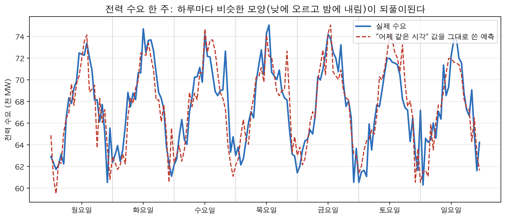
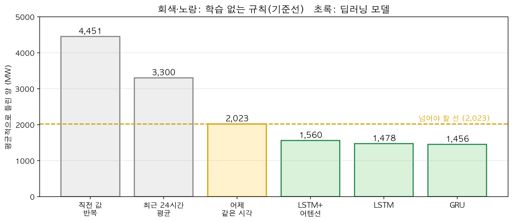
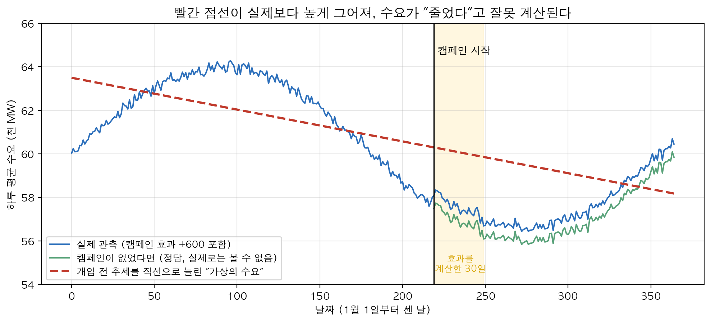

# 9장. 시계열 인과분석: 정책지표 예측과 시계열 모델

## □ 이 장의 질문

  ○ 전력거래소 담당자는 매일 "내일 24시간 동안 전기가 얼마나 쓰일까"를 미리 알아야 한다. 그래야 발전소를 몇 개 돌릴지 정할 수 있다

  ○ 이렇게 시간 순서대로 쌓인 값으로 앞날을 맞히는 일을 **시계열 예측**이라고 부른다. 이 장은 여섯 가지 질문에 차례로 답한다

    – 시간 순서대로 쌓인 자료는 무엇이 특별한가

    – 예측이 잘 맞는지는 무엇과 비교해서 판정하는가

    – 예측 성적을 부풀리는 실수는 무엇인가

    – 딥러닝 모델은 단순한 규칙보다 얼마나 나은가

    – 모델을 언제 다시 학습시켜야 하는가

    – 잘 맞히는 모델이 있으면 "절약 캠페인 덕분에 수요가 줄었다"고 말해도 되는가

  ○ 실습 자료는 한국 전력 수요의 모양을 본떠 만든 2년치 시간별 가상 자료다. 실습 코드는 practice/chapter09/code/ 에 있다

## □ 1. 시계열은 순서가 정보다

### 1.1 순서를 바꾸면 자료가 무너진다

  ○ 설문 자료에서는 1번 응답자와 500번 응답자의 줄을 바꿔도 결과가 같다. 전력 수요 자료에서 3월과 8월을 바꾸면 자료가 엉망이 된다. 시간 순서 자체가 정보이기 때문이다

  ○ 전력 수요에는 세 가지 반복이 겹쳐 있다

    – 하루 반복: 새벽에 낮고, 낮과 저녁에 높다

    – 일주일 반복: 평일과 주말이 다르다

    – 1년 반복: 냉방을 하는 여름과 난방을 하는 겨울에 높다

  ○ 그림 읽기 — 실습 자료에서 2024년 4월 8일(월)부터 일주일을 그렸다

    – 파란 선(실제 수요)은 매일 비슷한 산 모양을 그린다

    – 빨간 점선은 "24시간 전 값을 그대로 내일 값이라고 말하는" 가장 단순한 예측이다. 이렇게 단순한 규칙도 산 모양을 대체로 따라간다

### 1.2 오늘은 어제와 닮았다

  ○ 오늘 오후 3시 수요는 어제 오후 3시, 지난주 같은 요일 오후 3시와 특히 비슷하다. 이처럼 값이 자기 과거와 닮는 성질이 시계열 예측의 출발점이다

  ○ 비유: 내일 날씨를 모를 때 "내일도 오늘과 비슷하겠지"라고 말하면 꽤 자주 맞는다. 날씨가 하루 사이에 크게 바뀌는 날이 드물기 때문이다

**한 줄 정리: 시계열에서는 순서가 정보다. 오늘 값은 어제·지난주 같은 시각 값과 닮았다.**

## □ 2. 먼저 꾀 없는 예측을 세운다 — 기준선

### 2.1 74점짜리 모델이 0점인 이유

  ○ 정책 5,000건 중 약 75%가 성공한 자료가 있다. 이 자료로 성공·실패를 맞히는 신경망을 만들고, 공부에 쓰지 않은 750건으로 시험을 봤다. 750건 중 성공이 562건, 실패가 188건이다(실습 `9-mlp-example.py`)

  ○ 모델은 750건 중 555건을 맞혀 정확도가 74%였다. 74%는 높아 보인다

  ○ 그런데 아무것도 배우지 않고 750건 모두 "성공"이라고 답하면 성공 562건을 전부 맞히므로 정확도가 75%(562 ÷ 750)다. 모델이 이 단순한 답보다 못하다

  ○ 이유는 모델이 750건 중 13건만 "실패"라고 답하고 나머지는 모두 "성공"이라고 답했기 때문이다. 실패한 정책 188건 중 모델이 실패로 맞힌 것은 3건뿐이다. 모델은 실패를 가려내는 법을 배우지 못하고 사실상 "모두 성공"이라고 답했다

  ○ 비유: 정답이 대부분 ③번인 시험에서 모두 ③번을 찍어 74점을 받았다면, 그 점수는 실력이 아니다

### 2.2 기준선 세 개

  ○ 그래서 모델을 만들기 전에 **학습 없이 만드는 단순한 예측 규칙**을 먼저 세운다. 이것을 **기준선**이라고 부른다. 모델은 기준선을 이겨야 쓸모가 있다

  ○ 전력 수요 실습에서 세운 기준선은 세 개다

    – 직전 값 반복: 마지막으로 본 값을 앞으로 24시간 내내 그대로 쓴다

    – 어제 같은 시각: 24시간 전 값을 시각별로 그대로 가져온다(그림 9e-1의 빨간 점선)

    – 최근 24시간 평균: 지난 하루 평균 하나를 24시간 내내 쓴다

  ○ 성적은 **평균 오차**(MAE)로 비교한다. "예측이 평균적으로 몇 MW 틀렸는가"를 뜻하며, 작을수록 좋다. 실습 자료의 평균 수요는 약 66,700 MW다

<표 1: 기준선 세 개의 평균 오차>

| 기준선 | 평균적으로 틀린 양 |
| --- | --- |
| 직전 값 반복 | 4,451 MW |
| 최근 24시간 평균 | 3,300 MW |
| 어제 같은 시각 | **2,023 MW** |

  ○ "어제 같은 시각"이 가장 잘 맞는다. 하루 반복이 그만큼 강하다는 뜻이다. 이제 딥러닝 모델은 **2,023 MW보다 적게 틀려야** 쓸 수 있다

  ○ 판정 연습(가상의 수치): 기준선이 2,000 MW만큼 틀리는데 모델 세 개가 각각 2,100, 1,960, 900 MW만큼 틀린다면

    – 2,100: 기준선보다 못하므로 쓰지 않는다

    – 1,960: 겨우 2% 나으므로, 모델을 만들고 관리하는 수고만큼 값어치가 있는지 따진다

    – 900: 절반 넘게 좋아졌다. 너무 좋으면 3절의 실수가 있었는지부터 의심한다

**한 줄 정리: 기준선을 먼저 세운다. 기준선을 이기지 못한 모델의 성적은 의미가 없다.**

## □ 3. 시험 문제를 미리 보면 안 된다 — 시간 순서대로 나누기

### 3.1 공부용과 시험용을 나누는 방법

  ○ 모델의 실력을 확인하려면 자료를 나눈다. 앞부분으로 공부(학습)시키고, 공부에 쓰지 않은 뒷부분으로 시험을 본다

  ○ 실습에서는 시간 순서 그대로 잘랐다

    – 가장 오래된 70%: 공부용

    – 그다음 15%: 중간 점검용

    – 가장 최근 15%: 최종 시험용

  ○ 실제로 모델을 쓸 때도 과거로 배워 미래를 맞힌다. 시험도 같은 조건이어야 공정하다

### 3.2 무작위로 섞으면 생기는 일

  ○ 일반 표 자료처럼 줄을 무작위로 섞어 나누면, 공부용 자료 사이사이에 시험 날짜의 앞뒤 날이 끼어든다. 모델은 "월요일과 수요일을 알고 화요일을 맞히는" 쉬운 문제를 풀게 된다

  ○ 이렇게 미래 정보가 공부용 자료에 새어 들어가는 실수를 **데이터 누수**라고 부른다. 누수가 있으면 시험 성적은 좋아지지만, 실제로 내일을 맞히는 실력은 그대로다

  ○ 비유: 시험 전에 정답지를 잠깐 본 학생의 점수는 실력이 아니다. 다른 점은, 누수는 코드 몇 줄 안에 숨어 있어서 만든 사람도 알아채기 어렵다는 것이다

### 3.3 자주 하는 실수 세 가지

  ○ 무작위로 섞어서 나눈다

  ○ 자료의 크기를 맞추는 기준(평균·범위 등)을 전체 기간으로 계산한다. 시험 기간의 정보가 공부에 섞인다. 기준은 공부용 70%만으로 계산한다

  ○ 정답 시점보다 뒤의 값을 입력에 넣는다. 예를 들어 "앞뒤 3시간 평균"을 입력으로 쓰면, 뒤 3시간이라는 미래가 들어간다

  ○ 성적이 지나치게 좋으면(예: 실제 수요의 1%도 안 틀림) 모델을 칭찬하기 전에 이 세 가지부터 확인한다

**한 줄 정리: 옛 자료로 공부하고 최신 자료로 시험 본다. 성적이 너무 좋으면 누수부터 의심한다.**

## □ 4. 딥러닝 모델을 붙여 본다

### 4.1 모델이 하는 일

  ○ 모델은 지난 일주일(168시간)의 수요·기온·요일 등을 보고, 다음 24시간 수요를 한 번에 내놓는다

    – 일주일을 보는 이유: 하루 반복과 평일·주말 차이를 한꺼번에 담을 수 있다

    – 24시간을 맞히는 이유: 다음 날 발전 계획을 하루 단위로 짠다

  ○ 이번 실습에서 쓴 모델은 **LSTM**과 **GRU**다. 둘 다 자료를 한 시간씩 차례로 읽으면서 "지금까지 읽은 내용의 요약"을 고쳐 적어 나간다. 읽는 동안 무엇을 기억하고 무엇을 잊을지를 자료에서 스스로 배운다

    – 예: 3개월 전 한파는 점점 잊고, 새로 시작된 정책으로 달라진 수요 수준은 오래 기억한다

    – GRU는 LSTM을 조금 단순하게 만든 모델이다

    – LSTM+어텐션은 LSTM에 "168시간 중 어느 시각을 더 눈여겨볼지" 고르는 장치를 덧붙인 모델이다

### 4.2 결과 — 기준선을 이겼는가

  ○ 그림 읽기 — 막대가 낮을수록 적게 틀린 것이다. 같은 최종 시험 기간(가장 최근 15%)으로 비교했다(실습 `9-3-train-evaluate.py`)

    – 노란 점선(어제 같은 시각, 2,023 MW)이 넘어야 할 선이다

    – 딥러닝 모델 세 개 모두 이 선보다 낮다. 기준선보다 23~28% 적게 틀렸다

    – 가장 잘 맞힌 모델은 가장 단순한 GRU(1,456 MW)다. 장치를 가장 많이 붙인 LSTM+어텐션(1,560 MW)이 셋 중 가장 많이 틀렸다

  ○ 기준선보다 28%나 좋아졌으므로, 2절의 규칙대로 누수부터 확인했다. 시간 순서대로 나눴고 크기 맞추는 기준도 공부용 70%만으로 계산했으므로 통과다

  ○ 교훈: **복잡한 모델이 항상 더 잘 맞히지는 않는다.** 여러 모델을 같은 시험으로 비교한 뒤 고른다

**한 줄 정리: 딥러닝 모델 세 개 모두 기준선을 이겼고, 가장 단순한 GRU가 가장 잘 맞혔다.**

## □ 5. 몇 시간 앞까지 믿을 수 있는가

  ○ 1시간 뒤 수요와 24시간 뒤 수요는 맞히기 어려운 정도가 다르다. 먼 앞날일수록 그사이에 날씨 같은 변수가 더 많이 바뀌기 때문이다

  ○ 그래서 24시간 전체의 평균 오차 하나만 보지 않고, **1시간 뒤, 2시간 뒤, …, 24시간 뒤를 따로 나눠 오차를 계산한다.** 그리고 모델과 기준선의 오차를 시간마다 나란히 그린다

  ○ 그래프를 읽는 방법

    – 24시간 내내 모델이 기준선보다 적게 틀리면: 24시간 전체를 모델 예측으로 쓴다

    – 예를 들어 12시간째부터 모델이 기준선보다 많이 틀리면: 12시간까지만 모델을 쓰고 그 뒤는 기준선을 쓰거나, 반나절마다 예측을 새로 만든다

  ○ 비유: 일기예보도 내일 예보는 꽤 맞지만 열흘 뒤 예보는 잘 안 맞는다. 그래서 먼 날의 예보는 참고만 한다

  ○ 실습 코드는 이 그래프를 `results/9-3-baseline-vs-deep.png` 의 오른쪽 아래 칸에 그린다

**한 줄 정리: 시간마다 오차를 나눠 보고, 모델이 기준선보다 나은 시간까지만 모델을 쓴다.**

## □ 6. 모델은 쓰기 시작한 날부터 낡는다

### 6.1 세상이 바뀌면 모델이 틀리기 시작한다

  ○ 전기 요금 체계가 바뀌거나, 큰 공장이 새로 들어오거나, 여름이 예년보다 훨씬 더워지면 모델이 배운 과거 패턴이 더는 맞지 않는다. 이렇게 자료의 성질이 바뀌어 모델이 틀리기 시작하는 현상을 **드리프트**라고 부른다

  ○ 비유: 작년 시간표를 외운 학생은 올해 시간표가 바뀌면 교실을 잘못 찾아간다. 학생의 기억력이 나빠진 것이 아니라 시간표가 바뀐 것이다

### 6.2 확인 방법 — 시험 기간을 셋으로 나눈다

  ○ 최종 시험 기간을 시간 순서대로 앞·가운데·뒤 셋으로 나누고, 각각 평균 오차를 계산한다. 뒤로 갈수록 오차가 커지면 모델이 최근 자료에서 약해지고 있다는 뜻이다

<표 2: 시험 기간을 셋으로 나눈 GRU 모델의 평균 오차>

| 구간 | 평균 오차 |
| --- | --- |
| 앞 | 1,452 MW |
| 가운데 | 1,481 MW |
| 뒤 | 1,427 MW |

  ○ 가장 큰 값과 가장 작은 값의 차이가 약 3.8%다. 아직 낡지 않았다

### 6.3 다시 학습할 규칙은 미리 숫자로 정한다

  ○ 실습에서 정한 규칙이다

    – 세 구간 오차의 차이가 10% 안쪽: 안정. 정해 둔 주기(예: 석 달마다)에 다시 학습한다

    – 뒤 구간 오차가 앞 구간보다 20% 이상 큼: 최근 자료를 넣어 바로 다시 학습한다

    – 뒤 구간 오차가 기준선(2,023 MW)보다 큼: 모델을 멈추고 기준선으로 돌아간다. 다시 학습한 모델이 기준선을 이길 때까지 모델을 쓰지 않는다

  ○ 판정 연습(가상의 수치): 세 구간 오차가 1,100, 1,150, 1,600 MW라면, 뒤 구간이 앞 구간보다 45% 크므로 바로 다시 학습한다. 다만 1,600은 기준선 2,023보다 아직 작으므로 다시 학습하는 동안 모델을 계속 써도 된다

**한 줄 정리: 다시 학습할 기준과 멈출 기준을 미리 숫자로 적어 두고, 오차가 그 선을 넘는지만 본다.**

## □ 7. 잘 맞힌다고 효과를 아는 것은 아니다

### 7.1 예측과 인과는 다른 질문이다

  ○ 예측은 "내일 수요가 얼마인가"를 묻는다. 인과는 "절약 캠페인 때문에 수요가 얼마나 줄었는가"를 묻는다

  ○ 인과 질문에 답하려면 "캠페인이 없었다면 수요가 얼마였을까"를 알아야 한다. 그런데 캠페인을 이미 했으므로 그 값은 아무도 볼 수 없다

  ○ 그래서 예측 모델로 "캠페인이 없었다면 이랬을 것"이라는 가상의 수요를 만들고, 실제 수요와의 차이를 효과로 계산하는 방법이 있다. 이 가상의 값을 **반사실 예측**이라고 부른다

### 7.2 가상의 수요를 잘못 그리면 효과가 뒤집힌다

  ○ 실습 `9-counterfactual-with-stats.py`는 1년치 가상 자료에 **캠페인 효과 +600 MW를 일부러 심었다.** 정답을 아는 상태에서, 가장 단순한 방법으로 가상의 수요를 만들어 효과를 계산해 본 것이다

    – 방법: 캠페인 전 수요에 직선 하나를 맞추고, 캠페인 뒤에도 그 직선대로 갔을 것이라고 가정한다

  ○ 그림 읽기

    – 실제 수요(파란 선)는 1년 반복 때문에 둥글게 오르내린다

    – 빨간 점선은 캠페인 전 자료에 직선을 맞춘 "캠페인이 없었다면"의 값이다. 캠페인이 시작될 무렵 실제 수요는 곡선을 따라 내려가는 중이었는데, 직선은 이 내림을 따라가지 못하고 실제보다 높게 그어졌다

    – 노란 30일 동안 실제 수요에서 빨간 점선을 빼면 평균 **−2,482 MW**가 나온다. 정답은 **+600 MW**다. 크기만 틀린 것이 아니라 늘었는지 줄었는지까지 거꾸로 나왔다

  ○ 더 위험한 점이 있다. 통계 계산으로는 이 −2,482가 "확실한 결과"로 나온다(95% 신뢰구간 −2,626 ~ −2,339). 가상의 수요를 잘못 만들면 통계는 **틀린 답을 확신 있게** 내놓는다

### 7.3 이렇게 확인한다

  ○ 가상의 수요를 만드는 방법을 쓰기 전에, **캠페인 전 기간에서 그 방법이 얼마나 틀리는지부터 계산한다.** 캠페인 전에는 실제 값을 알기 때문에 확인할 수 있다

    – 캠페인 전 오차가 찾으려는 효과보다 훨씬 작다: 써 볼 만하다

    – 캠페인 전 오차가 찾으려는 효과와 비슷하거나 크다: 그 방법으로 계산한 효과는 보고하지 않는다

  ○ 정책 효과를 최종 판단할 때는 2~6장에서 배운 방법(이중차분법, 합성통제법, 도구변수 등)을 주 결과로 쓴다. 예측 모델로 만든 가상의 수요는 보조 근거로만 붙인다

**한 줄 정리: 예측을 잘한다는 사실은 효과의 근거가 아니다. 가상의 수요를 잘못 그리면 +600이 −2,482로 뒤집힌다.**

## □ 8. 이야기로 정리하기 — 어느 시청의 전력 예측

  ○ 이 절은 가상의 시청과 가상의 상황으로 만든 이야기다. 앞에서 배운 순서를 한 번에 따라간다

  ○ **문제**: 시청 에너지 담당자는 관내 공공건물의 다음 날 전력 사용량을 예측하는 모델을 만들고 싶다. 올여름 "냉방 온도 1도 올리기" 캠페인의 효과도 보고해야 한다

  ○ **1단계 — 자료 살피기(1절)**: 사용량에 하루 반복(낮에 높음)과 일주일 반복(주말에 낮음)이 뚜렷한지 그래프로 확인한다

  ○ **2단계 — 기준선 세우기(2절)**: 모델보다 먼저 "어제 같은 시각", "지난주 같은 요일 같은 시각" 규칙의 평균 오차를 계산해 표에 적는다

  ○ **3단계 — 나누기(3절)**: 앞 70%로 공부시키고 가장 최근 15%로 시험 본다. 섞지 않는다

  ○ **4단계 — 모델 비교(4절)**: GRU와 LSTM을 같은 시험 기간으로 비교한다. 기준선을 못 이기면 기준선 규칙을 그대로 쓴다

  ○ **5단계 — 쓸 범위와 다시 학습할 규칙 정하기(5·6절)**: 몇 시간 앞까지 모델을 쓸지, 오차가 몇 % 커지면 다시 학습하고 언제 멈출지를 문서에 적은 뒤 쓰기 시작한다

  ○ **6단계 — 캠페인 효과 보고(7절)**: "캠페인 기간에 예측보다 사용량이 적었으니 캠페인 효과"라고 쓰지 않는다. 그해 여름이 유난히 선선했을 수도 있기 때문이다. 캠페인을 하지 않은 이웃 시의 공공건물과 비교하는 이중차분법(5장)을 주 결과로 쓰고, 예측 모델로 만든 가상의 사용량은 보조로 붙인다

## □ 기억할 규칙 다섯 가지

  ○ **시계열은 순서가 정보다.** 오늘 값은 어제·지난주 같은 시각 값과 닮았다

  ○ **기준선부터 세운다.** "어제 같은 시각" 같은 단순 규칙을 이기지 못한 모델은 쓰지 않는다. 실습에서는 2,023 MW가 넘어야 할 선이었다

  ○ **시간 순서대로 나눈다.** 섞으면 미래가 새어 들어가 성적이 부풀려진다. 성적이 너무 좋으면 누수부터 의심한다

  ○ **복잡한 모델이 항상 낫지는 않다.** 실습에서는 가장 단순한 GRU가 가장 잘 맞혔다. 쓸 범위와 다시 학습할 기준은 미리 숫자로 정한다

  ○ **잘 맞히는 모델로 효과를 단정하지 않는다.** 가상의 수요를 잘못 그리면 효과의 방향까지 뒤집힌다. 정책 효과는 2~6장의 방법으로 판단한다
