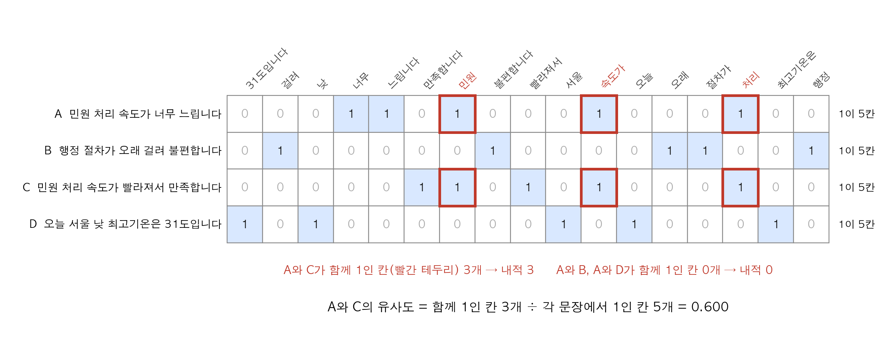
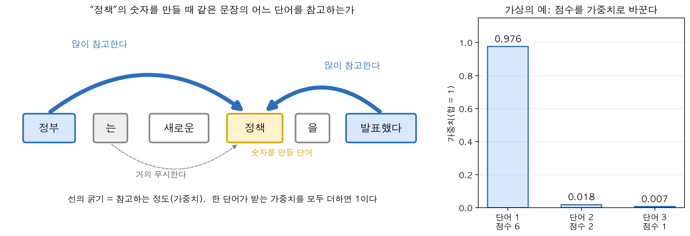
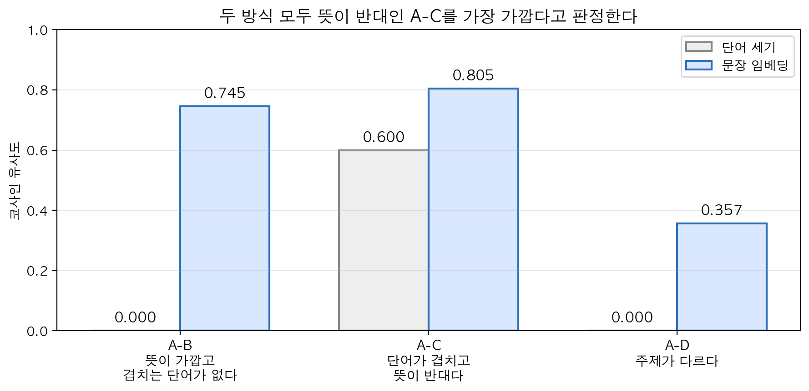
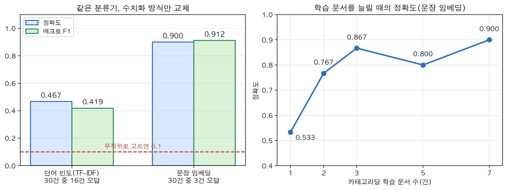
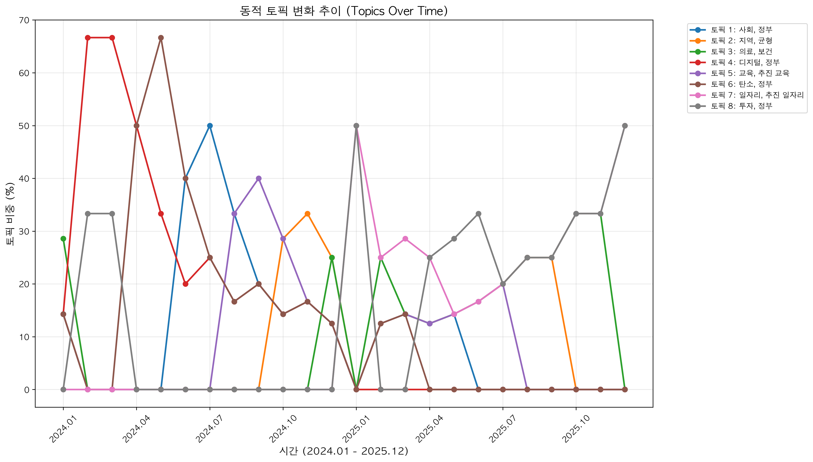
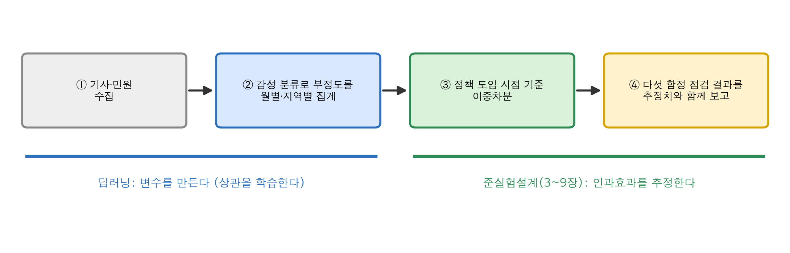

# 10장. 텍스트 분석 — 글을 인과분석의 변수로 바꾼다

## □ 이 장의 질문

○ 민원 데이터를 받아 "민원이 부정적일수록 처리 기간이 길어지는가"를 회귀로 확인하려 한다. 처리 기간은 숫자로 들어 있지만, 민원 본문은 글자다. 회귀식 `처리기간 ~ 부정도 + 통제변수`에 넣을 "부정도"라는 열이 원자료에는 없다

○ 이 장은 이 빠진 열을 만드는 방법을 배운다. 글을 숫자로 바꾸는 두 갈래(단어 세기, 임베딩)를 실습으로 비교하고, 그렇게 만든 숫자를 3~9장의 인과분석에 넣을 때 어디서 무엇이 깨지는지 판정한다

## □ 이 장을 읽는 방법


○ 용어 미리보기 — 본문에서 처음 나올 때마다 다시 풀어 설명하므로, 여기서는 눈에 익히기만 하면 된다

| 용어 | 쉬운 뜻 |
| --- | --- |
| 토큰 | 문장을 잘게 자른 조각. 단어이거나 그보다 작은 단위다 |
| 벡터화 | 글 한 편을 숫자 목록으로 바꾸는 일 |
| 단어 세기 | 어휘마다 칸을 만들어 등장 횟수를 적는 가장 단순한 벡터화 |
| TF-IDF | 단어 세기에서, 아무 문서에나 나오는 흔한 단어의 비중을 낮춘 방식 |
| 코사인 유사도 | 두 숫자 목록이 얼마나 같은 방향을 가리키는지 잰 값. 0이면 무관, 1이면 구성이 같다 |
| 임베딩 | 문장 전체의 뜻을 정해진 개수의 실수 칸으로 압축한 숫자 목록 |
| 어텐션 | 한 단어의 표현을 만들 때 같은 문장의 다른 단어를 얼마나 참고할지 정하는 가중치 |
| 사전학습 | 대량의 일반 문서로 모델을 미리 학습시켜 두는 것 |
| 미세조정 | 사전학습된 모델을 내 과제의 데이터로 추가 학습시키는 것 |
| 매크로 F1 | 카테고리마다 성능을 따로 재서 단순 평균한 값. 작은 카테고리를 놓치면 떨어진다 |
| 토픽 모델 | 라벨 없이 문서를 비슷한 것끼리 묶고 묶음마다 대표 단어를 뽑는 방법 |
| 라벨 누수 | 정답 정보가 입력에 섞여 들어가 성능이 부풀려지는 것 |

# 1부. 텍스트를 숫자로 바꾸고 문서를 분류한다

## □ 10.1 텍스트를 숫자로 바꾸는 이유와 단어 세기

○ 회귀·매칭·이중차분은 전부 숫자 열로 계산한다. 글을 숫자로 바꾸지 않으면 분석은 "민원을 읽어 보니 부정적인 것이 많더라"는 인상 보고에서 멈춘다

○ 숫자로 바꾸기 전에 문자열부터 정리한다. 원문을 그대로 세면 컴퓨터가 "민원."과 "민원", "민원을"을 전부 다른 항목으로 세기 때문이다. 이 정리 절차를 **전처리 파이프라인**이라고 부르며, 순서는 여섯 단계다

– 수집·중복 제거 → 정규화(대소문자·기호 통일) → 개인정보 마스킹 → 토큰화 → 불용어·저빈도어 처리 → 수치화

– **토큰화**는 문장을 단어 또는 더 작은 조각(**토큰**)으로 자르는 단계다

– 각 단계에서 정보를 버린다. 개인정보 마스킹에서 지역명을 지우면 지역별 차이를 볼 수 없고, 저빈도어를 지우면 새로 등장한 정책 용어가 사라진다

– 전처리는 청소가 아니라 **무엇을 버릴지 정하는 일**이다. 뒤에 쓸 변수와 관련된 정보를 버리지 않았는지 확인하고 다음 단계로 넘어간다

○ 무엇을 얼마나 버렸는지는 코드북에 기록한다. 이 실습의 민원 1,000건 코드북(`practice/chapter10/data/codebook.md`)에는 원본 평균 길이 52.37자, 전처리 후 평균 길이 43.48자, 압축률(줄어든 비율) 16.96%, 평균 토큰 수 9.21개가 적혀 있다

○ 글 한 편을 숫자 목록으로 바꾸는 일을 **벡터화**라고 부르고, 가장 단순한 벡터화가 **단어 세기**다. 절차는 세 단계다

– ① 전체 문서의 단어를 모아 어휘 사전을 만든다

– ② 단어마다 칸을 하나씩 배정한다

– ③ 문서마다 "각 칸의 단어가 몇 번 나왔는지"를 적는다

○ 실습에는 네 문장을 쓴다. A와 나머지 문장의 관계를 하나씩 보여 주도록 골라 둔 문장이다

<표 10-1: 실습에 쓰는 네 문장>

| 기호 | 문장 | A와의 관계 |
| --- | --- | --- |
| A | 민원 처리 속도가 너무 느립니다 | 기준 문장 |
| B | 행정 절차가 오래 걸려 불편합니다 | 뜻이 가깝고 겹치는 단어가 없다 |
| C | 민원 처리 속도가 빨라져서 만족합니다 | 단어가 겹치고 뜻이 반대다 |
| D | 오늘 서울 낮 최고기온은 31도입니다 | 주제가 다르다 |

○ 두 문서가 비슷한 정도는 **코사인 유사도**로 계산한다. 두 숫자 목록이 같은 방향을 가리키면 1, 겹치는 데가 없으면 0이다

○ 실습 코드(핵심 부분, 전체는 `10-1-text-to-vector.py`)

```python
cv = CountVectorizer(token_pattern=r"(?u)\b\w+\b")
counts = cv.fit_transform(SENTENCES).toarray()   # 행=문장, 열=어휘, 값=등장 횟수
sim_count = cosine_similarity(counts)            # 문장 쌍마다 유사도 하나
```

○ 실행 결과(`results/10-1-text-to-vector.log` 발췌)

```
어휘 사전 크기: 17개
문장 A의 벡터:
  [0, 0, 0, 1, 1, 0, 1, 0, 0, 0, 1, 0, 0, 0, 1, 0, 0]

손으로 확인하기 — A와 C의 코사인 유사도
  내적           = 3   (두 문장에 함께 나온 단어 수)
  A의 길이       = sqrt(5) = 2.236
  코사인 유사도  = 3 / (2.236 x 2.236) = 0.600
```

○ 로그에는 문장 A의 숫자 목록만 나온다. 네 문장의 숫자 목록을 한 줄씩 쌓으면 다음 표가 된다. 행이 문서, 열이 단어, 칸의 값이 등장 횟수인 이 표를 **문서-단어 행렬**(DTM, Document-Term Matrix)이라고 부른다



○ 그림 10-1 읽는 법

– 네 문장의 어휘가 17개이므로 모든 문장이 17칸짜리 숫자 목록이 되고, 대부분의 칸은 0이다. 한 행에서 1인 칸은 5개, 0인 칸은 12개다

– 첫 행이 로그의 "문장 A의 벡터"와 같다

– A와 C는 "민원·처리·속도가" 세 단어를 공유하므로 내적이 3이다. 그림에서 A행과 C행이 함께 1인 칸(빨간 테두리)이 3개다

– 각 문장에 단어가 5개씩이므로 유사도는 3 ÷ 5 = 0.600이다

– A행과 B행이 함께 1인 칸은 없다. 그래서 A-B 유사도는 0이다

○ 문장 쌍의 값을 모으면 단어 세기의 한계가 나타난다(로그의 4단계)

<표 10-2: 단어 세기로 계산한 유사도와 판정 결과>

| 문장 쌍 | 두 문장의 관계 | 단어 세기 유사도 | 단어 세기가 내린 판정 |
| --- | --- | --- | --- |
| A-B | 같은 불만을 말한다. 겹치는 단어가 없다 | **0.000** | "관련 없음" |
| A-C | 단어가 겹친다. 뜻이 반대다 | **0.600** | 세 쌍 중 가장 가깝다 |

– 표 10-2에서 읽을 것: 단어 세기는 뜻이 아니라 **표현**을 측정한다

○ 판정 — 자료의 종류에 따라 정한다

– 같은 내용을 다른 말로 쓰는 자료(민원·댓글)에는 단어 세기를 그대로 쓰지 않는다

– 같은 용어를 반복하는 정형 서식 자료에는 단어 세기로 충분하다. 계산이 빠르고 어느 단어가 기여했는지 바로 읽을 수 있다

**한 줄 정리: 단어 세기는 표현을 측정한다. 뜻이 같아도 단어가 다르면 0, 뜻이 반대여도 단어가 겹치면 0.600이다.**

## □ 10.2 문맥을 담은 수치화 — 임베딩과 어텐션

○ 필요한 것은 "겹치는 단어"가 아니라 "비슷한 상황"에 값을 주는 수치화다. **문장 임베딩**이 이 일을 한다. 임베딩은 문장 하나를 정해진 개수의 실수 칸으로 바꾼 것이다

<표 10-3: 단어 세기와 문장 임베딩 비교>

| 비교 항목 | 단어 세기 | 문장 임베딩 |
| --- | --- | --- |
| 칸 수 | 어휘 수만큼(네 문장에서는 17칸) | 문장 길이와 무관하게 항상 384칸(실습 모델) |
| 새 단어가 나오면 | 어휘 사전에 없는 단어는 칸이 없다 | 어휘 사전이 없으므로 칸이 늘지 않는다 |
| 칸 하나의 뜻 | 그 칸의 단어가 나온 횟수 | 사람이 읽을 뜻이 없다 |
| 같은 단어가 다른 문장에 나오면 | 어느 문장에서나 같은 칸에 1을 적는다 | 문장에 따라 결과 숫자가 달라진다 |
| 측정하는 것 | 표현 | 상황 |

– 임베딩의 칸 하나하나에는 사람이 읽을 뜻이 없다. 3번째 칸이 +0.109라고 해서 "3번 항목이 그만큼 있다"는 뜻이 아니다. 의미는 두 문장의 숫자 목록을 **비교할 때만** 나온다

○ 지도 위의 좌표와 구조가 같다. 서울의 좌표 숫자 자체로는 도시의 성격을 알 수 없지만, 두 도시의 좌표로 거리를 계산하면 가깝다는 사실이 나온다

<표 10-4: 지도와 임베딩의 대응>

| 지도 | 임베딩 |
| --- | --- |
| 지도 위 한 지점 | 문장 하나 |
| 두 지점이 가깝다 | 두 문장의 뜻이 비슷하다 |
| 좌표축 | 384칸 |
| 축에 동서·남북이라는 이름이 있다 | 384개 축에는 이름이 없다(대응이 끝나는 곳) |

○ 임베딩이 문맥을 담는 이유는 모델 내부의 **어텐션** 계산에 있다. 어텐션은 한 단어의 표현을 만들 때 같은 문장의 다른 단어를 얼마나 참고할지 정하는 가중치다



○ 그림 10-2 읽는 법

– 왼쪽: "정부는 새로운 정책을 발표했다"에서 "정책"의 표현을 만들 때, 모델은 "정부"와 "발표"를 많이 참고하고 조사 "는"은 거의 무시한다. 선의 굵기는 참고하는 정도를 나타낸 개념도이고 측정값이 아니다

– 계산은 세 단계다. ① 단어 쌍마다 관련 점수를 낸다 → ② 점수가 지나치게 커지지 않게 일정한 수로 나눈다 → ③ 합이 1이 되는 가중치로 바꾼다

– 오른쪽(가상의 수치다): 세 단어에 대한 ②단계 점수가 [6, 2, 1]이면 ③단계 가중치는 [0.976, 0.018, 0.007]이다. 첫 단어에 98% 가까이 몰린다

– 같은 단어라도 문장이 바뀌면 숫자가 달라진다. 단어 세기는 "처리"를 어느 문장에서나 같은 칸의 1로 적지만, 임베딩 모델은 주변 단어를 섞어 숫자를 만들기 때문이다. 문장 A와 C에서 "처리"의 숫자 목록은 서로 다르다(유사도 0.923)

– 문장 임베딩은 단어 조각마다 만든 숫자 목록을 칸별로 평균한 값이다. 그래서 단어가 겹치지 않아도 문맥이 비슷하면 두 문장의 숫자가 가까워질 수 있다

○ 실습 코드(핵심 부분, 전체는 `10-1-text-to-vector.py`)

```python
model = SentenceTransformer("paraphrase-multilingual-MiniLM-L12-v2")
emb = model.encode(SENTENCES, show_progress_bar=False)   # (4, 384): 문장 수 x 칸 수
sim_emb = cosine_similarity(emb)
```

○ 실행 결과(`results/10-1-text-to-vector.log` 발췌)

```
문장 쌍  단어 세기  문장 임베딩          두 문장의 관계
 A-B    0.0   0.745 뜻이 가깝고 겹치는 단어가 없다
 A-C    0.6   0.805    단어가 겹치고 뜻이 반대다
 A-D    0.0   0.357           주제가 다르다
```



○ 그림 10-3 읽는 법 — 회색 막대가 단어 세기, 파란 막대가 문장 임베딩이다

– A-B: 0.000 → **0.745**. 겹치는 단어가 하나도 없는데 값이 나왔다. 임베딩이 표현이 아니라 상황을 측정한다는 증거다. 표현이 제각각인 민원·댓글 자료에 임베딩을 쓰는 이유가 이 값이다

– A-D: **0.357**. 주제가 전혀 다른 문장에도 0이 아닌 값이 나온다. 임베딩 유사도에는 절대 기준이 없으므로 "0.357이면 관련 있다"고 읽지 않는다. 임계값은 항상 같은 데이터 안에서 상대적으로 정한다

– A-C: **0.805**. 뜻이 정반대인 두 문장이 여전히 가장 높다. 임베딩으로 "무엇에 관한 글인가"는 측정할 수 있지만 "찬성인가 반대인가"는 측정할 수 없다

○ 판정 — 측정하려는 것에 따라 도구를 나눈다

– 같은 주제의 문서를 묶을 때는 임베딩 유사도를 쓴다

– 찬반·만족도·감성을 측정할 때는 유사도로 대신하지 않고 감성 분류를 따로 돌린다

– 이유: A-C가 A-B보다 높은 이상, 유사도를 감성의 대리 변수로 쓰면 부호가 뒤집힌 변수를 회귀식에 넣게 된다

**한 줄 정리: 임베딩은 상황을 측정하지만 찬반은 측정하지 못한다. 두 방식 모두 뜻이 반대인 A-C를 가장 가깝다고 판정했다.**

## □ 10.3 한국어 모델 고르기

○ 임베딩·분류에 쓸 모델은 처음부터 만들지 않는다. 두 단계로 준비한다

– **사전학습**: 누군가 대량의 일반 문서로 미리 학습시켜 둔 모델을 받는다

– **미세조정**: 받은 모델을 내 과제 데이터로 추가 학습시킨다

○ 한국어 문서에는 어떤 사전학습 모델을 고를지가 문제다

– 한국어는 "먹다"가 "먹는다·먹었다·먹겠다"로 변하는 동안 어간은 그대로이고 뒤 조각만 바뀌는 언어다. 영어 기준으로 토큰을 자른 모델은 이 규칙성을 담지 못한다

– 기존 강의자료의 이전 실행값으로는, "검토하겠습니다"와 "추진하겠습니다"류의 구분에서 한국어 전용 모델이 87%, 다국어 모델이 72%였다. 15%p 차이는 문서 100건 중 15건이 반대로 분류된다는 뜻이다

○ 실습 코드(핵심 부분, 전체는 `10-3-korean-model-comparison.py`) — 이 스크립트는 후보 모델의 제원과 공개 성적표를 표로 정리해 출력한다

```python
models_info = pd.DataFrame({
    '모델명':   ['KoBERT', 'KLUE BERT', 'KcELECTRA', 'HyperCLOVA X', 'EXAONE'],
    '학습 데이터': ['5GB',   '62GB',      '34GB',      '대규모',       '대규모'],
    '파라미터': ['110M',    '110M',      '110M',      '82B+',        '7.8B+'],
    '공개 여부': ['공개',    '공개',      '공개',      'API',         'API']})
```

○ 실행 결과(`results/10-3-korean-model-comparison.log` 발췌 — 스크립트에 정리된 공개 벤치마크 수치이며, 이 컴퓨터에서 측정한 값이 아니다)

```
       태스크 KoBERT KLUE BERT KcELECTRA 인간 성능
 문장 분류 (TC)   87.2      89.5      88.9     92.3
관계 추출 (RE)    72.8      75.2      74.1     82.5
```

○ 먼저 다섯 모델을 쓰는 방법으로 나눈다

<표 10-5: 공개 모델과 API 모델>

| 구분 | 모델 | 쓰는 방법 | 외부로 내보낼 수 없는 자료(민원 원문 등) |
| --- | --- | --- | --- |
| 공개 | KoBERT, KLUE BERT, KcELECTRA | 가중치를 내 서버에 내려받아 쓴다 | 후보가 된다 |
| API | HyperCLOVA X, EXAONE | API로만 접근한다 | 후보가 되지 못한다 |

– 이 구분은 성능이 아니라 **데이터 통제권**의 문제다

○ 벤치마크 표에서 볼 것은 절대 점수가 아니라 **사람과의 격차**다

<표 10-6: 과제별 사람과의 격차 (KLUE BERT 기준)>

| 과제 | KLUE BERT | 사람 | 격차 | 읽는 법 |
| --- | --- | --- | --- | --- |
| 문장 분류 | 89.5 | 92.3 | 2.8점 | 자동 분류를 검토용 초안으로 쓸 수 있는 수준이다 |
| 관계 추출 | 75.2 | 82.5 | 7.3점 | 자동 출력을 인과분석의 입력으로 쓰면 오차가 다음 단계로 넘어간다 |

– 관계 추출은 "탄소 중립 정책이 재생에너지 투자를 촉진한다" 같은 인과 진술을 뽑는 과제다. 격차가 큰 출력을 그대로 쓰면 안 되는 이유가 여기에 있다

– 판정 기준(이 책의 관행): 사람과의 격차가 3점 이내면 자동 처리 후 표본을 검토한다. 5점을 넘으면 자동 출력을 최종값으로 쓰지 않는다

○ 같은 로그에는 정책 문서 분류 비교(시뮬레이션 표기)도 있다

<표 10-7: 정책 문서 분류 비교 (시뮬레이션 표기)>

| 모델 | 정확도 | 파라미터 | 학습 데이터 |
| --- | --- | --- | --- |
| KLUE BERT | 88.5% | 110M | 62GB |
| KoBERT | 87.2% | 110M | 5GB |
| KcELECTRA | 86.9% | 110M | 34GB |

– 1위와 3위의 차이가 1.6%p다. 문서 100건 중 두 건 차이이므로 이 격차만 보고 모델을 바꾸지 않는다

– 세 모델은 파라미터가 110M으로 같고 학습 데이터가 5GB에서 62GB까지 열두 배 차이 난다. 격차의 원인은 규모가 아니라 데이터 양이다

○ 모델은 다음 순서로 고른다. 공개 순위만 보고 정하지 않는다

<표 10-8: 모델 선택 순서>

| 순서 | 확인할 것 | 정해지는 것 |
| --- | --- | --- |
| ① | 데이터를 외부로 보낼 수 있는가 | 공개 모델 후보군인지 API 모델 후보군인지 |
| ② | 내 데이터 수백 건으로 두세 모델을 직접 비교한다 | 내 데이터에서 성능이 높은 모델 |
| ③ | 추론 속도·GPU 요구량이 운영 환경에 맞는가 | 실제로 운영할 수 있는 모델 |

**한 줄 정리: 모델은 순위표가 아니라 데이터 통제권 → 내 데이터 성능 → 운영 환경 순으로 고른다.**

## □ 10.4 문서 분류와 감성 분석

○ 분류는 텍스트에서 변수를 만드는 가장 직접적인 방법이다

– 문서에 카테고리를 붙이면 범주형 변수가 생긴다

– 문서에 감성 라벨을 붙이면 순서형 변수가 생긴다

– 뒤의 인과분석은 전부 이 변수로 계산한다

○ 이 절의 실습 과제는 정책 문서 한 건의 본문만 보고 그 문서가 어느 정책 분야의 글인지 맞히는 것이다

– 카테고리는 정책 분야 열 개다: 디지털·경제·환경·보건·고용·교육·과학기술·지역개발·보안·농업 정책

– 예: "정부는 탄소중립 달성을 위해 재생에너지 확대와 에너지 효율 개선 정책을 추진한다"로 시작하는 문서의 정답은 환경정책이다

– 정답은 CSV의 `카테고리` 열에 적혀 있다. 100건 중 70건으로 분류기를 학습시키고, 나머지 30건에서 분류기가 맞힌 비율을 계산한다

○ 실습 데이터(`data/policy_sample_data.csv`)

<표 10-9: 실습 데이터 정책 문서의 구성>

| 항목 | 값 |
| --- | --- |
| 문서 수 | 100건 |
| 카테고리 수 | 10개 |
| 카테고리당 문서 수 | 5~15건(치우쳐 있다) |
| 문서 길이 | 평균 133자(최소 109, 최대 190) |

○ 실험 설계를 한 가지로 고정한다. 분류기는 로지스틱 회귀 하나로 두고 **수치화 방식만 바꿔 넣는다**. 달라진 것이 수치화뿐이므로 정확도 차이는 수치화의 차이로 해석할 수 있다

○ 평가 지표는 둘이다

<표 10-10: 평가 지표 둘>

| 지표 | 계산 방법 | 특징 |
| --- | --- | --- |
| **정확도** | 맞힌 건수 ÷ 전체 건수 | 문서가 많은 카테고리만 잘 맞혀도 오른다 |
| **매크로 F1** | 카테고리마다 성능을 따로 계산해 단순 평균한다 | 문서가 많은 카테고리만 잘 맞히면 오르지 않는다 |

– 두 값이 벌어지면 작은 카테고리를 놓치고 있다는 신호다

○ 실습 코드(핵심 부분, 전체는 `10-2-document-classification.py`)

```python
X_tr_txt, X_te_txt, y_tr, y_te = train_test_split(
    docs, labels, test_size=0.3, random_state=SEED, stratify=labels)  # 층화 70:30

tfidf = TfidfVectorizer(token_pattern=r"(?u)\b\w+\b")     # 수치화 1: 단어 빈도
Xtr_tf = tfidf.fit_transform(X_tr_txt)
clf_tf = LogisticRegression(max_iter=2000, random_state=SEED)
clf_tf.fit(Xtr_tf, y_tr)

Xtr_em = model.encode(X_tr_txt, show_progress_bar=False)  # 수치화 2: 문장 임베딩
```

○ 실행 결과(`results/10-2-document-classification.log` 발췌)

```
       수치화 방식  열 개수   정확도  매크로 F1  틀린 건수
단어 빈도(TF-IDF)  1022 0.467   0.419     16
       문장 임베딩   384 0.900   0.912      3
```



○ 그림 10-4 왼쪽 읽는 법

– 빨간 점선이 기준이다. 카테고리가 10개이므로 아무렇게나 고르면 정확도가 0.1이다

– 단어 빈도의 0.467도 무작위보다는 높다. 그러나 평가 30건 중 16건이 틀렸으므로, 이 결과를 행정 배분에 쓰면 열여섯 건이 엉뚱한 부서로 간다

– 같은 분류기에서 수치화만 임베딩으로 바꾸자 0.467 → **0.900**이 됐다. 이 데이터의 문서들이 같은 내용을 서로 다른 표현으로 쓰고 있어서, 10.1에서 본 단어 세기의 약점이 정확도 하락으로 나타났다

– 두 방식 모두 매크로 F1이 정확도와 붙어 있다(0.419/0.467, 0.912/0.900). 특정 카테고리만 몰아서 맞히는 상태는 아니다

○ 어디서 틀렸는지도 본다. 임베딩 기준 오답 3건은 경제→과학기술, 환경→과학기술, 과학기술→경제다. 전부 R&D·기술 키워드를 공유하는 경계에 몰려 있다

– 판정: 오분류가 특정 쌍에 몰리면 모델을 바꾸기 전에 **카테고리 정의부터 손본다**

– 이유: "친환경 기술 R&D" 문서를 환경에 넣을지 과학기술에 넣을지 사람도 갈린다면, 모델을 바꿔도 그 경계는 맞지 않는다. 두 카테고리를 합치거나 복수 라벨을 허용하는 편이 낫다

○ 그림 10-4 오른쪽 읽는 법 — 로그의 6단계다. 카테고리당 학습 문서를 1, 2, 3, 5, 7건으로 바꿔 가며 정확도를 다시 계산했다

– 값은 0.533 → 0.767 → 0.867 → 0.800 → 0.900이다. 3건 부근부터 상승이 완만해진다

– 이 곡선이 평평해지면 라벨을 더 붙여도 얻는 것이 적다. 계속 오르면 라벨링에 투자할 가치가 있다

○ **감성 분석**은 문서에 긍정·중립·부정을 붙이는 작업이다. 이 장 첫머리의 질문("민원이 부정적일수록 처리 기간이 길어지는가")에 답하려면 민원마다 감성 라벨이 있어야 하고, 그 라벨을 세어 만든 **부정 비율**이 2부에서 변수로 쓰인다. 방법은 두 가지다

– 사전 방식: 사람이 긍정 단어 목록과 부정 단어 목록을 미리 적어 두고, 문장에 든 단어를 세어 많은 쪽으로 판정한다. 두 수가 같거나 둘 다 0이면 중립이다. 학습한 모델이 없다

– 분류기 방식: 정답 라벨이 붙은 문장으로 분류기를 학습시킨다. 앞의 정책 분야 분류와 절차가 같고, 카테고리가 긍정·중립·부정으로 바뀐다

○ 실습 데이터: `practice/chapter10/data/complaint_sentiment_sample.csv`

– 민원 문장 120건이다. 긍정 40건, 중립 40건, 부정 40건이며, 중립은 "주민등록등본 발급에 필요한 서류를 문의합니다" 같은 문의·신고 문장이다

– 84건으로 분류기를 학습시키고, 나머지 36건(평가 문장)에 두 방식으로 라벨을 붙여 정답과 대조한다

○ 실습 코드(핵심 부분, 전체는 `10-4b-sentiment-variable.py`)

```python
# 사전 방식: 단어 목록 대조
positive_words = ["만족", "감사", "고맙", "친절", "좋", "편리", "편해", "깨끗", "안전", "도움"]
negative_words = ["불편", "불친절", "느립", "늦", "실망", "걱정", "고장", "악취", "않습니다", "없습니다"]
pos = sum(w in text for w in positive_words)
neg = sum(w in text for w in negative_words)        # 많은 쪽으로 판정, 같으면 중립

# 분류기 방식: 문장 임베딩 + 로지스틱 회귀
X_tr = model.encode(X_tr_txt)                        # 문장 하나 = 숫자 384개
clf = LogisticRegression(max_iter=2000, random_state=SEED).fit(X_tr, y_tr)
pred_clf = clf.predict(model.encode(X_te_txt))

kappa = cohen_kappa_score(y_te, pred_clf)            # 정답 라벨과 대조
```

○ 실행 결과(`results/10-4b-sentiment-variable.log` 발췌)

```
방법             정확도     매크로 F1     카파(κ)
사전             0.583       0.571      0.375
분류기            0.861       0.861      0.792

정답 라벨   : 부정 12건 / 36건 = 33.3%
사전 판정   : 부정 7건 / 36건 = 19.4%
분류기 판정  : 부정 11건 / 36건 = 30.6%
```

○ 결과 읽는 법

– 정확도: 평가 문장 36건 중 사전 방식은 21건, 분류기 방식은 31건을 맞혔다

– 카파(κ)는 우연히 맞은 몫을 빼고 계산한 일치도다. 1이면 정답과 완전히 일치하고 0이면 우연 수준이다. 판정 기준은 2부 10.6의 표에 있다

– 부정 비율: 정답 기준으로는 33.3%인데 사전 방식으로 만들면 19.4%, 분류기 방식으로 만들면 30.6%가 된다. 같은 문장 36건인데 라벨을 붙인 방법에 따라 변수의 값이 달라진다

○ 두 방식이 틀린 문장을 따로 본다

<표 10-11: 두 방식이 틀린 문장의 예>

| 문장 | 정답 | 판정 | 틀린 이유 |
| --- | --- | --- | --- |
| 직원은 친절했지만 결국 문제는 해결되지 않았습니다 | 부정 | 사전: 긍정 | '친절' 하나만 세었다. '해결되지 않았습니다'는 목록에 없다 |
| 같은 서류를 세 번이나 다시 내라고 합니다 | 부정 | 사전: 중립 | 목록에 든 단어가 하나도 없다 |
| 가로등 고장을 신고합니다. 위치는 중앙로 12번지 앞입니다 | 중립 | 사전: 부정 | 신고 문장인데 '고장'을 부정 단어로 세었다 |
| 홈페이지에서 필요한 서식을 찾을 수가 없습니다 | 부정 | 분류기: 중립 | 스크립트는 이유를 출력하지 않는다. 문의 문장과 낱말이 겹친다는 점만 확인된다 |

– 사전 방식이 틀린 15건 가운데 13건은 긍정·부정 문장을 중립으로 판정한 것이다. 목록에 없는 표현을 쓴 문장은 모두 중립이 되므로 부정 비율이 실제보다 낮게 나온다

– 분류기 방식은 5건을 틀렸고 그중 4건이 중립 판정이다

– 판정: 2부 10.6의 기준으로 보면 사전 방식(κ 0.375)은 0.6 미만이므로 이 부정 비율을 회귀식에 넣지 않는다. 분류기 방식(κ 0.792)은 0.6~0.8 구간이므로 라벨을 둘로 줄이거나 보정값을 함께 적는다

– 실제 연구에서는 정답이 없다. 그래서 문장 일부를 뽑아 사람이 라벨을 붙이고, 이 실습의 정답 자리에 그 라벨을 놓고 같은 대조를 한다. 대조 없이 만든 비율을 100% 정확한 변수처럼 쓰는 것이 이 장에서 가장 자주 일어나는 오류다

**한 줄 정리: 같은 분류기라도 수치화가 정확도를 0.467에서 0.900으로 바꾼다. 감성 라벨로 만든 부정 비율은 붙인 방법에 따라 19.4%에서 30.6%까지 달라진다(정답 33.3%).**

## □ 1부 정리

○ 지금까지 만든 것 세 가지

| 만든 것 | 핵심 수치 |
| --- | --- |
| 네 문장의 두 가지 유사도 표 | A-B에 단어 세기는 0.000, 임베딩은 0.745 |
| 정책 문서 100건의 분류 결과표 | 단어 빈도 0.467 대 임베딩 0.900 |
| 민원 문장 36건의 부정 비율 | 정답 33.3%, 사전 방식 19.4%, 분류기 방식 30.6% |

○ 확인한 판정 기준

– 단어가 겹치지 않아도 뜻이 같은 문서가 많은 자료면 단어 세기를 쓰지 않는다

– 유사도는 감성의 대리 변수가 아니다. 두 방식 모두 뜻이 반대인 쌍을 가장 가깝다고 판정했다

– 정확도와 매크로 F1을 함께 보고, 오분류가 몰린 쌍이 있으면 모델보다 카테고리 정의를 먼저 고친다

○ 2부로 넘길 질문: 유사도·요약·토픽으로 지표를 더 뽑을 수 있는가. 그 숫자를 회귀식에 넣어도 되는가. 넣는다면 무엇을 함께 보고해야 하는가

# 2부. 텍스트 지표를 인과분석 변수로 옮긴다

## □ 2부 개요

○ 이 파트가 끝나면: 유사도·요약·토픽 출력을 임계값으로 판정할 수 있고, 텍스트에서 뽑은 변수를 회귀식에 넣기 전에 확인할 다섯 함정의 점검표를 갖는다

○ 다루는 절: 10.5 ~ 10.7

| 절 | 답하는 질문 | 손에 넣는 것 |
| --- | --- | --- |
| 10.5 | 유사도·요약·토픽으로 지표를 더 뽑을 수 있는가 | 세 도구의 판정 기준 |
| 10.6 | 그 숫자를 회귀식에 넣어도 되는가 | 다섯 함정의 확인 절차 |
| 10.7 | 넣는다면 어느 자리에 놓고 무엇을 함께 보고하는가 | 자리별 요구 수준과 보고할 한계 |

## □ 10.5 유사도·요약·토픽 모델링

○ **유사도로 중복을 찾는다.** 새 정책 제안이 기존 정책과 겹치는지 보려면 세 단계를 밟는다

– ① 문서를 벡터로 바꾼다

– ② 문서 쌍마다 코사인 유사도를 계산한다

– ③ 임계값을 넘는 쌍만 사람이 검토한다

○ 실습 코드(핵심 부분, 전체는 `10-4-policy-analysis-suite.py`)

```python
vec = TfidfVectorizer()
vectors = vec.fit_transform(sample_texts)
similarity_matrix = cosine_similarity(vectors)
if sim > 0.1:   # 임계값을 넘는 쌍만 출력
```

○ 실행 결과(`results/10-4-policy-analysis-suite.log` 발췌)

```
정책 간 코사인 유사도:
  디지털정책 <-> 디지털정책: 1.000
  디지털정책 <-> 디지털정책: 1.000
```

– 해석: 유사도 1.000은 단어 구성이 완전히 같다는 뜻이다. 이 실습 문서들은 같은 틀 문장으로 생성한 모의 자료라서 사실상 동일 문서 쌍이 걸렸다

– 실제 자료에서 1.000 근처의 쌍이 나오면 중복 수집을 의심하고, 10.1의 전처리 1단계(중복 제거)로 돌아간다

○ 판정 — 임계값을 쓰는 법

– 임계값은 통합을 확정하는 선이 아니라 **사람이 검토할 후보를 추리는 선**으로 쓴다

– 임계값을 올리면 헛검토가 줄지만 실제 중복을 놓친다. 놓치는 비용과 헛검토 비용 중 어느 쪽이 큰지에 따라 임계값을 옮긴다

– 10.2에서 본 대로 유사도에는 절대 기준이 없으므로 임계값은 이 데이터 안에서 정한다

○ **요약**은 두 갈래다

<표 10-12: 요약의 두 갈래>

| 비교 항목 | 추출적 요약 | 생성적 요약 |
| --- | --- | --- |
| 만드는 방법 | 원문 문장 중 중요한 것을 골라 이어 붙인다 | 원문을 읽고 새 문장을 만든다 |
| 장점 | 원문 문장을 그대로 두므로 사실이 바뀌지 않는다 | 사람이 읽는 초안 용도면 시간을 아껴 준다 |
| 약점 | 문장 사이의 연결이 어색하다 | 원문에 없는 문장이 섞인다 |

○ 실습 코드(핵심 부분 — 추출적 요약, 전체는 `10-4-policy-analysis-suite.py`)

```python
keywords = ['정책', '예산', '지원', '추진']
score = len(sent) / 50                              # 길이 점수
score += sum(2 for kw in keywords if kw in sent)    # 키워드 점수
top_indices = np.argsort(scores)[-2:]               # 점수 상위 2개 문장을 뽑는다
```

– 실행하면 다섯 문장짜리 정책문에서 예산·추진 일정을 담은 두 문장이 뽑힌다(로그 4단계)

– 생성적 요약의 품질은 사람 요약과의 겹침(ROUGE)으로 측정한다. 기존 강의자료의 이전 실행값은 ROUGE-L 0.42였다. "사람 요약과 절반 못 미치게 겹친다"는 뜻이지 "42% 맞다"는 뜻이 아니다

– 판정: 요약 결과에서 다시 변수를 뽑을 계획이면 생성적 요약을 쓰지 않는다. 원문에 없는 문장이 섞인 뒤 지표를 뽑으면 측정 대상이 문서가 아니라 모델의 출력이 된다

○ **토픽 모델링**은 라벨 없이 문서를 묶고 묶음마다 대표 단어를 뽑는다

– 10.4의 분류는 카테고리 목록이 먼저 있어야 돌아간다. 새 자료를 처음 볼 때는 그 목록 자체를 모르므로 토픽 모델링을 쓴다

○ 실무 표준인 BERTopic은 네 단계로 이 일을 한다

<표 10-13: BERTopic의 네 단계>

| 단계 | 하는 일 |
| --- | --- |
| ① | 문서를 임베딩으로 바꾼다 |
| ② | 차원을 줄인다 |
| ③ | 밀도가 높은 곳끼리 묶는다. 어디에도 안 속하는 문서는 잡음으로 남긴다 |
| ④ | 묶음별 대표 단어를 뽑는다 |

– 옛 방식(LDA)과 달리 임베딩을 쓰므로 동음이의어를 구분하고, 토픽 개수를 미리 정해 넣지 않아도 된다

– 실습 스크립트는 대형 모델 없이 구조를 보여 주는 간소화 버전(단어 세기 + K-평균 군집)이다

○ 실습 코드(핵심 부분, 전체는 `10-5-bertopic-advanced.py`)

```python
vectorizer = CountVectorizer(max_features=50, ngram_range=(1, 2))
doc_vectors = vectorizer.fit_transform(df['document'])
kmeans = KMeans(n_clusters=8, random_state=42)          # 문서 120건을 8묶음으로
cluster_labels = kmeans.fit_predict(doc_vectors)
top_indices = center.argsort()[-5:][::-1]               # 묶음별 상위 5개 키워드
```

○ 실행 결과(`results/10-5-bertopic-advanced.log` 발췌)

```
토픽 3 (15개 문서): 지역, 균형, 지역 균형, 추진한다 지역, 추진한다
토픽 4 (15개 문서): 디지털, 전환 분야, 추진한다, 도모한다, 디지털 전환

유사한 토픽 쌍 (유사도 > 0.3):
  토픽 2 <-> 토픽 8 (투자, 발전을): 0.677
```

○ 결과 읽는 법

– 토픽 4는 "디지털, 전환"이라는 내용어가 잡혀 하나의 주제로 읽힌다

– 그런데 대표 키워드에 "추진한다·도모한다·정부는" 같은 서술 어구가 섞여 있다. 모든 문서가 공유하는 틀 문장을 불용어 처리(전처리 5단계)로 거르지 않았기 때문이다. 이런 단어가 상위에 오르면 토픽 해석보다 전처리로 먼저 돌아간다

– 로그의 토픽 간 유사도는 0.520~0.677로 전부 0.3을 넘는다. 묶음들이 서로 충분히 갈라지지 않았다는 신호다

○ 판정 기준 — 토픽을 변수로 쓰기 전 세 가지를 확인한다

<표 10-14: 토픽을 변수로 쓰기 전 확인할 세 가지>

| 번호 | 확인할 것 |
| --- | --- |
| ① | 대표 키워드를 사람이 읽어 하나의 주제로 이름 붙일 수 있는가 |
| ② | 특정 토픽만 응집도(평균 확률)가 낮아 다른 토픽과 겹치지 않는가 |
| ③ | 어디에도 안 묶인 잡음 문서의 비율이 과도하지 않은가 |

– 하나라도 어긋나면 토픽 번호를 변수로 넣지 않고 사람이 정의한 카테고리로 돌아간다

○ 문서에 날짜가 있으면 토픽 비중의 시간 변화를 추적할 수 있다. 이번 실행에서 2024.01과 2025.10을 비교하면 토픽 2가 28.6% → 33.3%로 오르고 토픽 1·3·4·5는 0%로 떨어졌다(로그 4단계)



○ 그림 10-5 읽는 법

– 가로축은 2024.01~2025.12의 월, 세로축은 그달 문서 중 각 토픽의 비중(%)이다. 색깔 선 하나가 토픽 하나다

– 선들이 0%와 67% 사이를 급하게 오르내린다. 월별 문서가 몇 건 안 되어 한 건만 늘어도 비중이 수십 %p 뛰기 때문이다

– 비중 곡선을 읽기 전에 분모(그달의 문서 건수)부터 확인한다

○ 비중 변화를 해석할 때 한 번 멈춘다. 비중은 합이 100%라서 **한 토픽이 오르면 다른 토픽은 자동으로 내려간다**

– 예를 들어 어떤 토픽이 12%에서 10%로 내려갔다면 해석이 둘이다. 그 주제의 문서가 실제로 줄었을 수도 있고(줄었다), 다른 주제의 문서가 늘어 몫이 밀렸을 수도 있다(밀렸다). 두 해석은 다른 데이터다

– 판정: 비중 변화를 근거로 쓰려면 절대 건수를 함께 보고한다. 건수가 있어야 "줄었다"와 "밀렸다"를 구분할 수 있다

**한 줄 정리: 유사도 1.000은 중복 신호, 토픽 키워드에 서술 어구가 오르면 전처리로 돌아가고, 비중 곡선은 분모와 함께 읽는다.**

## □ 10.6 통합 파이프라인과 텍스트 변수의 다섯 함정

○ 앞의 도구를 하나로 잇는다. 문서가 들어오면 다음 순서로 처리한다

<표 10-15: 통합 파이프라인의 네 단계>

| 순서 | 도구 | 하는 일 |
| --- | --- | --- |
| ① | 분류 | 카테고리를 붙인다 |
| ② | 유사도 | 중복을 확인한다 |
| ③ | 요약 | 문서를 줄인다 |
| ④ | 토픽 | 전체 지형을 본다 |

○ 실습 코드(핵심 부분, 전체는 `policy_analysis_complete.py`)

```python
df = pd.read_csv(data_path)                       # data/policy_sample_data.csv
X_train, X_test, y_train, y_test = train_test_split(
    df['정책문서'], df['카테고리'],
    test_size=0.3, random_state=42, stratify=df['카테고리'])
vectorizer = TfidfVectorizer(max_features=500)
classifier = LogisticRegression(max_iter=1000, random_state=42)
```

○ 실행 결과(`results/policy_analysis_complete.log` 발췌)

```
정확도 (Accuracy): 56.7%
F1 Score: 0.534
오분류 사례:
  보건정책 → 디지털정책: 2건
  농업정책 → 지역개발정책: 1건
```

– 해석: 같은 100건을 TF-IDF로 분류한 정확도가 56.7%로, 10.4의 임베딩(90.0%)과 다시 크게 벌어진다

– 오분류에는 문서가 5건뿐인 농업정책이 끼어 있다. 작은 카테고리는 학습 자료 자체가 부족해서 먼저 무너진다

○ 여기까지가 변수를 뽑는 과정이다. 이 변수를 회귀식에 넣기 전에 다섯 가지를 확인한다

<표 10-16: 텍스트 변수의 다섯 함정 한눈에 보기>

| 함정 | 무슨 일이 생기는가 | 확인하는 방법 |
| --- | --- | --- |
| 1. 측정오차와 감쇠 | 분류기가 만든 열에 오차가 들어 있다 | 사람 라벨과 대조해 카파(κ)를 계산한다 |
| 2. 순환성 | 같은 문서에서 처치와 결과를 뽑으면 상관이 자동으로 생긴다 | 처치 문서와 결과 문서의 교집합을 센다 |
| 3. 라벨 누수 | 입력에 정답이 들어 있어 성능이 부풀려진다 | 분류에 크게 기여한 상위 단어 20개를 출력한다 |
| 4. 시점 표류 | 측정 도구가 전후에 달라 도구 교체 효과가 섞인다 | 전 기간을 하나의 모델·버전·설정으로 재처리한다 |
| 5. 텍스트가 있는 사람만 관측 | 글을 쓰지 않은 사람이 표본에서 빠진다 | 텍스트가 있는 집단과 없는 집단의 특성을 비교한다 |

○ **함정 1 — 측정오차와 감쇠.** 분류기가 만든 열에는 오차가 들어 있다. 10.4 실습의 감성 분류기는 평가 문장 36건 중 31건을 맞혔다(정확도 0.861). 부정도 열의 값 일곱 건 중 한 건 정도가 틀렸다는 뜻이다

<표 10-17: 오차 섞인 변수를 놓은 자리에 따른 결과>

| 오차 섞인 변수의 자리 | 추정 계수 | 표준오차 |
| --- | --- | --- |
| **설명변수** | 0 쪽으로 당겨진다(감쇠 편향) | (이 절에서 다루지 않는다) |
| **결과변수** | 그대로다 | 커진다 |

– 같은 지표라도 식의 어느 쪽에 놓았는지에 따라 위험이 다르므로 자리부터 확인한다

– 확인 절차: 평가 표본에 사람이 직접 라벨을 붙여 모델 출력과 대조한다

– 단순 일치율은 라벨 분포가 치우치면 부풀려진다. 부정이 90%인 자료에서 전부 "부정"으로 답해도 일치율이 0.90이다. 그래서 우연 일치를 뺀 일치도인 카파(κ)를 함께 본다

<표 10-18: 카파(κ) 값에 따른 판정 (이 책의 관행)>

| 카파(κ) 값 | 판정 |
| --- | --- |
| 0.8 이상 | 정확도를 보고서에 적고 변수로 쓴다 |
| 0.6~0.8 | 라벨을 둘로 줄여 오차를 줄이거나 보정값을 병기한다 |
| 0.6 미만 | 회귀식에 넣지 않는다. 0으로 당겨진 계수를 "효과가 없다"로 읽게 되기 때문이다 |

– 검증 표본은 카테고리당 50건을 기준으로 잡는다. 이 실습의 농업정책처럼 5건뿐인 카테고리는 정확도를 애초에 측정할 수 없다는 사실을 그대로 적는다

○ **함정 2 — 순환성.** 같은 문서에서 처치와 결과를 동시에 뽑으면 상관은 자동으로 생긴다

– 예: 정책 도입 여부를 보도자료에서 뽑고 효과도 같은 보도자료의 긍정 어휘로 측정하면, 문서의 문체 하나가 두 변수를 함께 움직인다. 그 계수는 정책 효과가 아니라 문체의 상관이다

– 확인: 처치를 만든 문서 집합과 결과를 만든 문서 집합의 교집합을 센다

– 판정: 교집합이 0이 아니면 겹치는 부분을 떼거나, 결과변수를 행정 기록처럼 텍스트 밖에서 가져온다. 처치는 정부 문서, 결과는 민원·언론처럼 다른 주체의 글로 나누는 구성이 안전하다

○ **함정 3 — 라벨 누수.** 입력에 정답이 들어 있으면 성능이 부풀려진다. 이번 실행에서 실제로 확인할 수 있다

○ 실습 코드(핵심 부분, 전체는 `10-1-nlp-comparison.py` — 옛 버전 스크립트를 교보재로 남겨 둔 것이다)

```python
text = f"정부는 {np.random.choice(keywords)}를 통해 {category} 정책을 추진한다. "
# 카테고리 이름이 본문에 그대로 들어 있다 → 정답이 입력에 적혀 있다
```

○ 실행 결과(`results/10-1-nlp-comparison.log` 발췌)

```
[2단계] TF-IDF + Naive Bayes
정확도: 1.000
[3단계] TF-IDF + SVM
정확도: 1.000
```

<표 10-19: 같은 TF-IDF의 정확도 — 정답이 적힌 자료와 진짜 문서>

| 자료 | TF-IDF 정확도 | 이유 |
| --- | --- | --- |
| 카테고리 이름을 본문에 적어 넣은 문장 | 1.000 | 정답이 입력에 적혀 있다 |
| 진짜 문서(10.4) | 0.467 | 정답이 입력에 없다 |

– 해석: 정확도 100%는 과제가 쉬워서가 아니라 문장을 만들 때 정답(카테고리 이름)을 본문에 적어 넣었기 때문이다

– 인과분석에서는 같은 일이 눈에 띄지 않게 일어난다. 처치군과 대조군 문서를 다른 시기·다른 양식으로 수집하면, 서식·머리말·부서명 같은 흔적이 처치 여부를 알려 주는 정답 표지가 된다

– 확인: 분류에 크게 기여한 상위 단어 20개를 출력한다

– 판정: 내용어가 아니라 서식·부서명·연도가 오르면 그 단어를 빼고 다시 학습해 정확도가 얼마나 내려가는지 본다. 크게 내려가면 원래 성능은 내용이 아니라 표지를 맞힌 값이었다

○ **함정 4 — 시점 표류.** 이중차분처럼 전후를 비교할 때는 "측정 도구가 전후에 같았는가"를 따로 확인한다

– 도구가 바뀌는 경우: 모델 버전을 중간에 바꾸거나, 전반기는 사람이·후반기는 모델이 라벨을 붙였다면 전후 차이에 도구 교체 효과가 섞인다. 정책이 아무것도 하지 않아도 값이 달라진다

– 언어가 바뀌는 경우: 2024년에 없던 용어가 2025년에 흔해지면, 옛 자료로 학습한 모델은 새 표현을 제대로 처리하지 못한다

– 확인: 전 기간을 하나의 모델·버전·전처리 설정으로 한 번에 재처리한다

– 판정: 재처리가 불가능하면 처치 전 기간만으로 위약 검정을 돌린다. 정책이 없던 두 시점 사이에서 값이 유의하게 움직이면 본 추정치를 보고하지 않는다

○ **함정 5 — 텍스트가 있는 사람만 관측된다.** 민원을 분석하면 민원을 쓴 사람만 표본에 들어온다. 글을 쓰지 않은 사람, 온라인 창구를 못 쓰는 사람은 처음부터 빠져 있다 — 8장에서 본 선택 편향과 같은 구조다

– 정책이 접수 창구 자체를 바꾸면 문제가 한 단계 심해진다. 글 쓰는 사람의 구성이 달라지면, 감성 지표의 변화가 여론의 변화인지 작성자 구성의 변화인지 구분할 수 없다

– 확인: 텍스트가 있는 집단과 없는 집단의 관측 가능한 특성(연령·지역·처리 유형)을 비교한다

<표 10-20: 두 집단을 비교한 결과에 따른 조치>

| 비교 결과 | 조치 |
| --- | --- |
| 두 집단이 비슷하다 | 한계를 적고 진행한다 |
| 두 집단이 크게 다르다 | 성향점수 가중치를 주거나, 분석 대상을 "글을 남긴 집단"으로 명시해 좁힌다 |
| 처치 전후로 텍스트 보유율이 달라졌다 | 그 변화부터 보고한다 |

**한 줄 정리: 정확도 100%가 나오면 성능을 보고하기 전에 입력에 정답이 적혀 있는지부터 본다. 다섯 함정은 전부 지표가 아니라 설계의 문제다.**

## □ 10.7 텍스트 변수를 어느 자리에 놓을 것인가

○ 같은 텍스트 지표라도 회귀식의 어느 자리에 놓느냐에 따라 요구되는 정확도가 다르다

<표 10-21: 자리별 오차의 영향>

| 놓는 자리 | 예 | 오차가 미치는 영향 | 요구 수준 |
| --- | --- | --- | --- |
| 결과변수 Y | 정책 시행 후 민원 부정도 | 계수는 유지, 표준오차 증가 | 상대적으로 관대 |
| 처치변수 D | 문서에서 추출한 정책 도입 여부 | 계수가 0 쪽으로 당겨짐 | 가장 엄격 |
| 통제변수 X | 문서 주제 카테고리 | 통제가 덜 되어 잔여 편향 | 중간 |
| 이질성 구분자 | 토픽별 효과 비교 | 잘못된 집단으로 나뉨 | 중간 |

– 판정: 정확도가 낮은 지표는 결과변수 쪽으로 밀고, 처치변수로는 쓰지 않는다

– 처치를 텍스트에서 뽑아야만 한다면 그 정의를 사람이 검토한 표본으로 확정하고, 모델은 나머지 문서를 채우는 데만 쓴다

○ 이 장에서 가장 중요한 구분: 딥러닝 모델이 학습하는 것은 상관이다

– 모델은 "정책 A 시행 뒤 지표 B가 좋아졌다"는 패턴은 찾아 주지만, A 때문에 B가 좋아졌는지는 알려 주지 않는다. 모델 정확도가 90%를 넘어도 이 사실은 달라지지 않는다

– 그래서 역할을 나눈다. 딥러닝은 분류·요약·감성·토픽으로 **변수를 만드는 일**을 하고, 인과효과 추정은 3~9장의 준실험설계가 한다



○ 그림 10-6 읽는 법 — 실제 분석은 네 단계를 왼쪽부터 이어 붙인다

– ① 기사·민원 수집 → ② 감성 분류로 부정도를 월별·지역별 집계: 딥러닝이 변수를 만드는 단계다

– ③ 정책 도입 시점 기준 이중차분: 준실험설계로 인과효과를 추정하는 단계다

– ④ 10.6의 다섯 함정 점검 결과를 추정치와 함께 보고한다

○ 보고서에 함께 적는 한계

<표 10-22: 보고서에 함께 적는 한계 네 가지>

| 한계 | 무슨 문제인가 | 할 일 |
| --- | --- | --- |
| 편향 | 사전학습 데이터의 편향이 출력에 남는다 | 집단별 정확도를 따로 측정한다 |
| 환각 | 생성 모델은 원문에 없는 내용을 만든다 | 요약·답변을 근거로 쓸 때는 원문에서 해당 문장을 찾아 대조하고, 못 찾으면 버린다 |
| 프라이버시 | 원문에 개인정보가 들어 있다 | 마스킹을 전처리 3단계에서 끝내고, 외부 API로 원문을 보내지 않는다 |
| 재현성 | 같은 문서에 두 번 돌려 다른 값이 나오면 그 지표는 시계열 비교에 쓸 수 없다 | 시드, 모델 이름과 버전, 전처리 설정을 기록한다 |

**한 줄 정리: 딥러닝은 변수를 만들고 인과는 설계가 추정한다. 두 단계를 한 문장으로 합쳐 말하지 않는다.**

## □ 결과를 읽는 순서

○ 이 장의 출력은 종류가 다르고 읽는 순서도 다르다. 순서를 지키지 않으면 오차 섞인 지표를 그대로 회귀식에 넣게 된다

– 1순위 **수치화 점검**: 유사도 표에서 A-B(뜻 같음·단어 다름)와 A-C(단어 같음·뜻 반대)형 쌍이 어떻게 판정되는지 본다. 감성을 재야 하는데 유사도를 쓰고 있으면 여기서 멈춘다

– 2순위 **분류 성능**: 정확도를 무작위 기준선(카테고리 10개면 10%)과 대조하고, 매크로 F1과 벌어졌는지, 오분류가 특정 쌍에 몰렸는지 본다. 몰렸으면 모델이 아니라 카테고리 정의를 고친다

– 3순위 **누수·순환성**: 상위 기여 단어에 서식·표지가 오르는지, 처치와 결과가 같은 문서에서 나왔는지 확인한다. 정확도가 이상하게 높으면 이 단계부터 의심한다

– 4순위 **사람과의 일치도**: 표본에 사람 라벨을 붙여 κ를 잰다. 0.6 미만이면 그 변수는 회귀식에 넣지 않는다

– 5순위 **인과 추정**: 앞의 관문을 통과한 변수만 3~9장의 설계에 넣고, 다섯 함정의 점검 결과를 추정치와 함께 보고한다

## □ 실무 적용 점검표

○ 만들려는 변수가 무엇이고 회귀식의 어느 자리에 놓을지 먼저 적었는가? 처치 자리면 요구 정확도가 가장 높다

○ 전처리 여섯 단계에서 무엇을 버렸는지 코드북에 남겼는가? 마스킹은 임베딩 이전에 끝냈는가?

○ 단어 세기와 임베딩을 같은 분류기에 넣어 비교했는가? 표현이 제각각인 자료면 임베딩, 정형 서식이면 단어 세기다

○ 모델 후보를 데이터 통제권(공개/API)으로 먼저 거르고, 내 데이터로 직접 비교했는가?

○ 정확도와 매크로 F1을 함께 보고하고, 혼동 행렬을 첨부했는가?

○ 표본에 사람 라벨을 붙여 일치율과 κ를 쟀는가? 검증 표본은 카테고리당 50건이 기준이다

○ 처치를 만든 문서와 결과를 만든 문서의 교집합이 0인가?

○ 분류 상위 기여 단어에 서식·부서명·연도가 올라오지 않는가?

○ 전 기간을 같은 모델·버전으로 처리했는가? 처치 전 구간 위약 검정을 돌렸는가?

○ 텍스트가 있는 집단과 없는 집단의 특성을 비교하고, 전후로 보유율이 달라졌는지 확인했는가?

○ 시드·모델 버전·전처리 설정·실행 일자를 보고서에 적었는가?

## □ 핵심 정리

| 도구 | 무엇을 재는가 | 유의할 점 |
| --- | --- | --- |
| 단어 세기·TF-IDF | 겹치는 단어의 비율 | 뜻이 반대여도 단어가 겹치면 값이 크다 |
| 문장 임베딩 | 상황의 근접성 | 절대 기준 없음. 찬반은 못 잰다 |
| 문서 분류 | 문서 → 범주형 변수 | 정확도와 매크로 F1을 함께 본다 |
| 감성 분석 | 문장 → 긍정·중립·부정, 부정 비율 | 붙인 방법에 따라 비율이 달라진다. 정답 라벨과 대조해 카파(κ)를 확인한다 |
| 토픽 모델 | 라벨 없는 묶음과 대표 단어 | 키워드에 서술 어구가 오르면 전처리부터 다시 |

○ 이 장의 판정 규칙 세 가지

– **유사도는 감성을 대신하지 못한다.** 두 방식 모두 뜻이 반대인 A-C를 가장 가깝다고 판정했다(0.600, 0.805)

– **성능이 너무 좋으면 누수부터 의심한다.** 정답이 입력에 적힌 데이터에서는 100%가 나왔고, 진짜 문서에서는 같은 방법이 0.467이었다

– **딥러닝은 변수를 만들고, 인과효과는 준실험설계가 추정한다.** 오차 섞인 변수(κ 0.6 미만)는 회귀식에 넣지 않고, 다섯 함정의 점검 결과를 추정치와 함께 보고한다
