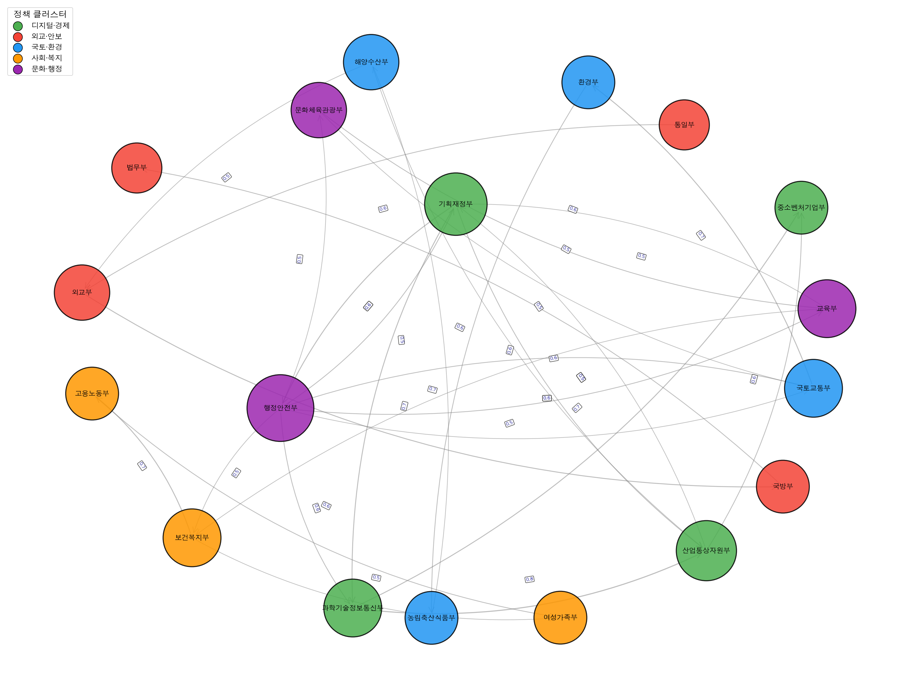
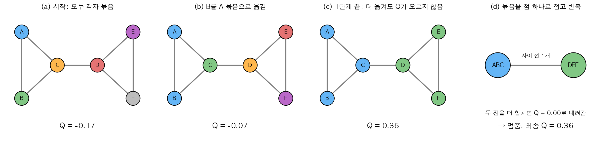
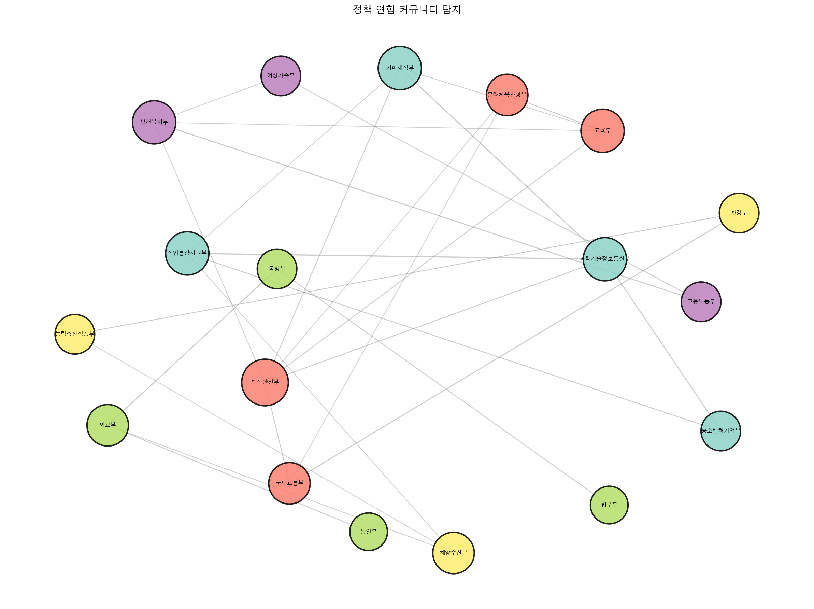
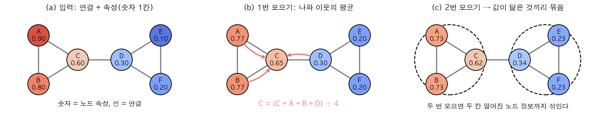
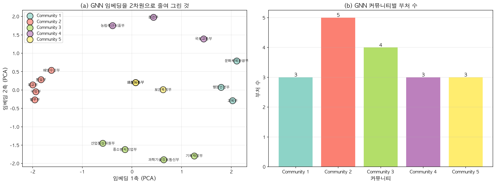
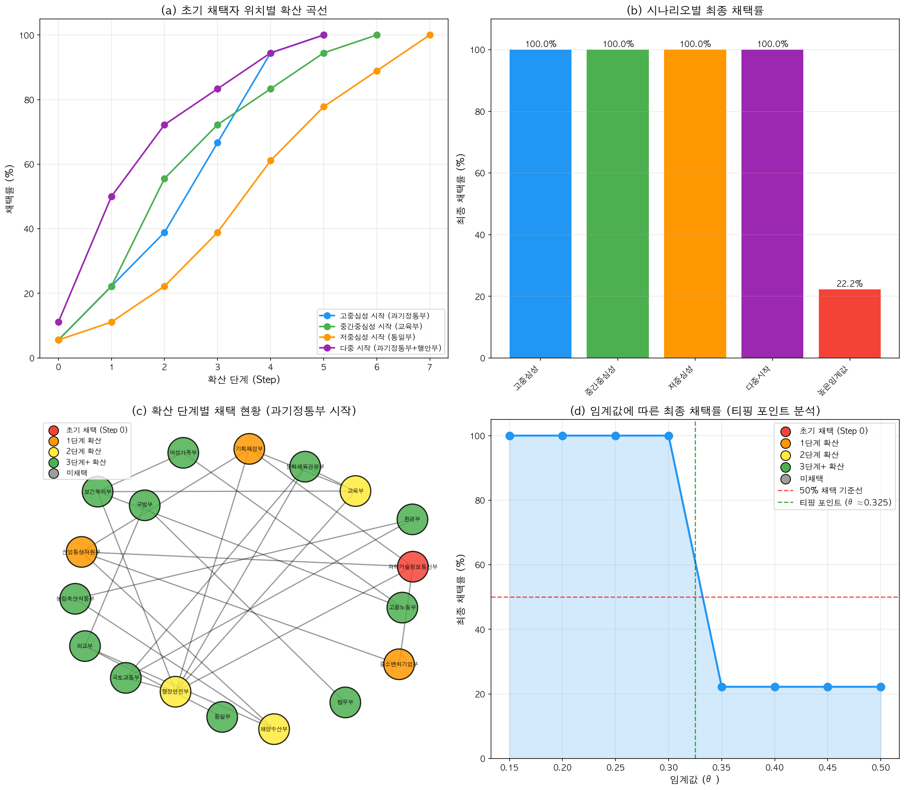
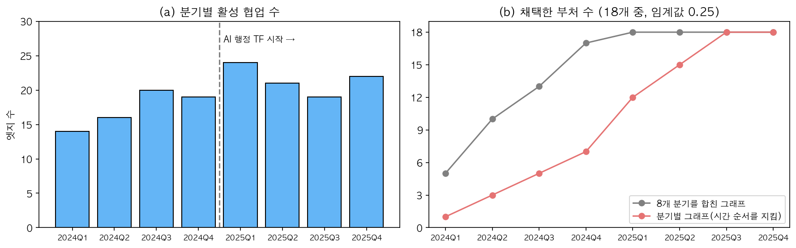

# 11장. 네트워크 분석과 그래프 신경망(GNN) — 부처 협업의 구조·묶음·확산

## □ 이 장의 질문

○ 과학기술정보통신부(과기정통부)에 AI 행정 시스템을 먼저 도입하고, 1년 뒤 도입 부처와 미도입 부처의 업무 처리 속도를 비교했다. 이 차이를 "도입 효과"로 보고해도 되는가

○ 부처끼리 협업 관계로 연결되어 있으면 이 차이를 도입 효과로 보고하지 않는다. 과기정통부와 자주 일하는 산업통상자원부가 도입 소식을 듣고 비슷한 시스템을 들여오면, 비교 대상이던 부처도 처치를 받은 셈이 되기 때문이다

○ 이 장은 이 연결을 자료로 만드는 방법을 배운다. 부처 사이의 협업을 그래프로 적고, 어느 부처가 어떤 자리에 있는지(중심성), 어느 부처끼리 묶이는지(커뮤니티), 정책이 연결을 따라 얼마나 빨리 퍼지는지(확산), 협업이 분기마다 바뀌면 확산이 어떻게 달라지는지(시간적 네트워크)를 실습으로 계산한다

## □ 이 장을 읽는 방법

○ 실습 데이터는 정부 18개 부처의 협업 관계를 흉내 내어 만든 연습용 자료다. 부처 이름은 실제 명칭을 빌렸지만 협업 관계와 강도는 만든 값이므로, 결과 순위를 실제 부처의 서열로 읽지 않는다

○ 실습 코드는 `practice/chapter11/code/`에 있고, 실행하면 콘솔 출력이 `practice/chapter11/results/<스크립트명>.log`로, 그림이 같은 폴더에 저장된다. 본문의 실행 결과는 전부 이 로그에서 옮겼다

– 실행 순서: `11-government-network.py` → `11-centrality-analysis.py` → `11-influence-analysis.py` → `11-community-detection.py` → `11-gnn-community.py`. 앞 스크립트가 저장한 CSV를 뒤 스크립트가 읽는다. `11-policy-diffusion.py`와 `11-temporal-network.py`는 첫 스크립트 다음이면 언제든 돌릴 수 있다

– 스크립트끼리 주고받는 파일(모두 `practice/chapter11/data/`)

| 파일 | 한 행 | 주요 열 | 만드는 스크립트 | 읽는 스크립트 |
| --- | --- | --- | --- | --- |
| `11-government-network-edges.csv` | 협업 관계 하나 (29행) | `source`, `target`, `weight` | government-network | centrality, community, gnn, policy-diffusion, temporal-network |
| `11-government-network-nodes.csv` | 부처 하나 (18행) | `ministry`, `degree`, `in_degree`, `out_degree` | government-network | (확인용) |
| `11-centrality-analysis.csv` | 부처 하나 (18행) | `ministry`와 중심성 열(`degree_centrality` 등) | centrality | influence, gnn |
| `11-community-assignments.csv` | 부처 하나 (18행) | `ministry`, `community_id` | community | gnn |
| `11-temporal-edges.csv` | 한 분기의 협업 관계 하나 (155행) | `quarter`, `source`, `target` | temporal-network | (확인용) |

– 설치: `pip install networkx seaborn torch torch_geometric`. mac과 Windows에서 같은 명령으로 설치되고, 그림의 한글 글꼴은 스크립트가 운영체제를 보고 고른다(mac은 AppleGothic, Windows는 맑은 고딕)

○ 용어 미리보기 — 코드와 실행 로그에는 영어 표기가 나오므로 한글 용어와 짝지어 둔다. 본문에서 처음 나올 때 다시 풀어 설명한다

<style>table { page-break-inside: auto; } tr { page-break-inside: avoid; } p:has(+ table) { break-after: avoid; }</style>

<div class="split-table">

| 용어 | 영어 (코드·로그에 나오는 표기) | 쉬운 뜻 |
| --- | --- | --- |
| 노드 | node | 관계망의 점. 이 장에서는 부처 하나 |
| 엣지 | edge | 두 점을 잇는 선. 이 장에서는 협업 관계 하나 |
| 방향 그래프 | directed graph (`DiGraph`) | 엣지에 방향(누가 누구에게)이 있는 그래프 |
| 가중치 | weight | 엣지에 붙인 숫자. 이 장에서는 협업 세기 |
| 차수 | degree (`avg_degree` = 평균 차수) | 한 노드에 붙은 엣지 수 |
| 밀도 | density | 맺을 수 있는 연결 가운데 실제로 맺은 연결의 비율 |
| 클러스터링 계수 | clustering coefficient | 내 협업 상대끼리도 서로 협업하는 비율 |
| 강연결 성분 | strongly connected component (`n_components`) | 방향을 따라 서로 오갈 수 있는 노드 묶음 |
| 최단 경로·지름 | shortest path (`avg_path_length`)·diameter | 두 노드 사이 가장 짧은 길의 단계 수, 그 가운데 가장 긴 값 |
| 중심성 | centrality | 한 노드가 얼마나 중요한 자리에 있는지 계산한 값. 아래 네 가지를 쓴다 |
| 연결 중심성 | degree centrality (`degree_centrality`) | 직접 연결된 상대가 얼마나 많은가 |
| 근접 중심성 | closeness centrality (`closeness_centrality`) | 나머지 모두에게 얼마나 가까운가 |
| 매개 중심성 | betweenness centrality (`betweenness_centrality`) | 다른 둘 사이를 오가는 최단 경로에 얼마나 자주 끼어 있는가 |
| 고유벡터 중심성 | eigenvector centrality (`eigenvector_centrality`) | 점수가 높은 상대와 얼마나 연결되어 있는가 |
| 커뮤니티 | community | 안에서는 연결이 많고 밖과는 연결이 적은 노드 묶음 |
| 모듈러리티 | modularity (Q) | 묶음 나누기가 무작위로 연결했을 때보다 얼마나 뚜렷한지 계산한 점수 |
| Louvain 방법 | Louvain | 모듈러리티가 오르도록 노드를 옮기며 묶음을 찾는 방법 |
| NMI | Normalized Mutual Information | 두 묶음 나누기가 얼마나 일치하는지 0~1로 나타낸 값 |
| 그래프 신경망 | Graph Neural Network (GNN) | 노드마다 숫자 목록을 붙이고, 이웃의 숫자를 모아 자기 숫자를 고치는 일을 반복하는 신경망 |
| 임베딩·손실·에포크 | embedding·loss·epoch | 노드를 나타내는 숫자 목록, 모델이 틀린 정도, 학습 반복 1회 |
| 임계값 | threshold (θ) | 이웃 가운데 채택한 부처의 비율이 이 값을 넘어야 나도 채택한다는 문턱 |
| 채택·미채택 | adopted·susceptible | 확산 실습에서 부처의 상태. 정책을 받아들였는지 여부 |
| 파급효과·간섭 | spillover·interference | 한 단위에 준 처치가 연결된 다른 단위의 결과까지 바꾸는 현상 |
| SUTVA | Stable Unit Treatment Value Assumption | 처치는 받은 단위의 결과만 바꾼다는 가정. 연결이 있으면 깨진다 |

</div>


○ 그림 11-1 읽는 법 — 칸마다 용어 하나를 점 3~6개짜리 그래프로 보여 준다

– (a)·(b)·(c)는 11.2, (d)는 11.3, (e)·(f)는 11.4·11.5, (g)는 11.6, (h)는 11.1에서 실제 자료로 다시 계산한다

– (b) 점 4개는 선을 최대 6개 맺을 수 있다. 실선 3개를 맺었으므로 밀도는 3 ÷ 6 = 0.50이다

– (c) "나"의 상대는 가·다·라 셋이고, 셋이 만드는 쌍(가-다, 가-라, 다-라) 가운데 실제로 연결된 쌍은 가-다 하나다. 그래서 "나"의 클러스터링 계수는 1 ÷ 3 = 0.33이다

– (g) "나"의 이웃 4곳 중 2곳이 채택했으므로 비율은 0.50이다. 문턱이 0.50 이하인 부처는 채택하고, 0.50보다 높은 부처는 채택하지 않는다

# 1부. 관계를 그래프로 세우고 중심성을 계산한다

## □ 11.1 연결된 자료는 왜 그냥 비교하면 안 되는가

○ 3~10장의 방법은 모두 한 가정을 깔고 있었다. 어떤 단위에 처치를 주면 그 단위의 결과만 바뀌고 다른 단위의 결과는 그대로라는 가정이며, 이것을 **SUTVA**(안정적 단위 처치값 가정)라고 부른다

○ 단위끼리 연결되어 있으면 이 가정이 깨진다. 이 장 첫머리의 예에서 산업통상자원부는 통제군인데도 과기정통부를 통해 처치의 영향을 받았다. 두 집단의 차이에는 도입 효과와 함께 옆으로 샌 효과가 섞인다. 한 단위의 처치가 다른 단위의 결과를 바꾸는 현상을 **간섭** 또는 **파급효과**라고 부른다

○ 독감 백신과 구조가 같다

<표 11-1: 독감 백신과 부처 협업의 대응>

| 독감 백신 | 부처 협업 |
| --- | --- |
| 한 반의 절반에게 백신을 놓는다 | 일부 부처에 AI 시스템을 도입한다 |
| 맞지 않은 학생도 주변 감염자가 줄어 결석이 준다 | 도입하지 않은 부처도 협업 상대에게서 영향을 받는다 |
| 같은 교실에서 접촉한다 | 협업 관계(엣지)로 이어져 있다 |

– 대응은 파급이 접촉 하나로 일어날 때까지만 맞다. 부처 사이의 파급은 예산 배분·언론 보도·상급 기관 지시로도 일어나므로, 협업 네트워크 하나로 모든 통로를 대신하지 못한다

○ 간섭을 다루는 방법은 둘이다. 간섭이 생기지 않게 설계를 바꾸거나, 간섭이 지나가는 연결 자체를 측정해 분석에 넣는다. 이 장은 두 번째 방법을 배운다

**한 줄 정리: 단위가 연결되어 있으면 처치 효과가 옆 단위로 샌다. 효과가 새는 통로(연결)부터 자료로 만든다.**

## □ 11.2 그래프로 적고 전체 모양을 읽는다

○ 관계 자료는 **그래프**로 적는다. 그래프는 점(**노드**)과 점을 잇는 선(**엣지**)으로 이루어진다. 이 장의 노드는 부처 18개, 엣지는 협업 관계다

– 협업 요청은 한쪽에서 다른 쪽으로 가므로 엣지에 방향을 준다. 이런 그래프를 **방향 그래프**라고 한다

– 엣지마다 협업의 세기를 0.5~0.8 사이 숫자로 붙인다. 이 숫자를 **가중치**라고 하며, 0.8은 강한 협업, 0.5는 약한 협업이다

○ 데이터 수집 방법 — 부처 사이의 협업은 다음 순서로 모아 숫자로 바꾼다. ① 수집할 기록: 부처 사이에 오간 협조 요청 공문. 공문에는 보낸 부처, 받은 부처, 날짜가 적혀 있다. 기관 안에서는 업무관리시스템의 문서 목록으로, 외부 연구자는 정보공개포털(open.go.kr)의 원문 공개 목록이나 정보공개청구로 모은다

– ② 범위: 중앙부처 18개, 1년치 공문. 청·위원회는 넣지 않는다. 순위는 이 18개 안에서만 유효하다

– ③ 한 건을 세는 기준: 협조 요청과 그 회신은 묶어서 1건으로 센다. 모든 부처에 한꺼번에 보내는 통보·배포 공문은 협업이 아니므로 뺀다

– ④ 방향: 공문을 보낸 부처가 source, 받은 부처가 target이다. A→B와 B→A는 따로 센다

– ⑤ 협업 세기: 한 해 협업 건수 ÷ 20건을 소수 첫째 자리에서 반올림하고, 1을 넘으면 1로 둔다. 예: 14건이면 0.7, 10건이면 0.5

– ⑥ 엣지로 남기는 기준: 세기 0.5 미만(한 해 10건 미만)인 쌍은 한두 번 오간 접촉으로 보고 뺀다. 그래서 이 자료의 세기는 0.5부터 시작한다

– 보완 자료: "관계부처 합동" 보도자료(정책브리핑, korea.kr)와 여러 부처가 함께 맡은 사업 목록으로 공문에서 빠진 협업이 있는지 대조한다. 보도자료에는 보낸 쪽·받은 쪽이 없으므로 방향을 정하는 데는 쓰지 않는다

○ 실습 데이터는 **엣지 목록**(edge list) 형태다. CSV 한 행이 협업 관계 하나이고, "어느 부처가 어느 부처에게 얼마나 세게 협업하는가"를 적는다

<표 11-2: 실습 데이터 `data/11-government-network-edges.csv`의 앞 5행>

| source (보내는 부처) | target (받는 부처) | weight (협업 세기) |
| --- | --- | --- |
| 기획재정부 | 과학기술정보통신부 | 0.7 |
| 기획재정부 | 행정안전부 | 0.7 |
| 기획재정부 | 산업통상자원부 | 0.6 |
| 교육부 | 기획재정부 | 0.5 |
| 교육부 | 보건복지부 | 0.5 |

– 첫 행은 "기획재정부가 과학기술정보통신부에 협업을 요청하고, 세기는 0.7"이라는 뜻이다. 화살표 방향은 source → target이다

– 전체는 29행이다. 부처는 18개이고, 협업 관계가 하나도 없는 부처는 없다

– 세기 분포: 0.5가 11행, 0.6이 11행, 0.7이 6행, 0.8이 1행(과학기술정보통신부 → 산업통상자원부)이다

– 기획재정부 ↔ 행정안전부처럼 양쪽으로 적힌 쌍이 3개 있다. 방향을 지우면 이 3쌍이 한 선씩으로 합쳐져 엣지가 26개가 된다(11.4·11.5·11.6에서 쓰는 수)

○ 개별 부처를 보기 전에 전체 모양을 세 숫자로 요약한다

<표 11-3: 그래프 전체를 요약하는 세 숫자>

| 숫자 | 계산 방법 | 읽는 법 |
| --- | --- | --- |
| **밀도** | 실제 엣지 수 ÷ 맺을 수 있는 엣지 수 | 18개 부처가 방향까지 구분해 맺을 수 있는 엣지는 18×17 = 306개다 |
| **평균 차수** | 부처 하나가 맺은 연결 수(차수)의 평균 | 부처 하나가 평균 몇 부처와 일하는가 |
| **클러스터링 계수** | 내 협업 상대 두 부처가 서로도 협업하는 비율 | 친구의 친구가 서로도 친구인 비율과 같은 셈법이다 |

○ 실습 코드(핵심 부분, 전체는 `11-government-network.py`)

```python
G = nx.DiGraph()                      # 방향 그래프
G.add_nodes_from(ministries)          # 18개 부처
for source, target, weight in collaborations:          # 29개 (보내는 쪽, 받는 쪽, 세기)
    G.add_edge(source, target, weight=weight)

density = nx.density(G)                                 # 29 / 306
clustering = nx.average_clustering(G.to_undirected())
```

○ 실행 결과(`results/11-government-network.log` 발췌)

```
  nodes: 18
  edges: 29
  density: 0.095
  avg_degree: 3.222
  n_components: 9
  largest_component_size: 10
  avg_path_length: 3.044
  diameter: 7
  clustering_coefficient: 0.361
```



○ 결과 해석

– 밀도 0.095: 맺을 수 있는 연결 306개 가운데 29개(9.5%)만 맺었다. 부처는 아무 부처와 협업하지 않고 상대를 골라 협업한다

– 평균 차수 3.22: 부처 하나가 평균 3개 남짓의 부처와 협업한다

– 클러스터링 계수 0.361은 밀도 0.095의 3.8배다. 아무렇게나 연결했다면 두 값이 비슷해야 하므로, 같은 정책 영역 안에서 세 부처가 서로 협업하는 삼각형이 많다는 뜻이다. 11.4에서 묶음을 찾을 근거가 이 값이다. 이 값이 0.1 미만이면 묶음 찾기를 건너뛴다

○ 그래프를 따라 정보가 몇 단계 만에 닿는지도 본다. 방향 그래프에서는 A에서 B로 갈 수 있어도 B에서 A로 못 올 수 있다. 서로 오갈 수 있는 부처 묶음을 **강연결 성분**이라 부르고, 단계 수는 가장 큰 성분 안에서 계산한다

– 강연결 성분이 9개이고 가장 큰 성분이 10개 부처다. 나머지 8개 부처에는 정보가 들어가도 되돌아 나오지 않는다

– 가장 큰 성분 안에서 평균 3.04단계면 닿지만 가장 먼 쌍(**지름**)은 7단계다. 평균과 최악이 두 배 넘게 차이 나면 한쪽으로 길게 늘어진 구간이 있다는 뜻이므로, 11.6의 확산 실험에서 시작 부처를 바꿔 비교한다

○ 방향 그래프에서는 받은 연결(**내향**)과 보낸 연결(**외향**)을 나누어 센다

```
  부처                     총차수    내향    외향
  행정안전부                    8     2     6
  기획재정부                    6     3     3
  산업통상자원부                  5     3     2
```

– 행정안전부는 보낸 연결이 6개, 받은 연결이 2개로 협업을 먼저 요청하는 쪽에 치우쳐 있다. 이 치우침이 조직 성격 때문인지 조정 권한 때문인지는 그래프로 알 수 없으므로 직제·법령 문서로 확인한다

**한 줄 정리: 부처 순위를 보기 전에 밀도(0.095)·평균 차수(3.22)·클러스터링 계수(0.361)로 전체 모양을 읽는다. 평균 단계 수(3.04)와 최악 단계 수(7)는 함께 본다.**

## □ 11.3 중심성 — "중요한 부처"를 네 가지로 계산한다

○ "누가 중요한가"에는 답이 하나가 아니다. 상대가 가장 많은 부처, 모두에게 가장 빨리 닿는 부처, 떨어진 영역을 잇는 통로인 부처, 힘 있는 부처와 연결된 부처는 서로 다를 수 있다. 이 네 가지를 각각 계산한 값이 네 가지 **중심성**이다

○ 계산 방법은 다섯 사람이 한 줄로 이어진 관계망(가-나-다-라-마)으로 본다. 그림 11-3과 표 11-4의 값은 같은 계산 결과다


<표 11-4: 한 줄로 이어진 다섯 사람의 중심성 (networkx로 계산)>

| 중심성 | 계산 방법 | 가 | 나 | 다 |
| --- | --- | --- | --- | --- |
| **연결** (degree) | 직접 연결된 사람 수 ÷ 연결될 수 있는 사람 수(4) | 0.25 | 0.50 | 0.50 |
| **근접** (closeness) | 4 ÷ (나머지 모두까지 거리의 합) | 0.40 | 0.57 | 0.67 |
| **매개** (betweenness) | 다른 두 사람 사이의 최단 경로가 나를 지나는 비율 | 0 | 0.50 | 0.67 |
| **고유벡터** (eigenvector) | 점수가 높은 사람과 연결될수록 내 점수가 오르도록 반복 계산 | 0.29 | 0.50 | 0.58 |

– 표에 라와 마가 없는 이유: 관계망이 좌우 대칭이라 라는 나와, 마는 가와 값이 같다(그림 11-3 (c)에서 같은 색 막대)

– 나와 다는 연결 수가 둘로 같다. 그런데 다는 한가운데에 있어서 모두까지의 거리 합이 1+1+2+2 = 6으로 가장 작고(그림 11-3 (a)), 가·나와 라·마를 오가는 최단 경로 4개가 전부 다를 지난다(그림 11-3 (b)의 주황 화살표). 연결 중심성은 같지만 근접·매개 중심성은 다가 높다

– 다가 빠지면 관계망이 두 동강 난다. 매개 중심성이 높은 사람은 이런 통로에 서 있는 사람이다

○ 실습에는 함정이 하나 있다. 근접·매개 중심성을 계산하는 함수는 가중치를 **거리**(클수록 멀다)로 읽는데, 협업 세기는 클수록 가깝다. 그래서 거리 = 1 ÷ 세기로 뒤집어 넘긴다. 세기 0.8은 거리 1.25, 세기 0.5는 거리 2.0이 된다

○ 실습 코드(핵심 부분, 전체는 `11-centrality-analysis.py`)

```python
for u, v, d in G_undirected.edges(data=True):
    d['distance'] = 1.0 / d['weight']      # 세기를 거리로 뒤집는다

deg = nx.degree_centrality(G_undirected)
clo = nx.closeness_centrality(G_undirected, distance='distance')
btw = nx.betweenness_centrality(G_undirected, weight='distance', normalized=True)
eig = nx.eigenvector_centrality(G_undirected, weight='weight', max_iter=1000)
```

○ 실행 결과(`results/11-centrality-analysis.log`와 `data/11-centrality-analysis.csv`에서 주요 6개 부처를 모은 표)

<표 11-5: 부처별 중심성 — 세로가 아니라 가로로 읽는다>

| 부처 | 연결 (degree) | 근접 (closeness) | 매개 (betweenness) | 고유벡터 (eigenvector) |
| --- | --- | --- | --- | --- |
| 행정안전부 | **0.353** (1위) | **0.240** (1위) | 0.415 (2위) | **0.466** (1위) |
| 과학기술정보통신부 | 0.235 | 0.239 | 0.294 | 0.435 |
| 산업통상자원부 | 0.235 | 0.232 | 0.353 | 0.323 |
| 기획재정부 | 0.235 | 0.223 | **0.044** | 0.404 |
| 교육부 | 0.235 | 0.199 | **0.026** | 0.326 |
| 해양수산부 | **0.176** | 0.213 | **0.419** (1위) | **0.086** |

○ 결과 해석 — 네 값이 어긋나는 부처가 이 분석에서 얻는 정보다

– **해양수산부**: 연결은 0.176으로 낮은데 매개는 0.419로 전체 1위다. 협업 상대는 적지만 떨어진 정책 영역을 잇는 통로에 서 있다. 이 부처를 그래프에서 빼면 협업 경로가 끊기는지 확인하고, 끊기면 다른 협업 경로를 만들어 둔다

– **기획재정부·교육부**: 연결은 0.235로 공동 2위인데 매개는 0.044, 0.026으로 낮다. 로그의 순위 비교표에서 교육부는 연결 2위, 매개 12위다. 상대는 많지만 그 상대끼리 이미 연결되어 있어 통로 역할이 없다. 정보를 모으는 창구로는 맞지만, 이 부처를 거쳐 새 부처 묶음에 닿으려는 계획은 세우지 않는다

– **행정안전부**: 네 값 모두 1~2위다. 다만 매개 1위는 해양수산부이고 차이가 0.004이므로 "행정안전부가 통로 역할까지 독점한다"고 쓰지 않는다

○ 네 값을 모두 보고서에 실어야 하는지는 지표끼리의 상관으로 정한다(`11-influence-analysis.py`). 상관은 두 값이 같은 방향으로 움직이는 정도이며 −1~1 사이다

```
                  degree  closeness  betweenness  eigenvector
degree             1.000      0.802        0.644        0.860
betweenness        0.644      0.605        1.000        0.334
```

– 연결과 고유벡터의 상관은 0.860이다. 0.8을 넘으면 두 값이 사실상 같은 것을 측정하므로 하나만 싣는다

– 매개와 고유벡터의 상관은 0.334다. 서로 다른 자리를 측정하므로 둘 다 싣는다. 해양수산부(매개 높음, 고유벡터 낮음)가 이 차이에서 나온 사례다

○ 같은 스크립트는 네 값을 0.2·0.2·0.3·0.3으로 가중 평균한 종합 점수도 낸다. 1위 행정안전부 0.383, 2위 과기정통부 0.314다. 이 배점은 자료에서 나온 값이 아니라 분석자가 정한 값이므로, 보고서에 배점을 적고 배점을 바꿔도 순위가 유지되는지 확인한다. 4위 해양수산부(0.229)와 5위 기획재정부(0.226)처럼 0.003 차이인 순위는 배점을 조금만 바꿔도 뒤집히므로 단정하지 않는다

**한 줄 정리: 중심성은 네 가지를 모두 계산하고 표를 가로로 읽는다. 연결은 하위권인데 매개는 1위인 해양수산부 같은 부처가 발견이다.**

## □ 1부 정리

○ 지금까지 만든 것

| 만든 것 | 핵심 수치 |
| --- | --- |
| 전체 모양 요약 | 밀도 0.095, 평균 차수 3.22, 클러스터링 계수 0.361 |
| 경로 | 가장 큰 강연결 성분(10개 부처) 안에서 평균 3.04단계, 최악 7단계 |
| 부처별 중심성 표 | 해양수산부: 연결 0.176, 매개 0.419(1위) |

○ 확인한 판정 기준

– 클러스터링 계수가 0.1 미만이면 묶음 찾기를 건너뛴다

– 중심성은 하나만 보지 않는다. 상관 0.8 이상인 두 지표는 하나만 싣는다

– 종합 점수는 배점을 공개하고, 점수 차이가 작은 순위는 단정하지 않는다

○ 2부로 넘길 질문: 부처들은 어떤 묶음으로 나뉘는가. 정책은 이 연결을 따라 몇 단계 만에 퍼지는가. 연결이 분기마다 바뀌면 그 답이 달라지는가

# 2부. 묶음을 찾고 확산과 시간 변화를 계산한다

## □ 11.4 커뮤니티 탐지 — 묶음을 찾고 모듈러리티로 채점한다

○ 협의체를 짜려면 순위가 아니라 묶음이 필요하다. 안에서는 연결이 많고 밖과는 적은 부처 묶음을 계산으로 찾는 작업이 **커뮤니티 탐지**다

○ 묶음을 잘 나눴는지 매기는 점수가 **모듈러리티**(Q)다

```
Q ≈ (선 가운데 묶음 안에 떨어진 비율) − (선을 아무렇게나 이었을 때 묶음 안에 떨어질 비율)
```

– 이 자료: 선 26개 중 18개(69%)가 묶음 안에 있다. 상대를 제비뽑기로 바꿔 이으면 평균 23%만 묶음 안에 떨어진다. Q ≈ 0.69 − 0.23 = 0.46이고, 협업 세기까지 반영하면 0.485다

– 학급 비유: 친구 관계(엣지)가 같은 동아리(커뮤니티) 안에 몰려 있고, 그 비율이 친구를 제비뽑기(뒤 항)로 정했을 때보다 훨씬 높으면 "동아리별로 뭉쳐 논다"고 말한다

<표 11-6: 모듈러리티 판정 기준>

| Q | 판정 |
| --- | --- |
| 0.3 미만 | 무작위와 구분되지 않는다. 묶음을 보고하지 않는다 |
| 0.3~0.7 | 묶음을 해석한다 |
| 0.7 초과 | 묶음끼리 거의 끊겨 있다. 하나의 네트워크로 볼지부터 다시 검토한다 |

○ 실습은 **Louvain 방법**으로 Q가 가장 큰 묶음을 찾는다. 원리는 두 단계의 반복이다(그림 11-4, 삼각형 둘을 선 하나가 잇는 작은 예)



– 1단계 옮기기 (a)→(c): 처음에는 노드마다 자기 혼자 묶음이다(Q = −0.17). 노드 하나를 이웃의 묶음으로 옮겨 보고 Q가 오르면 옮긴다. B를 A 묶음으로 옮기면 −0.07, 끝까지 옮기면 두 삼각형이 각각 한 묶음이 되어 0.36이다

– 2단계 접기 (d): 묶음 하나를 점 하나로 접는다. 접은 점끼리 다시 1단계를 한다. 두 점을 합치면 Q가 0으로 내려가므로 합치지 않고 멈춘다

– 옮기는 순서를 무작위로 정하므로 시드를 고정한다. 이 실습 자료에서는 시드 0, 1, 7, 42에서 같은 결과가 나왔다. 방향은 쓰지 않으므로 엣지는 26개다

```python
communities = list(community.louvain_communities(G, weight='weight', seed=SEED))
modularity = community.modularity(G, communities, weight='weight')
```

○ 실행 결과(`results/11-community-detection.log`): 묶음 5개, Q = 0.485, 묶음 안 연결 18개(69.2%), 묶음 사이 연결 8개(30.8%)

<표 11-7: 커뮤니티 탐지 결과>

| 묶음 | 부처 | 내부 밀도 | 정책 영역 |
| --- | --- | --- | --- |
| 1 | 과학기술정보통신부, 기획재정부, 산업통상자원부, 중소벤처기업부 | 0.833 | 경제·디지털 |
| 2 | 교육부, 국토교통부, 문화체육관광부, 행정안전부 | 0.833 | 교육·문화·행정·국토 |
| 3 | 국방부, 법무부, 외교부, 통일부 | 0.500 | 외교·안보 |
| 4 | 고용노동부, 보건복지부, 여성가족부 | 1.000 | 사회·복지 |
| 5 | 농림축산식품부, 해양수산부, 환경부 | 0.667 | 농림·해양·환경 |



○ 결과 해석 — Q = 0.485는 해석 구간(0.3~0.7)이다. 다섯 묶음이 정책 영역과 대체로 맞는다

– 내부 밀도는 묶음 안에서 맺을 수 있는 연결 가운데 실제 연결의 비율이다. 묶음 4는 1.000으로 셋이 모두 서로 연결되어 협의체로 바로 옮길 수 있다. 다만 3개짜리 묶음은 우연히 생겼을 수 있으므로, 부처 하나를 빼고 다시 돌려 유지되는지 확인한다

– 묶음 사이 연결 8개 중 3개가 행정안전부에 걸려 있다. 11.6에서 정책이 다른 묶음으로 넘어가는 길이 이 8개다

**한 줄 정리: Q 0.485이므로 다섯 묶음을 해석한다. Q가 0.3 미만이면 묶음이 없는 것으로 본다.**

## □ 11.5 GNN 커뮤니티 — 연결과 속성을 함께 쓴다

○ 11.4의 방법은 연결만 본다. **그래프 신경망**(GNN)은 연결과 속성을 함께 넣는다

<표 11-8: GNN에 넣는 두 가지 입력>

| 입력 | 무엇인가 | 이 실습의 값 | 실제 분석에서 넣을 수 있는 것 |
| --- | --- | --- | --- |
| 연결 | 누가 누구의 이웃인가. 정보가 오가는 길 | 엣지 목록 26개(`11-government-network-edges.csv`) | 공문·합동 사업으로 센 협업 관계 |
| 속성 | 부처 하나하나의 특징을 적은 숫자 목록 | 중심성 4개(`11-centrality-analysis.csv`) | 예산 규모, 정원, 소관 법령 수, 민원 건수 |

– 속성 예(표준화 전): 행정안전부 [연결 0.353, 근접 0.240, 매개 0.415, 고유벡터 0.466], 해양수산부 [0.176, 0.213, 0.419, 0.086], 통일부 [0.059, 0.134, 0.000, 0.006]

– 연결만 보면 "누구와 일하는가"만 알고, 속성만 보면 "어떤 부처인가"만 안다. GNN은 연결을 길로 삼아 이웃의 속성을 자기 쪽으로 모은다. 그래서 협업이 적어도 성격이 비슷한 이웃을 가진 부처끼리 숫자가 닮는다



– 그림 11-6은 속성을 숫자 1칸으로, 모으는 방법을 평균으로 줄인 예다. (b)에서 C는 자기와 이웃 셋(A, B, D)의 값을 평균해 0.60 → 0.65가 된다. (c) 두 번 모으면 왼쪽 삼각형은 0.62~0.73, 오른쪽은 0.23~0.34로 닮아 두 묶음이 드러난다

– 실제 GNN은 단순 평균 대신 학습한 가중치로 섞는다(`GATv2Conv`, 10장의 어텐션과 같은 구조). 숫자도 16칸이며, "연결된 두 부처의 목록은 비슷하게, 연결 안 된 두 부처는 다르게" 학습한 뒤 K-평균 군집으로 5개 묶음을 만든다

– 중심성은 0~0.47에 몰려 있어 표준화(평균 0, 표준편차 1)한 뒤 넣는다. 표준화하지 않으면 손실이 1.04에서 더 줄지 않았다

```python
x = (x - x.mean(dim=0)) / x.std(dim=0)                              # 중심성 4개 표준화
self.conv1 = GATv2Conv(num_features, 32, heads=4, concat=True)      # 1번째 이웃 모으기
self.conv2 = GATv2Conv(32*4, embedding_dim, heads=1, concat=False)  # 2번째, 16칸으로
kmeans = KMeans(n_clusters=5, random_state=SEED, n_init=10)
```

○ 실행 결과(`results/11-gnn-community.log`): 손실은 첫 에포크 1.98에서 마지막 50 에포크 평균 0.66으로 줄었다



– 그림 11-7 (a) 읽는 법: 점 하나가 부처 하나이고, 가까운 점일수록 GNN이 비슷하다고 본 부처다. 외교·안보 4개 부처는 왼쪽에, 경제·디지털 4개 부처는 아래에 모였다

<표 11-9: Louvain 분할과 GNN 분할 비교>

| 항목 | Louvain | GNN | 읽는 법 |
| --- | --- | --- | --- |
| 모듈러리티 Q | 0.485 | 0.471 | 둘 다 해석 구간. 연결만으로 채점하면 Louvain이 조금 높다 |
| 두 분할의 일치도(NMI, 0~1) | 0.851 | | 18개 부처 중 16개가 두 방법에서 같은 부처들과 묶였다 |
| 국토교통부 | 교육·문화·행정·국토 | 농림·환경 | 협업 기록과 부처 성격이 가리키는 묶음이 다르다 |
| 해양수산부 | 농림·해양·환경 | 외교·안보 | 위와 같다. 이 차이를 그대로 보고한다 |

– 부처가 18개뿐이라 이 실습은 방법을 익히는 데 목적이 있다. GNN이 Louvain보다 쓸모 있으려면 노드 수와 속성 변수가 충분해야 한다

**한 줄 정리: GNN은 연결과 속성을 함께 써서 묶는다. 이 자료에서 두 방법은 거의 일치하고(NMI 0.851), 배정이 다른 부처는 둘이다.**

## □ 11.6 확산 시뮬레이션 — 어디서 시작하면 몇 단계에 퍼지는가

○ 알고 싶은 것: "이 정책을 어느 부처에서 시작하면 전체로 퍼지는가, 몇 단계가 걸리는가"

○ 채택 규칙은 **임계값 모형**이다. 이웃 가운데 채택한 부처의 **비율**이 자기 문턱(임계값)을 넘으면 다음 단계에 채택한다(그림 11-1 (g))

– 예: 이웃 다섯 중 둘이 채택하면 비율 0.4. 임계값 0.25인 부처는 채택하고, 0.5인 부처는 채택하지 않는다

– 감염병 모형은 시간만 충분하면 다 퍼지지만, 임계값 모형은 문턱이 조금만 높아도 도중에 멈춘다. 조직은 주변이 얼마나 움직였는지 보고 정하므로 이 규칙을 쓴다

```python
adopted_ratio = sum(1 for n in neighbors if self.states[n] == 'adopted') / len(neighbors)
if adopted_ratio >= threshold:          # 이웃 채택 비율 ≥ 임계값이면 채택
    new_adopters.append(node)
```

○ 실행 결과(`results/11-policy-diffusion.log`)

<표 11-10: 시나리오별 확산 결과>

| 시나리오 | 시작 부처 | 임계값 | 최종 채택률 | 단계 | 읽는 법 |
| --- | --- | --- | --- | --- | --- |
| 연결 많은 곳에서 시작 | 과학기술정보통신부 | 0.25 | 100% | 5 | 가장 빠르다 |
| 중간 | 교육부 | 0.25 | 100% | 6 | |
| 연결 적은 곳에서 시작 | 통일부 | 0.25 | 100% | 7 | 2단계 늦다(한 단계 = 한 분기면 6개월) |
| 두 곳에서 시작 | 과기정통부 + 행정안전부 | 0.25 | 100% | 5 | 두 부처가 가까워 빨라지지 않았다 |
| 문턱을 올림 | 과학기술정보통신부 | 0.40 | 22.2% | 3 | 4개 부처에서 멈췄다 |



○ 그림 11-8 읽는 법 — 최종 채택률을 먼저 보고, 100%인 시나리오끼리만 단계 수를 비교한다

– (c) 1단계 채택 부처(기획재정부·산업통상자원부·중소벤처기업부)는 모두 과기정통부와 같은 묶음 1이다. 정책은 묶음 안에서 먼저 퍼지고 그다음 묶음 사이를 건너간다

– (d) 임계값 0.30까지는 100%, 0.35부터는 22.2%다. 문턱이 0.05 오르자 확산이 통째로 멈췄다

○ 임계값은 어떻게 정했나 — 자료에서 구한 값이 아니라 분석자가 정한 시나리오 값이다. 18개 부처 모두 같은 값을 쓰고, 시나리오 4개는 0.25, "문턱을 올림"은 0.40, 그림 (d)는 0.15~0.50을 0.05 간격으로 바꿔 가며 계산했다

– 확산이 0.30과 0.35 사이에서 멈추는 이유: 0.35로 계산하면 4개 부처가 채택한 뒤, 아래 세 부처가 문턱을 넘지 못한다

<표 11-11: 임계값 0.35에서 확산이 멈춘 경계 (과학기술정보통신부에서 시작)>

| 부처 | 채택한 이웃 / 전체 이웃 | 비율 | 0.30이면 | 0.35면 |
| --- | --- | --- | --- | --- |
| 행정안전부 | 2 / 6 | 0.333 | 채택 | 채택 안 함 |
| 해양수산부 | 1 / 3 | 0.333 | 채택 | 채택 안 함 |
| 교육부 | 1 / 4 | 0.25 | 채택 안 함 | 채택 안 함 |

– 이웃이 2~4개인 부처가 18개 중 15개라서 비율은 1/2, 1/3, 1/4 같은 몇 가지 값만 나온다. 그래서 확산은 임계값이 이 분수(여기서는 1/3)를 지나는 곳에서 한꺼번에 멈춘다. "0.35에서 멈춘다"는 정책의 성질이 아니라 이 네트워크의 이웃 수 구조에서 나온 값이다

<표 11-12: 실제 분석에서 임계값을 정하는 방법>

| 방법 | 하는 일 | 필요한 자료 |
| --- | --- | --- |
| ① 범위를 바꿔 보고 | 이 실습처럼 여러 값을 돌리고, 결과가 바뀌는 지점을 함께 보고한다 | 없음 |
| ② 과거 채택 기록으로 추정 | 부처가 실제로 채택한 시점에 "이웃 가운데 이미 채택한 비율"을 계산해 그 부처의 임계값으로 본다 | 부처별 채택 날짜와 그 시점의 연결 |
| ③ 부처마다 다른 값 | 임계값을 일정 범위에서 부처마다 다르게 뽑아 여러 번 돌리고 결과의 범위를 본다 | 없음(범위 가정 필요) |
| ④ 조사 | 담당자에게 "다른 부처가 몇 곳쯤 도입하면 검토하는가"를 묻는다 | 설문 |

○ 판정

– 채택률 100%: 시작 부처를 바꿔 속도를 높인다. 여러 곳에서 시작할 때는 서로 다른 묶음에서 하나씩 고른다

– 채택률 100% 미만: 시작 부처가 아니라 문턱을 낮추는 개입(인센티브, 의무화)을 설계한다

**한 줄 정리: 임계값 0.30→0.35에서 채택률이 100%→22.2%로 떨어졌다. 확산이 멈추면 시작 부처가 아니라 문턱을 본다.**

## □ 11.7 시간적 네트워크 — 협업은 분기마다 바뀐다

○ 11.2~11.6은 1년치 협업을 그래프 한 장으로 합쳐 썼다. 실제 협업은 분기마다 생기고 사라진다. 엣지마다 시점을 붙인 네트워크를 **시간적 네트워크**(temporal network)라고 한다

○ 데이터는 엣지 목록에 `quarter`(분기) 열 하나를 더한 형태다. 11.2의 수집 절차를 분기 단위로 적용해, 그 분기에 협조 공문이 기준 건수 이상 오간 쌍만 적는다

<표 11-13: 분기별 엣지 목록 `data/11-temporal-edges.csv`의 앞 4행>

| quarter | source | target |
| --- | --- | --- |
| 2024Q1 | 기획재정부 | 행정안전부 |
| 2024Q1 | 교육부 | 보건복지부 |
| 2024Q1 | 통일부 | 외교부 |
| 2024Q1 | 국방부 | 법무부 |

– 2024Q1~2025Q4 8개 분기, 155행이다.

○ 실습 코드(핵심 부분, 전체는 `11-temporal-network.py`) — 11.6과 같은 임계값 규칙(0.25)을 쓰되, 분기마다 그 분기의 연결만으로 한 단계씩 계산한다

```python
for q in QUARTERS:
    G_q = quarter_graph(df, q, nodes)                       # 그 분기의 연결만
    adopted_static = threshold_step(static, adopted_static)  # 8개 분기를 합친 그래프
    adopted_temporal = threshold_step(G_q, adopted_temporal)
```



○ 결과 해석(`results/11-temporal-network.log`) — 그림 (b)의 두 선을 분기별로 풀어 쓰면 다음과 같다

<표 11-14: 분기별 누적 채택 부처 수 (18개 중, 과기정통부에서 시작)>

| 분기 | 채택 부처 수 (합친 그래프) | 채택 부처 수 (분기별 그래프) | 분기별 그래프에서 일어난 일 |
| --- | --- | --- | --- |
| 2024Q1 | 5 | 1 | 과기정통부의 연결은 행정안전부 하나뿐이다. 행정안전부는 이웃이 5곳이라 채택 비율이 1/5 = 0.2로 문턱(0.25)에 못 미친다 |
| 2024Q2 | 10 | 3 | 이 분기에 연결된 산업통상자원부·중소벤처기업부가 채택한다 |
| 2024Q3 | 13 | 5 | 기획재정부·해양수산부가 채택한다 |
| 2024Q4 | 17 | 7 | 교육부·행정안전부까지 채택한다 |
| 2025Q1 | 18 | 12 | TF 협업이 생겨 국토교통부·보건복지부를 포함해 5곳이 한꺼번에 채택한다 |
| 2025Q2 | 18 | 15 | 국방부·통일부·환경부가 채택한다 |
| 2025Q3 | 18 | 18 | 고용노동부·법무부·여성가족부가 마지막으로 채택한다 |
| 2025Q4 | 18 | 18 | 변화 없음 |

– 왜 늦어지나: 분기별 그래프에서는 그 분기에 공문이 오가지 않은 관계로는 소식이 전해지지 않는다. 합친 그래프는 8개 분기의 연결이 늘 함께 있다고 보므로 첫 분기부터 빠르게 퍼진다. 전체 채택 시점은 합친 그래프 2025Q1, 분기별 그래프 2025Q3으로 두 분기 차이다

– 무엇이 틀리나: 합친 그래프에서는 2024Q1에 국토교통부가 채택한다. 과기정통부-국토교통부 연결은 2025Q1에 생긴 TF 협업인데, 합친 그래프가 이 연결을 2024년에도 있던 것처럼 쓴 결과다. 기간을 합치면 나중에 생긴 연결로 이전의 확산을 설명하게 된다

– 새 연결의 효과: 분기별 그래프에서 한 분기에 가장 많이 채택한 때는 TF가 생긴 2025Q1(5곳)이다. 시간적 네트워크로 계산해야 "새 협업 기구가 확산을 얼마나 당겼는가"를 시점과 함께 읽을 수 있다

○ 판정 — 협업 시점을 모을 수 있으면 분기별 그래프로 확산을 계산한다. 기간을 합친 그래프의 결과는 "가장 빨리 퍼지는 경우"로만 읽는다

**한 줄 정리: 연결은 시간에 따라 바뀐다. 분기별 그래프로 계산하면 전체 채택이 합친 그래프보다 두 분기 늦었다(2025Q1 → 2025Q3).**

